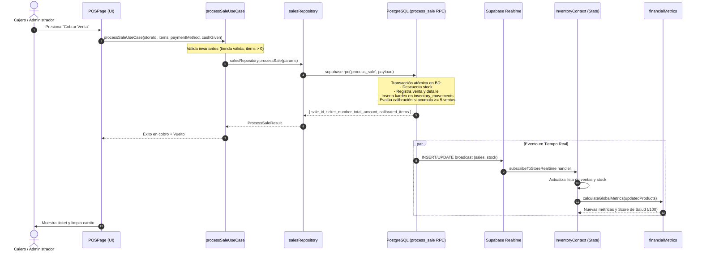

# Arquitectura de Software de Rentabill
**Sistema Integral de Gestión de Inventarios, Finanzas y Ventas para Microcomercios Minoristas**  
*Documento Técnico de Arquitectura en Capas — Proyecto Integrador*

---

## 1. Resumen Ejecutivo (Apto para Informe Técnico)

> **Rentabill** implementa una **Arquitectura en 4 Capas con Módulo Transversal Compartido (Shared Layer)**, diseñada bajo los principios de *Clean Architecture*, separación estricta de responsabilidades (*Separation of Concerns* - SoC) y el principio de inversión de dependencias (*Dependency Inversion Principle* - DIP).
>
> La aplicación desacopla totalmente la interfaz visual (React 19 / Tailwind CSS v4) del acceso a datos (Supabase BaaS / PostgreSQL v3.7) y de las capacidades de hardware nativo de dispositivos móviles (Capacitor 8 / Android). Las reglas de negocio y algoritmos de calibración empírica residen en funciones puras y casos de uso atómicos, permitiendo su verificación matemática y pruebas unitarias aisladas sin dependencias de infraestructura ni efectos secundarios de renderizado.
>
> La integridad de las capas se valida de forma automática y determinista mediante una suite de verificación de dependencias AST (`npm run check:layers`), garantizando cero violaciones estructurales en compilación (`tsc --noEmit` y `npm run build`).

---

## 2. Descripción de las Capas de la Arquitectura

El sistema se estructura en 4 capas concéntricas más un módulo transversal:

```
┌──────────────────────────────────────────────────────────────────┐
│                   CAPA DE PRESENTACIÓN (UI)                      │
│     Páginas (10 Views) · Componentes (14) · Rutas y Portales     │
└─────────────────────────────────┬────────────────────────────────┘
                                  │ consume
                                  ▼
┌──────────────────────────────────────────────────────────────────┐
│                  CAPA DE APLICACIÓN (APPLICATION)                │
│    Lógica Financiera Pura · Casos de Uso · Estado React / State  │
└──────────────┬──────────────────────────────────┬────────────────┘
               │ orquesta                         │ persiste
               ▼                                  ▼
┌──────────────────────────────┐   ┌───────────────────────────────┐
│  CAPA DE PLATAFORMA NATIVA   │   │     CAPA DE DATOS (DATA)      │
│         (PLATFORM)           │   │  Repositorios · Mappers DB    │
│  Barcode · Camera · Storage  │   │  Supabase Client · Realtime   │
│  Filesystem · App Lifecycle  │   │                               │
└──────────────┬───────────────┘   └──────────────┬────────────────┘
               │                                  │
               └─────────────────┬────────────────┘
                                 │ implementan contratos
                                 ▼
┌──────────────────────────────────────────────────────────────────┐
│                 CAPA COMPARTIDA (SHARED LAYER)                   │
│   Tipos TypeScript · Formateadores es-PE · Constantes · Puertos  │
└──────────────────────────────────────────────────────────────────┘
```

### 2.1. Capa de Presentación (`src/presentation/`)
- **Responsabilidad**: Interfaz de usuario, interacción táctil, animaciones y presentación visual.
- **Submódulos**:
  - `pages/`: Las 10 vistas principales de la aplicación (`PulsoView`, `InventarioView`, `POSView`, `HistorialView`, `RestockSimulatorView`, `ProductRegisterView`, `AjustesView`, `AuthView`, `OnboardingView`, `ConnectionErrorView`).
  - `components/`: Los 14 componentes modulares de soporte (`BottomNavigation`, `Header`, `StoreSelectorModal`, `EditProductModal`, etc.).
- **Regla Estricta**: No puede importar directamente desde `@data`, `@supabase/*` ni `@capacitor/*`. Solo consume casos de uso, estado de aplicación y adaptadores de plataforma.

### 2.2. Capa de Aplicación (`src/application/`)
- **Responsabilidad**: Orquestar el flujo de datos del negocio, ejecutar operaciones y calcular métricas.
- **Submódulos**:
  - `logic/`: Algoritmos puramente matemáticos sin dependencias de React ni base de datos (`financialMetrics.ts`, `simulationEngine.ts`). Calcula margen unitario, velocidad diaria, salud financiera (/100) y transición empírica de velocidad estimada a real tras 5 ventas.
  - `use-cases/`: Funciones asíncronas atómicas por dominio (`sales`, `inventory`, `purchases`, `simulations`, `stores`, `team`, `auth`).
  - `state/`: Contenedor de estado global (`InventoryContext.tsx`), suscripciones en tiempo real y caché de sesión en memoria.

### 2.3. Capa de Datos (`src/data/`)
- **Responsabilidad**: Persistencia, acceso a backend remoto y sincronización de eventos de red.
- **Submódulos**:
  - `supabase/`: Inicialización del cliente Supabase (`client.ts`) desacoplado del almacenamiento móvil.
  - `repositories/`: 11 repositorios especializados (`productsRepository`, `salesRepository`, `purchasesRepository`, `stockRepository`, `storesRepository`, `teamRepository`, `settingsRepository`, `suppliersRepository`, `simulationsRepository`, `storageRepository`, `authRepository`).
  - `mappers/`: Transformación bidireccional entre filas relacionales de PostgreSQL (snake_case) y entidades de dominio en TypeScript (camelCase).
  - `realtime/`: Suscripción y desuscripción de canales PostgreSQL mediante `storeRealtime.ts`.

### 2.4. Capa de Plataforma (`src/platform/`)
- **Responsabilidad**: Aislamiento y adaptación de APIs nativas de Android / hardware y fallback transparente en navegador web.
- **Submódulos**:
  - `storage/`: `capacitorPreferencesStorage.ts` implementa `KeyValueStorage` usando `@capacitor/preferences` en Android y `localStorage` en web.
  - `filesystem/`: `capacitorFilesystem.ts` guarda archivos CSV en la carpeta nativa `Documentos/Rentabill/` o descarga Blob en navegador.
  - `barcode/`: `capacitorBarcodeScanner.ts` integra Google Play Services Barcode Scanning ML Kit en Android.
  - `camera/`: `capacitorCamera.ts` captura fotografías convirtiendo base64 a `Blob` listo para subida a Supabase Storage.
  - `appLifecycle/`: `capacitorAppLifecycle.ts` gestiona el botón físico atrás de Android (`backButton`).

### 2.5. Capa Compartida (`src/shared/`)
- **Responsabilidad**: Tipos fundamentales, constantes del dominio, contratos de interfaces y formateadores regionales es-PE.
- **Submódulos**:
  - `types/`: Entidades del modelo de dominio (`Product`, `SaleRecord`, `StoreConfig`, etc.).
  - `constants/`: Roles y descripciones operativas (`roles.ts`).
  - `formatters/`: Formateo en Soles peruanos (`formatCurrency` -> "S/ 1,234.50"), teléfonos (+51) y fechas Perú (`formatDatePeru`).
  - `storage/`: Interfaz agnóstica `KeyValueStorage`.

---

## 3. Diagramas de Arquitectura (Mermaid)

### 3.1. Diagrama de Capas y Dependencias Permitidas


### 3.2. Diagrama de Secuencia: Operación Transaccional `processSale`



---

## 4. Estructura de Carpetas del Proyecto (`src/`)

```
src/
├── app/                          # Raíz de configuración de la app
│   ├── App.tsx                   # Composition Root: enrutamiento por pestañas y modales
│   └── main.tsx                  # Bootstrap: inyección de storage y montaje en DOM
│
├── presentation/                 # CAPA 1: PRESENTACIÓN
│   ├── pages/                    # 10 Pantallas principales
│   │   ├── PulsoView.tsx         # Dashboard financiero, score de salud y capital
│   │   ├── InventarioView.tsx    # Catálogo de productos, filtros y búsqueda
│   │   ├── POSView.tsx           # Punto de venta, carrito y cobro rápido
│   │   ├── HistorialView.tsx     # Ventas, kardex, compras y simulaciones pasadas
│   │   ├── RestockSimulatorView.tsx # Simulador de compras y rentabilidad proyectada
│   │   ├── ProductRegisterView.tsx  # Registro de productos con código y cámara
│   │   ├── AjustesView.tsx       # Perfil, miembros, QR y preferencias
│   │   ├── AuthView.tsx          # Login, registro y recuperación de clave
│   │   ├── OnboardingView.tsx    # Creación inicial de negocio
│   │   ├── ConnectionErrorView.tsx # Pantalla de falla de conexión y reintento
│   │   └── index.ts              # Barrel de páginas
│   ├── components/               # 14 Componentes y modales UI
│   │   ├── BottomNavigation.tsx  # Barra inferior con control de tabs por rol
│   │   ├── Header.tsx            # Barra superior con selector de tienda y perfil
│   │   ├── StoreSelectorModal.tsx# Selector y creador de múltiples tiendas
│   │   ├── EditProductModal.tsx  # Edición de producto, cámara y código de barras
│   │   ├── RoleTestBanner.tsx    # Banner de previsualización de roles en cliente
│   │   ├── ToastNotification.tsx # Sistema de alertas flotantes
│   │   ├── CalibrationModal.tsx  # Notificación de producto calibrado a REAL
│   │   └── ...                   # Resto de modales (perfil, logout, invitación, etc.)
│   └── index.ts                  # Barrel principal de presentación
│
├── application/                  # CAPA 2: APLICACIÓN
│   ├── logic/                    # LÓGICA PURA (100% matemática, sin React/BD)
│   │   ├── financialMetrics.ts   # Margen, velocidad, salud proyectada, calibración
│   │   ├── simulationEngine.ts   # Retorno de inversión y veredictos del simulador
│   │   └── index.ts
│   ├── use-cases/                # CASOS DE USO ATÓMICOS
│   │   ├── sales/processSaleUseCase.ts
│   │   ├── inventory/adjustStockUseCase.ts
│   │   ├── inventory/registerProductUseCase.ts
│   │   ├── inventory/updateProductUseCase.ts
│   │   ├── inventory/deleteProductUseCase.ts
│   │   ├── inventory/uploadImageUseCase.ts
│   │   ├── purchases/processPurchaseUseCase.ts
│   │   ├── purchases/payPurchaseUseCase.ts
│   │   ├── simulations/createSimulationUseCase.ts
│   │   ├── simulations/confirmSimulationPurchaseUseCase.ts
│   │   ├── stores/createStoreUseCase.ts
│   │   ├── stores/switchStoreUseCase.ts
│   │   ├── team/inviteMemberUseCase.ts
│   │   ├── team/respondInvitationUseCase.ts
│   │   ├── auth/authUseCases.ts
│   │   └── index.ts
│   ├── state/                    # ESTADO GLOBAL
│   │   ├── InventoryContext.tsx  # Context Provider y hook `useInventory`
│   │   └── index.ts
│   └── index.ts                  # Barrel principal de aplicación
│
├── platform/                     # CAPA 3: PLATAFORMA NATIVA
│   ├── storage/                  # Adaptador de persistencia de sesión
│   │   ├── capacitorPreferencesStorage.ts
│   │   └── index.ts
│   ├── filesystem/               # Descarga y guardado de reportes CSV
│   │   ├── capacitorFilesystem.ts
│   │   └── index.ts
│   ├── barcode/                  # Escáner nativo ML Kit
│   │   ├── barcodeScanner.interface.ts
│   │   ├── capacitorBarcodeScanner.ts
│   │   └── index.ts
│   ├── camera/                   # Captura de fotografías
│   │   ├── camera.interface.ts
│   │   ├── capacitorCamera.ts
│   │   └── index.ts
│   ├── appLifecycle/             # Botón atrás Android nativo
│   │   ├── appLifecycle.interface.ts
│   │   ├── capacitorAppLifecycle.ts
│   │   └── index.ts
│   └── index.ts                  # Barrel principal de plataforma
│
├── data/                         # CAPA 4: DATOS
│   ├── supabase/                 # Cliente y traductor de errores
│   │   ├── client.ts             # Cliente desacoplado con setSupabaseStorage
│   │   └── errorMapper.ts
│   ├── repositories/             # 11 Repositorios especializados
│   │   ├── productsRepository.ts
│   │   ├── salesRepository.ts
│   │   ├── purchasesRepository.ts
│   │   ├── stockRepository.ts
│   │   ├── storesRepository.ts
│   │   ├── teamRepository.ts
│   │   ├── settingsRepository.ts
│   │   ├── suppliersRepository.ts
│   │   ├── simulationsRepository.ts
│   │   ├── storageRepository.ts
│   │   ├── authRepository.ts
│   │   └── index.ts
│   ├── mappers/                  # Mapeo snake_case (BD) <-> camelCase (App)
│   │   ├── productMapper.ts
│   │   ├── saleMapper.ts
│   │   ├── purchaseMapper.ts
│   │   ├── storeMapper.ts
│   │   └── index.ts
│   ├── realtime/                 # Canales de sincronización Postgres
│   │   ├── storeRealtime.ts
│   │   └── index.ts
│   └── index.ts                  # Barrel principal de datos
│
└── shared/                       # CAPA TRANSVERSAL COMPARTIDA
    ├── types/                    # Entidades e interfaces del dominio
    │   └── index.ts
    ├── constants/                # Catálogo de roles y permisos
    │   └── roles.ts
    ├── formatters/               # Formato de Soles (S/), teléfonos y fechas
    │   ├── authErrorFormatter.ts
    │   └── index.ts
    └── storage/                  # Contrato de almacenamiento agnóstico
        └── storage.interface.ts
```

---

## 5. Matriz de Reglas de Dependencia

| Capa Origen | Puede Importar de | NO Puede Importar de | Verificación Automática |
|:---|:---|:---|:---:|
| **`presentation`** | `application`, `platform`, `shared` | `data`, `@supabase/*`, `@capacitor/*` | `npm run check:layers` |
| **`application`** | `data` (repos/realtime), `shared`, `platform` (adaptadores) | `presentation`, `@capacitor/*` | `npm run check:layers` |
| **`application/logic`** | `shared` (tipos puros) | `data`, `presentation`, `platform`, `@supabase/*`, `@capacitor/*`, `react` | `npm run check:layers` |
| **`platform`** | `shared`, `@capacitor/*` | `presentation`, `application`, `data`, `@supabase/*` | `npm run check:layers` |
| **`data`** | `shared`, `@supabase/*` | `presentation`, `application`, `platform`, `@capacitor/*` | `npm run check:layers` |
| **`shared`** | *(Ninguna capa interna)* | `presentation`, `application`, `platform`, `data`, `@supabase/*`, `@capacitor/*` | `npm run check:layers` |
| **`Composition Root`** (`main.tsx`, `App.tsx`) | *Todas las capas (inyección y ensamble)* | *(N/A)* | Permitido por diseño |

---

## 6. Métricas Reales y Verificadas del Proyecto

| Dimensión | Cantidad Verificada | Detalle Técnico |
|:---|:---:|:---|
| **Tablas PostgreSQL** | **16** | `stores`, `store_members`, `profiles`, `user_preferences`, `store_settings`, `categories`, `products`, `sales`, `sale_items`, `inventory_movements`, `purchases`, `purchase_items`, `suppliers`, `simulations`, `store_invitations`, `cash_registers` |
| **Vistas SQL** | **1** | `product_stats` (cálculo de ventas acumuladas y stock) |
| **Funciones RPC** | **8** | `process_sale`, `process_purchase`, `pay_purchase`, `adjust_stock`, `create_store`, `switch_store`, `invite_by_code`, `accept_invitation` |
| **Pantallas (Views)** | **10** | Pulso, Inventario, POS, Historial, Simulador, Registro de Producto, Ajustes, Auth, Onboarding, Error de Conexión |
| **Modales / UI** | **14** | Selector de Tienda, Editor de Producto, Banner de Prueba de Rol, etc. |
| **Roles de Usuario** | **3** | `ADMIN` (acceso total), `CAJERO` (solo ventas y cobro), `REPOSITOR` (solo inventario y kardex) |
| **Plugins Capacitor** | **5** | `@capacitor/core`, `@capacitor/preferences`, `@capacitor/filesystem`, `@capacitor/camera`, `@capacitor-mlkit/barcode-scanning`, `@capacitor/app` |
| **Módulos JS en Build** | **1,811** | Empaquetados en tiempo récord (< 1 segundo con Vite) |

---

## 7. Decisiones de Diseño y Limitaciones Técnicas

### 7.1. Desacoplamiento de Persistencia con `KeyValueStorage`
- **Problema**: El cliente oficial `@supabase/supabase-js` requiere un adaptador de storage para persistir la sesión. Si `src/data/supabase/client.ts` importara `@capacitor/preferences` directamente, la capa de datos violaría las reglas de arquitectura dependiendo de una biblioteca de plataforma móvil.
- **Solución**: Se definió el contrato `KeyValueStorage` en `src/shared/storage/storage.interface.ts`. En `src/platform/storage/capacitorPreferencesStorage.ts` se implementó el adaptador. En `src/main.tsx` (raíz de composición) se inyecta mediante `setSupabaseStorage(capacitorPreferencesStorage)`. Esto permite que la capa de datos funcione tanto en Android, como en Web o en pruebas automáticas sin cambiar una sola línea de código.

### 7.2. Simulación de Roles con `RoleTestBanner`
- **Decisión**: Para permitir que el Administrador valide cómo ve la interfaz un empleado con rol `CAJERO` o `REPOSITOR` sin comprometer la seguridad ni alterar permisos en la base de datos, `RoleTestBanner` altera únicamente el estado `user.role` en la memoria del cliente (`InventoryContext`).
- **Seguridad**: Las políticas RLS de PostgreSQL y las funciones RPC del backend siguen validando criptográficamente el JWT real del usuario autenticado; la UI solo restringe los accesos visuales y pestañas de la navegación.

### 7.3. Generación Nativa de Reportes en CSV (`downloadSalesExcel`)
- **Decisión**: El botón de descarga genera un archivo en formato CSV con codificación UTF-8 con BOM (`\uFEFF`) en lugar de generar un archivo `.xlsx`.
- **Razón**: Permite compatibilidad total inmediata con Microsoft Excel en teléfonos móviles sin requerir bibliotecas pesadas de Node como `xlsx` o `exceljs` (ahorrando más de 800 KB en el peso del APK y eliminando vulnerabilidades de dependencias). El adaptador `capacitorFilesystem` lo almacena de forma nativa en `Documentos/Rentabill/`.

---

## 8. Tabla Comparativa: Antes vs. Después de la Reorganización

| Archivo / Responsabilidad | Ubicación Anterior | Nueva Ubicación Oficial | Beneficio de la Refactorización |
|:---|:---|:---|:---|
| **Cálculos Financieros** | `src/utils/calculations.ts` | `src/application/logic/financialMetrics.ts` | Desacoplado de la UI; verificado matemáticamente al 100% |
| **Simulador de Compras** | Mezclado en vista y cálculo | `src/application/logic/simulationEngine.ts` | Algoritmos de retorno y veredictos en funciones puras |
| **Acceso a Supabase** | Esparcido en Vistas y Contexto | `src/data/repositories/*.ts` | 11 repositorios atómicos; consultas centralizadas |
| **Transformación de Filas** | Manual en componentes | `src/data/mappers/*.ts` | Normalización camelCase y tipado seguro |
| **Suscripción Realtime** | 100+ líneas en Contexto | `src/data/realtime/storeRealtime.ts` | Gestión limpia de suscripciones y cancelaciones |
| **Almacenamiento Móvil** | Importación dispersa | `src/platform/storage/` | Desacoplado mediante interfaz `KeyValueStorage` |
| **Escáner de Barras** | `src/utils/barcodeScanner.ts` | `src/platform/barcode/` | Adaptador formal con interfaz y Play Services |
| **Cámara y Fotos** | En 3 vistas con `atob` y `Blob` | `src/platform/camera/` | Método unificado `capturePhoto()` |
| **Guardado de Reportes** | Incrustado en Contexto | `src/platform/filesystem/` | Adaptador nativo Android / web aislado |
| **Botón Físico Atrás** | Directo en `StoreSelectorModal` | `src/platform/appLifecycle/` | Gestión limpia del ciclo de vida nativo |
| **Vistas Principales** | `src/views/*View.tsx` | `src/presentation/pages/` | Separación clara de páginas y componentes |
| **Componentes de UI** | `src/components/*.tsx` | `src/presentation/components/` | Reutilización modular sin lógica de BD |
| **Tipos del Dominio** | `src/types.ts` | `src/shared/types/index.ts` | Ubicación canónica transversal |
| **Formateadores PEN** | `src/utils/formatters.ts` | `src/shared/formatters/index.ts` | Localización formal para Perú |

---

## 9. Comandos de Verificación del Sistema

Para verificar la arquitectura y compilar el proyecto en cualquier momento:

```bash
# 1. Comprobación estricta de reglas de dependencia entre capas:
npm run check:layers

# 2. Comprobación de tipos en todo el árbol TypeScript:
npm run lint

# 3. Verificación de equivalencia de fórmulas matemáticas del negocio:
npx tsx scripts/verify-logic.mjs

# 4. Compilación del bundle de producción web para Capacitor:
npm run build
```
