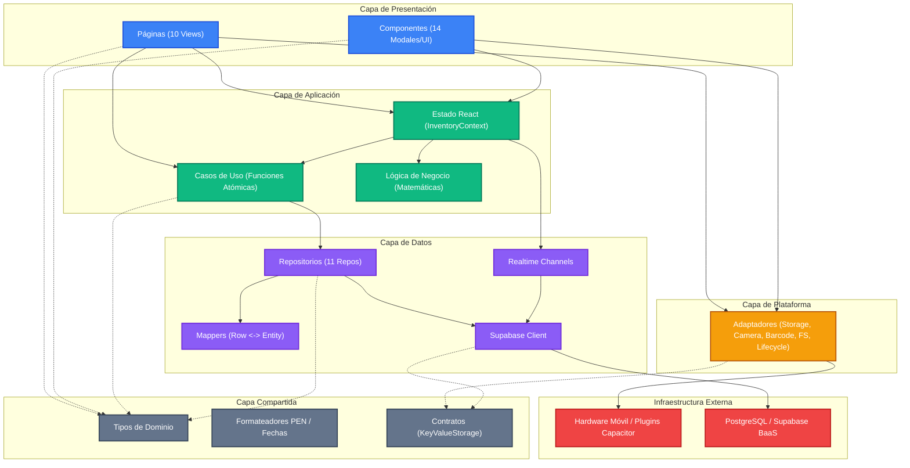

# Arquitectura de Software de Rentabill
**Sistema de Gestión de Inventarios, Finanzas y Ventas para Microcomercios Minoristas**  
*Documento Técnico de Arquitectura en Capas — Proyecto Integrador*

---

## 1. Resumen Ejecutivo (Apto para Informe Técnico)

> **Rentabill** implementa una **arquitectura en capas con un módulo transversal compartido (Shared Layer)**, diseñada bajo el principio de separación de responsabilidades (*Separation of Concerns*).
>
> La estructura del código organiza la aplicación desacoplando la interfaz de usuario (React 19 / Tailwind CSS v4) del acceso a datos (Supabase BaaS / PostgreSQL v3.7) y de las capacidades nativas del dispositivo móvil (Capacitor / Android). Las reglas de negocio y los cálculos de indicadores residen en funciones de la capa de aplicación, aisladas de la infraestructura y de los componentes visuales.
>
> La integridad de las dependencias entre capas se verifica de manera automatizada mediante el script `scripts/check-layers.mjs`, que comprueba mediante expresiones regulares que ninguna capa importe módulos no permitidos. El proyecto compila sin errores de tipos con TypeScript (`tsc --noEmit`), empaqueta correctamente para producción con Vite (`npm run build`) y cuenta con un script de verificación de fórmulas matemáticas (`scripts/verify-logic.mjs`). El proyecto no implementa un framework de pruebas unitarias automatizadas (como Jest o Vitest).

---

## 2. Descripción de las Capas de la Arquitectura

El sistema se estructura en 4 capas más un módulo transversal compartido:

```
┌──────────────────────────────────────────────────────────────────┐
│                   CAPA DE PRESENTACIÓN (UI)                      │
│     Páginas (10 Views) · Componentes (14) · Modales              │
└─────────────────────────────────┬────────────────────────────────┘
                                  │ consume
                                  ▼
┌──────────────────────────────────────────────────────────────────┐
│                  CAPA DE APLICACIÓN (APPLICATION)                │
│    Lógica Financiera · Casos de Uso · Estado Global              │
└──────────────┬──────────────────────────────────┬────────────────┘
               │ orquesta                         │ persiste
               ▼                                  ▼
┌──────────────────────────────┐   ┌───────────────────────────────┐
│  CAPA DE PLATAFORMA NATIVA   │   │     CAPA DE DATOS (DATA)      │
│         (PLATFORM)           │   │  Repositorios · Mappers DB    │
│  Barcode · Camera · Storage  │   │  Supabase Client · Realtime   │
│  Filesystem · App Lifecycle  │   │                               │
└──────────────┬───────────────┘   └──────────────┬────────────────┘
               │                                  │
               └─────────────────┬────────────────┘
                                 │ implementan contratos
                                 ▼
┌──────────────────────────────────────────────────────────────────┐
│                 CAPA COMPARTIDA (SHARED LAYER)                   │
│   Tipos TypeScript · Formateadores es-PE · Constantes · Puertos  │
└──────────────────────────────────────────────────────────────────┘
```

### 2.1. Capa de Presentación (`src/presentation/`)
- **Responsabilidad**: Renderizado visual, captura de eventos táctiles, formularios y navegación por pestañas.
- **Submódulos**:
  - `pages/`: Las 10 pantallas de la aplicación (`PulsoView`, `InventarioView`, `POSView`, `HistorialView`, `RestockSimulatorView`, `ProductRegisterView`, `AjustesView`, `AuthView`, `OnboardingView`, `ConnectionErrorView`).
  - `components/`: 14 componentes y modales auxiliares (`BottomNavigation`, `Header`, `StoreSelectorModal`, `EditProductModal`, `RoleTestBanner`, etc.).
- **Regla de Dependencias**: No puede importar directamente desde `@data`, `@supabase/*` ni `@capacitor/*`. Se comunica exclusivamente a través de los casos de uso, el contexto de aplicación y los adaptadores de plataforma.

### 2.2. Capa de Aplicación (`src/application/`)
- **Responsabilidad**: Orquestar el flujo de datos del negocio, ejecutar operaciones y calcular métricas financieras.
- **Submódulos**:
  - `logic/`: Funciones de cálculo sin dependencias de React ni de base de datos (`financialMetrics.ts`, `simulationEngine.ts`). Calcula margen unitario, velocidad diaria, salud financiera estimada y transición a datos reales tras acumular 5 ventas.
  - `use-cases/`: Funciones asíncronas por dominio (`sales`, `inventory`, `purchases`, `simulations`, `stores`, `team`, `auth`).
  - `state/`: Contenedor de estado global (`InventoryContext.tsx`), suscripciones de red en tiempo real y almacenamiento de sesión en memoria.

### 2.3. Capa de Datos (`src/data/`)
- **Responsabilidad**: Persistencia, comunicación con el backend Supabase y sincronización de cambios.
- **Submódulos**:
  - `supabase/`: Inicialización del cliente Supabase (`client.ts`), desacoplado del almacenamiento móvil mediante inyección de dependencias.
  - `repositories/`: 11 repositorios atómicos (`productsRepository`, `salesRepository`, `purchasesRepository`, `stockRepository`, `storesRepository`, `teamRepository`, `settingsRepository`, `suppliersRepository`, `simulationsRepository`, `storageRepository`, `authRepository`).
  - `mappers/`: Conversión bidireccional entre filas relacionales de PostgreSQL (snake_case) e interfaces de TypeScript (camelCase).
  - `realtime/`: Gestión de canales de Supabase Realtime (`storeRealtime.ts`).

### 2.4. Capa de Plataforma (`src/platform/`)
- **Responsabilidad**: Adaptar las APIs de plugins nativos de Capacitor y ofrecer una alternativa funcional cuando la aplicación se ejecuta en navegador web.
- **Submódulos**:
  - `storage/`: `capacitorPreferencesStorage.ts` implementa el contrato `KeyValueStorage` utilizando `@capacitor/preferences` en Android y `localStorage` en web.
  - `filesystem/`: `capacitorFilesystem.ts` guarda archivos CSV en la ruta nativa `Documentos/Rentabill/` o inicia la descarga Blob en navegador.
  - `barcode/`: `capacitorBarcodeScanner.ts` integra el escáner de códigos de barras mediante `@capacitor-mlkit/barcode-scanning` con Google Play Services en Android.
  - `camera/`: `capacitorCamera.ts` captura fotografías con `@capacitor/camera` y las convierte a objeto `Blob`.
  - `appLifecycle/`: `capacitorAppLifecycle.ts` gestiona el evento del botón físico atrás en Android (`@capacitor/app`).

### 2.5. Capa Compartida (`src/shared/`)
- **Responsabilidad**: Definición de tipos de datos, constantes globales, contratos e interfaces comunes, y utilidades de formato regional es-PE.
- **Submódulos**:
  - `types/`: Definición de interfaces (`Product`, `SaleRecord`, `StoreConfig`, etc.).
  - `constants/`: Constantes del sistema (`roles.ts`).
  - `formatters/`: Formateo de moneda en Soles (`formatCurrency` -> "S/ 1,234.50"), teléfonos peruanos (+51) y fechas en zona horaria local.
  - `storage/`: Contrato `KeyValueStorage`.

---

## 3. Diagramas de Arquitectura (Mermaid)

### 3.1. Diagrama de Capas y Dependencias Permitidas



### 3.2. Diagrama de Secuencia: Operación de Venta `processSale`


---

## 4. Estructura de Carpetas del Proyecto (`src/`)

```
src/
├── App.tsx                       # Raíz de composición: navegación y montaje de modales
├── main.tsx                      # Bootstrap: inyección de storage e inicialización React
│
├── presentation/                 # CAPA 1: PRESENTACIÓN
│   ├── pages/                    # 10 Pantallas principales
│   │   ├── PulsoView.tsx         # Dashboard financiero, score de salud y capital
│   │   ├── InventarioView.tsx    # Catálogo de productos, filtros y búsqueda
│   │   ├── POSView.tsx           # Punto de venta, carrito y cobro rápido
│   │   ├── HistorialView.tsx     # Ventas, kardex, compras y simulaciones pasadas
│   │   ├── RestockSimulatorView.tsx # Simulador de compras y rentabilidad proyectada
│   │   ├── ProductRegisterView.tsx  # Registro de productos con código y cámara
│   │   ├── AjustesView.tsx       # Perfil, miembros, QR y preferencias
│   │   ├── AuthView.tsx          # Login, registro y recuperación de clave
│   │   ├── OnboardingView.tsx    # Creación inicial de negocio
│   │   ├── ConnectionErrorView.tsx # Pantalla de falla de conexión y reintento
│   │   └── index.ts              # Barrel de páginas
│   ├── components/               # 14 Componentes y modales UI
│   │   ├── BottomNavigation.tsx  # Barra inferior con control de tabs por rol
│   │   ├── Header.tsx            # Barra superior con selector de tienda y perfil
│   │   ├── StoreSelectorModal.tsx# Selector y creador de múltiples tiendas
│   │   ├── EditProductModal.tsx  # Edición de producto, cámara y código de barras
│   │   ├── RoleTestBanner.tsx    # Banner de previsualización de roles en cliente
│   │   ├── ToastNotification.tsx # Sistema de alertas flotantes
│   │   ├── CalibrationModal.tsx  # Notificación de producto calibrado a REAL
│   │   └── ...                   # Resto de modales (perfil, logout, invitación, etc.)
│   └── index.ts                  # Barrel principal de presentación
│
├── application/                  # CAPA 2: APLICACIÓN
│   ├── logic/                    # LÓGICA DE NEGOCIO (sin React ni BD)
│   │   ├── financialMetrics.ts   # Margen, velocidad, salud proyectada, calibración
│   │   ├── simulationEngine.ts   # Retorno de inversión y veredictos del simulador
│   │   ├── writeGuard.ts         # Guardia de escritura y simulación para modo prueba
│   │   └── index.ts
│   ├── use-cases/                # CASOS DE USO ATÓMICOS
│   │   ├── sales/processSaleUseCase.ts
│   │   ├── inventory/adjustStockUseCase.ts
│   │   ├── inventory/registerProductUseCase.ts
│   │   ├── inventory/updateProductUseCase.ts
│   │   ├── inventory/deleteProductUseCase.ts
│   │   ├── inventory/uploadImageUseCase.ts
│   │   ├── purchases/processPurchaseUseCase.ts
│   │   ├── purchases/payPurchaseUseCase.ts
│   │   ├── simulations/createSimulationUseCase.ts
│   │   ├── simulations/confirmSimulationPurchaseUseCase.ts
│   │   ├── stores/createStoreUseCase.ts
│   │   ├── stores/switchStoreUseCase.ts
│   │   ├── team/inviteMemberUseCase.ts
│   │   ├── team/respondInvitationUseCase.ts
│   │   ├── auth/authUseCases.ts
│   │   └── index.ts
│   ├── state/                    # ESTADO GLOBAL
│   │   ├── InventoryContext.tsx  # Context Provider y hook useInventory
│   │   └── index.ts
│   └── index.ts                  # Barrel principal de aplicación
│
├── platform/                     # CAPA 3: PLATAFORMA NATIVA
│   ├── storage/                  # Adaptador de persistencia de sesión
│   │   ├── capacitorPreferencesStorage.ts
│   │   └── index.ts
│   ├── filesystem/               # Descarga y guardado de reportes CSV
│   │   ├── capacitorFilesystem.ts
│   │   └── index.ts
│   ├── barcode/                  # Escáner nativo ML Kit
│   │   ├── barcodeScanner.interface.ts
│   │   ├── capacitorBarcodeScanner.ts
│   │   └── index.ts
│   ├── camera/                   # Captura de fotografías
│   │   ├── camera.interface.ts
│   │   ├── capacitorCamera.ts
│   │   └── index.ts
│   ├── appLifecycle/             # Botón atrás Android nativo
│   │   ├── appLifecycle.interface.ts
│   │   ├── capacitorAppLifecycle.ts
│   │   └── index.ts
│   └── index.ts                  # Barrel principal de plataforma
│
├── data/                         # CAPA 4: DATOS
│   ├── supabase/                 # Cliente y traductor de errores
│   │   ├── client.ts             # Cliente desacoplado con setSupabaseStorage
│   │   └── errorMapper.ts
│   ├── repositories/             # 11 Repositorios especializados
│   │   ├── productsRepository.ts
│   │   ├── salesRepository.ts
│   │   ├── purchasesRepository.ts
│   │   ├── stockRepository.ts
│   │   ├── storesRepository.ts
│   │   ├── teamRepository.ts
│   │   ├── settingsRepository.ts
│   │   ├── suppliersRepository.ts
│   │   ├── simulationsRepository.ts
│   │   ├── storageRepository.ts
│   │   ├── authRepository.ts
│   │   └── index.ts
│   ├── mappers/                  # Mapeo snake_case (BD) <-> camelCase (App)
│   │   ├── productMapper.ts
│   │   ├── saleMapper.ts
│   │   ├── purchaseMapper.ts
│   │   ├── storeMapper.ts
│   │   └── index.ts
│   ├── realtime/                 # Canales de sincronización Postgres
│   │   ├── storeRealtime.ts
│   │   └── index.ts
│   └── index.ts                  # Barrel principal de datos
│
└── shared/                       # CAPA TRANSVERSAL COMPARTIDA
    ├── types/                    # Entidades e interfaces del dominio
    │   └── index.ts
    ├── constants/                # Catálogo de roles y permisos
    │   └── roles.ts
    ├── formatters/               # Formato de Soles (S/), teléfonos y fechas
    │   ├── authErrorFormatter.ts
    │   └── index.ts
    └── storage/                  # Contrato de almacenamiento agnóstico
        └── storage.interface.ts
```

---

## 5. Matriz de Reglas de Dependencia

| Capa Origen | Puede Importar de | NO Puede Importar de | Verificación en CI/Local |
|:---|:---|:---|:---:|
| **`presentation`** | `application`, `platform`, `shared` | `data`, `@supabase/*`, `@capacitor/*` | `npm run check:layers` |
| **`application`** | `data` (repos/realtime), `shared`, `platform` (adaptadores) | `presentation`, `@capacitor/*` | `npm run check:layers` |
| **`application/logic`** | `shared` (tipos puros) | `data`, `presentation`, `platform`, `@supabase/*`, `@capacitor/*`, `react` | `npm run check:layers` |
| **`platform`** | `shared`, `@capacitor/*` | `presentation`, `application`, `data`, `@supabase/*` | `npm run check:layers` |
| **`data`** | `shared`, `@supabase/*` | `presentation`, `application`, `platform`, `@capacitor/*` | `npm run check:layers` |
| **`shared`** | *(Ninguna capa interna)* | `presentation`, `application`, `platform`, `data`, `@supabase/*`, `@capacitor/*` | `npm run check:layers` |
| **`Raíz de Composición`** (`src/main.tsx`, `src/App.tsx`) | *Todas las capas (ensamble inicial)* | *(N/A)* | Permitido por diseño |

---

## 6. Métricas Reales y Verificadas del Proyecto

| Dimensión | Cantidad Verificada | Detalle Técnico en el Código |
|:---|:---:|:---|
| **Tablas PostgreSQL** | **16** | `stores`, `store_members`, `profiles`, `user_preferences`, `store_settings`, `categories`, `products`, `sales`, `sale_items`, `inventory_movements`, `purchases`, `purchase_items`, `suppliers`, `simulations`, `store_invitations`, `cash_registers` |
| **Vistas SQL** | **1** | `product_stats` (cálculo consolidado de ventas acumuladas y stock) |
| **Funciones RPC** | **8** | `process_sale`, `process_purchase`, `pay_purchase`, `adjust_stock`, `create_store`, `switch_store`, `invite_by_code`, `accept_invitation` |
| **Pantallas (Views)** | **10** | Pulso, Inventario, POS, Historial, Simulador, Registro de Producto, Ajustes, Auth, Onboarding, Error de Conexión |
| **Modales / UI** | **14** | Selector de Tienda, Editor de Producto, Banner de Prueba de Rol, etc. |
| **Roles de Usuario** | **3** | • **ADMIN**: Control total del negocio.<br>• **REPOSITOR**: Gestión del catálogo, proveedores, ajuste manual de stock e ingreso de mercadería (registrar compras); no paga compras pendientes.<br>• **CAJERO**: Exclusivamente ventas y cobro en POS.<br>*(Pagar compras, simulaciones de compras, invitar miembros y ajustes son exclusivos de ADMIN)* |
| **Plugins de Capacitor** | **5** | 1. `@capacitor/preferences` (almacenamiento clave-valor)<br>2. `@capacitor/filesystem` (guardado de archivos CSV)<br>3. `@capacitor/camera` (captura de fotos)<br>4. `@capacitor-mlkit/barcode-scanning` (escáner con Google Play Services)<br>5. `@capacitor/app` (manejo del botón físico atrás de Android)<br>*(Nota: `@capacitor/core` actúa como el runtime base de la plataforma, no como plugin)* |

---

## 7. Decisiones de Diseño

### 7.1. Desacoplamiento de Persistencia con `KeyValueStorage`
- **Motivo**: El cliente `@supabase/supabase-js` requiere persistir el token de sesión. Si `src/data/supabase/client.ts` importase `@capacitor/preferences`, la capa de datos dependería de una biblioteca de plataforma móvil nativa.
- **Implementación**: Se definió la interfaz `KeyValueStorage` en `src/shared/storage/storage.interface.ts`. En `src/platform/storage/capacitorPreferencesStorage.ts` se implementó el adaptador. En `src/main.tsx` (raíz de composición) se inyecta mediante `setSupabaseStorage(capacitorPreferencesStorage)`.

### 7.2. Funcionamiento de `RoleTestBanner` y Guardia de Simulación (`runWrite`)
- **Comportamiento y Visibilidad**: El banner `RoleTestBanner` se renderiza en la parte superior únicamente cuando `isTestingRole === true` (activado voluntariamente por un usuario Administrador desde la sección de Ajustes para previsualizar los permisos de otros roles). Los usuarios reales con roles `CAJERO` o `REPOSITOR` autenticados mediante sesión de base de datos **nunca** ven este banner.
- **Mensaje y Controles**: El banner muestra claramente `"MODO PRUEBA: los cambios NO se guardan"` junto con el botón `"Salir de prueba"`, el cual restaura de inmediato el rol real `ADMIN` del usuario.
- **Punto Único de Control (`runWrite`)**: Todas las operaciones de mutación están protegidas en la capa de aplicación mediante la función guardia `runWrite` (`src/application/logic/writeGuard.ts`). Cuando `isTestingRole` está activo:
  1. Se intercepta la operación antes de invocar cualquier llamada de red o cliente Supabase.
  2. Se ejecuta la rama `onSimulate`, la cual actualiza el estado local de React en memoria con la misma estructura y tipos que la base de datos real.
  3. Se notifica al usuario mediante un toast: `"Modo prueba: nada se guardó"`.
  4. Ninguna sentencia SQL (`INSERT`, `UPDATE`, `DELETE`, `UPSERT`), llamada RPC ni subida a Supabase Storage llega al servidor.
- **Reinicio Automático**: El modo prueba se desactiva automáticamente (`isTestingRole = false`) restableciendo el rol a `ADMIN` al:
  - Cerrar sesión (`logout` o evento `SIGNED_OUT`).
  - Cambiar de tienda activa (`switchStore`).
  - Recargar la aplicación en el navegador o iniciar la app móvil (`INITIAL_SESSION`).

### 7.3. Generación de Reportes en Formato CSV
- **Motivo**: El reporte se genera con texto plano en formato CSV codificado con UTF-8 BOM (`\uFEFF`), lo que permite su apertura en Microsoft Excel tanto en dispositivos móviles como en computadoras sin necesidad de incluir bibliotecas externas de hojas de cálculo (como `xlsx`).
- **Ruta de guardado**: Mediante `capacitorFilesystem.ts`, en Android se almacena en la carpeta nativa `Documentos/Rentabill/productos_YYYY-MM-DD.csv`, mientras que en navegadores web se genera la descarga directa mediante un objeto `Blob`.

### 7.4. Alineación de Contratos RPC con el Esquema Supabase v3.7
Todas las funciones RPC invocadas desde la capa de datos y repositorios están rigurosamente alineadas con los contratos del esquema SQL v3.7 (`rentabill_schema_v3.7.sql`):
1. **`process_sale`**:
   - `p_store_id`: UUID de la tienda activa.
   - `p_ticket_number`: Cadena formateada única (e.g., `TKT-00101`).
   - `p_payment_method`: Cadena en minúsculas (`'efectivo'`, `'tarjeta'`, `'yape'`, `'plin'`, `'transferencia'`, `'qr'`).
   - `p_cash_given`: Monto en efectivo entregado por el cliente.
   - `p_register_id`: Identificador de la caja registradora activa.
   - `p_items`: Array JSON donde cada elemento contiene de forma estricta las claves `{ productId: string, quantity: number }` (con cantidad estrictamente mayor a 0).
2. **`process_purchase`**:
   - `p_store_id`: UUID de la tienda.
   - `p_supplier_id`: UUID del proveedor opcional.
   - `p_items`: Array JSON de partidas con `{ product_id, quantity, unit_cost }`.
   - `p_note`: Observaciones de la compra.
   - `p_payment_condition`: `'contado'` o `'credito'`.
   - `p_credit_days`: Entero de días de crédito (0 si es contado).
   - `p_simulation_ids`: Array de UUIDs de simulaciones relacionadas.
3. **`adjust_stock`**:
   - `p_store_id`, `p_product_id`, `p_quantity_delta` (positivo para entradas, negativo para mermas/salidas), `p_note`, `p_user_name`.
4. **`pay_purchase`**:
   - `p_store_id`, `p_purchase_id`.
5. **`create_store`**:
   - `name`, `type`, `currency` (por defecto `'PEN'`).
6. **`switch_store`**:
   - `p_store_id`.
7. **`invite_by_code`**:
   - `p_store_id`, `p_user_code` (código público del usuario destino en mayúsculas), `p_role` (`'CAJERO'` | `'REPOSITOR'` | `'ADMIN'`).
8. **`accept_invitation`**:
   - `p_token`: Token alfanumérico o identificador único de la invitación.

---

## 8. Limitaciones Técnicas Conocidas

1. **Concentración de Estado en `InventoryContext.tsx`**:
   - `src/application/state/InventoryContext.tsx` contiene 2,961 líneas de código. Concentra 11 áreas de responsabilidad (autenticación, multi-tienda, carrito/POS, inventario, kardex, compras, simulaciones, equipo, configuración, suscripciones en tiempo real y estado de modales). Aunque se delegaron las mutaciones hacia casos de uso y repositorios, el estado global no ha sido fragmentado en contextos independientes por dominio.

2. **Dependencia de Conexión a Internet (Sin Cola Offline)**:
   - La aplicación requiere conectividad activa con el backend Supabase para registrar ventas, compras o movimientos de stock. No implementa una cola local persistente de sincronización (*offline-first sync queue*) para almacenar operaciones sin conexión y sincronizarlas automáticamente al recuperar la red.

3. **Cálculo de Indicadores en el Dispositivo Cliente**:
   - Los cálculos de margen, rotación, salud proyectada y el resumen global del negocio se procesan en el hilo principal del cliente dentro de `financialMetrics.ts`, iterando sobre el catálogo en memoria. En comercios con miles de productos este cálculo puede provocar caídas en los cuadros por segundo (*frame drops*) en teléfonos de gama de entrada.

4. **Alcance de los Reportes en Pantalla**:
   - En la interfaz de usuario existe **una única opción de descarga** (en `AjustesView` -> sección "Mis datos": botón *"Descargar reporte de productos y ventas"*), la cual exporta el catálogo de productos con sus ventas y márgenes acumulados (`productos_YYYY-MM-DD.csv`). No existe un reporte o botón separado en pantalla para descargar el historial transaccional de ventas individuales ticket por ticket.

---

## 9. Tabla Comparativa: Antes vs. Después de la Reorganización

| Elemento / Responsabilidad | Ubicación Anterior | Nueva Ubicación Oficial | Estado |
|:---|:---|:---|:---|
| **Cálculos Financieros** | `src/utils/calculations.ts` | `src/application/logic/financialMetrics.ts` | Desacoplado de la UI; verificado con `verify-logic.mjs` |
| **Simulador de Compras** | Lógica incrustada en vista | `src/application/logic/simulationEngine.ts` | Algoritmos de retorno y veredictos en funciones puras |
| **Acceso a Supabase** | Consultas dispersas en vistas y contexto | `src/data/repositories/*.ts` | 11 repositorios atómicos centralizados |
| **Mapeo de Datos** | Conversión ad-hoc en vistas | `src/data/mappers/*.ts` | Normalización camelCase y tipado |
| **Suscripción Realtime** | Código disperso en el contexto | `src/data/realtime/storeRealtime.ts` | Suscripción y desuscripción encapsuladas |
| **Persistencia de Sesión** | Importación directa de preferencias | `src/platform/storage/` | Desacoplado con la interfaz `KeyValueStorage` |
| **Escáner de Barras** | `src/utils/barcodeScanner.ts` | `src/platform/barcode/` | Adaptador formal con interfaz y módulo ML Kit |
| **Cámara** | Código duplicado con `atob` en 3 vistas | `src/platform/camera/` | Adaptador con función `capturePhoto()` unificada |
| **Descarga de CSV** | Código en el contexto con `@capacitor/filesystem` | `src/platform/filesystem/` | Adaptador nativo Android y fallback web |
| **Ciclo de Vida / Botón Atrás** | Llamada directa a `@capacitor/app` en modal | `src/platform/appLifecycle/` | Adaptador con función `onBackButton()` |
| **Páginas Principales** | `src/views/*View.tsx` | `src/presentation/pages/` | Vistas agrupadas en la capa de presentación |
| **Componentes Visuales** | `src/components/*.tsx` | `src/presentation/components/` | Componentes desacoplados de infraestructura |
| **Tipos de Dominio** | `src/types.ts` | `src/shared/types/index.ts` | Módulo compartido |
| **Formateadores** | `src/utils/formatters.ts` | `src/shared/formatters/index.ts` | Formatos de moneda (PEN) y fechas |

---

## 10. Procedimiento de Verificación Técnica

Los siguientes comandos permiten verificar el estado del código:

```bash
# 1. Comprobación de reglas de importación entre capas (análisis por expresiones regulares):
npm run check:layers

# 2. Comprobación estricta de tipos de TypeScript:
npm run lint

# 3. Comprobación de equivalencia matemática de fórmulas de métricas financieras:
npx tsx scripts/verify-logic.mjs

# 4. Generación del bundle de producción web:
npm run build
```
