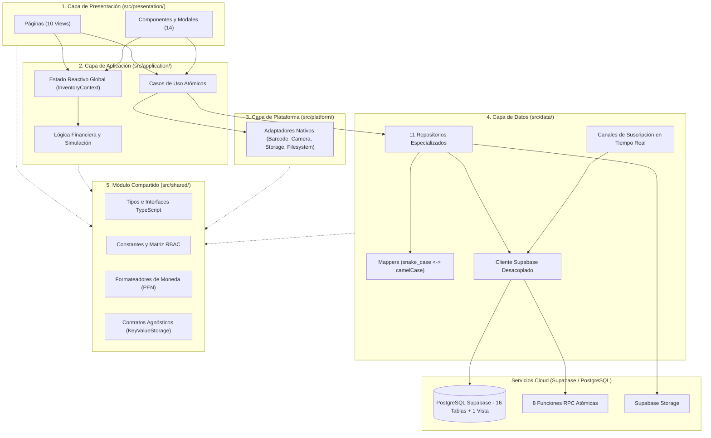

# Arquitectura del Software de Rentabill

## 1. Resumen de la Arquitectura en Capas

Rentabill implementa una **arquitectura en capas: 4 capas más un módulo compartido, con reglas de dependencia verificadas por el script npm run check:layers**. El diseño persigue el principio de separación de responsabilidades (*Separation of Concerns*) y el desacoplamiento entre la lógica de negocio, la interfaz visual, el acceso a datos en la nube y las APIs nativas del dispositivo móvil.

Para consultar los contratos detallados, la tabla comparativa de reorganización y los diagramas de secuencia específicos, referirse al documento técnico principal en [docs/ARQUITECTURA.md](../ARQUITECTURA.md).

---

## 2. Responsabilidades por Capa

### 2.1. Capa de Presentación (`src/presentation/`)
* **Responsabilidad:** Renderizado visual interactivo, captura de eventos táctiles en pantalla, formularios y control de navegación.
* **Componentes clave:**
  * `pages/`: 10 vistas principales (`PulsoView`, `InventarioView`, `POSView`, `HistorialView`, `RestockSimulatorView`, `ProductRegisterView`, `AjustesView`, `AuthView`, `OnboardingView`, `ConnectionErrorView`).
  * `components/`: 14 componentes y modales UI (`BottomNavigation`, `Header`, `StoreSelectorModal`, `EditProductModal`, `RoleTestBanner`, `ToastNotification`, etc.).
* **Regla de Dependencia:** No accede directamente a la capa de datos (`src/data/`), ni a `@supabase/*` ni a bibliotecas de `@capacitor/*`. Todo consumo se canaliza mediante casos de uso, el hook de estado `useInventory` o adaptadores de plataforma.

### 2.2. Capa de Aplicación (`src/application/`)
* **Responsabilidad:** Orquestar el flujo de datos del negocio, ejecutar operaciones de mutación mediante casos de uso, procesar métricas matemáticas y administrar el estado reactivo global en memoria.
* **Componentes clave:**
  * `logic/`: Funciones puras e independientes de React y de red (`financialMetrics.ts`, `simulationEngine.ts`, `writeGuard.ts`).
  * `use-cases/`: Casos de uso atómicos divididos por dominios (`sales`, `inventory`, `purchases`, `simulations`, `stores`, `team`, `auth`).
  * `state/`: Proveedor de contexto React (`InventoryContext.tsx`) y hook de consumo `useInventory`.
* **Regla de Dependencia:** Puede importar de `src/data/` (repositorios y suscripciones), `src/shared/` y `src/platform/` (adaptadores). El submódulo `src/application/logic/` está estrictamente aislado de React, red y librerías externas.

### 2.3. Capa de Plataforma (`src/platform/`)
* **Responsabilidad:** Encapsular todas las APIs nativas del dispositivo móvil provistas por Capacitor, exponiendo interfaces abstractas y proporcionando mecanismos de fallback para navegadores web estándar.
* **Componentes clave:**
  * `storage/`: Implementación de persistencia con `@capacitor/preferences` bajo el contrato `KeyValueStorage`.
  * `filesystem/`: Descarga y guardado físico del archivo CSV en carpetas del sistema operativo.
  * `barcode/`: Escaneo de códigos de barra mediante Google Play Services ML Kit.
  * `camera/`: Captura fotográfica con control de permisos y compresión.
  * `appLifecycle/`: Interceptación del botón físico atrás en dispositivos Android.
* **Regla de Dependencia:** Únicamente importa de `@capacitor/*` y de `src/shared/`.

### 2.4. Capa de Datos (`src/data/`)
* **Responsabilidad:** Administrar la comunicación con el backend en la nube (Supabase BaaS), ejecutar sentencias SQL protegidas por Row Level Security (RLS), invocar funciones RPC atómicas y transformar estructuras de datos.
* **Componentes clave:**
  * `supabase/client.ts`: Inicialización del cliente Supabase con inyección dinámica del almacenamiento de tokens.
  * `supabase/errorMapper.ts`: Traductor de códigos de error de Postgres (SQLSTATE) a mensajes en español orientados al usuario.
  * `repositories/`: 11 repositorios especializados (`productsRepository`, `salesRepository`, `purchasesRepository`, `stockRepository`, `storesRepository`, `teamRepository`, `settingsRepository`, `suppliersRepository`, `simulationsRepository`, `storageRepository`, `authRepository`).
  * `mappers/`: Funciones de transformación bidireccional entre la nomenclatura snake_case de la base de datos y camelCase de TypeScript en el cliente.
  * `realtime/`: Gestor de canales WebSocket de Supabase Realtime (`storeRealtime.ts`).
* **Regla de Dependencia:** No puede importar de `src/presentation/`, `src/application/` ni de `@capacitor/*`.

### 2.5. Módulo Compartido (`src/shared/`)
* **Responsabilidad:** Proveer definiciones transversales utilizadas por todas las demás capas sin introducir acoplamiento cruzado.
* **Componentes clave:**
  * `types/`: Entidades de dominio e interfaces TypeScript puras.
  * `constants/roles.ts`: Matriz de permisos RBAC para los roles `ADMIN`, `CAJERO` y `REPOSITOR`.
  * `formatters/`: Utilitarios de conversión de moneda (`S/`), números telefónicos y fechas peruanas.
  * `storage/storage.interface.ts`: Contrato agnóstico `KeyValueStorage`.
* **Regla de Dependencia:** No importa de ninguna otra capa interna del proyecto.

---

## 3. Matriz de Reglas de Dependencia y Validación

| Capa Origen | Puede Importar de | Prohibido Importar de | Validación en CI/Local |
| :--- | :--- | :--- | :---: |
| **`presentation`** | `application`, `platform`, `shared` | `data`, `@supabase/*`, `@capacitor/*` | `npm run check:layers` |
| **`application`** | `data`, `platform`, `shared` | `presentation`, `@capacitor/*` | `npm run check:layers` |
| **`application/logic`** | `shared` | `data`, `presentation`, `platform`, `react`, `@supabase/*`, `@capacitor/*` | `npm run check:layers` |
| **`platform`** | `shared`, `@capacitor/*` | `presentation`, `application`, `data`, `@supabase/*` | `npm run check:layers` |
| **`data`** | `shared`, `@supabase/*` | `presentation`, `application`, `platform`, `@capacitor/*` | `npm run check:layers` |
| **`shared`** | *(Ninguna capa interna)* | `presentation`, `application`, `platform`, `data`, `@supabase/*`, `@capacitor/*` | `npm run check:layers` |
| **Raíz de Ensamble** (`main.tsx`, `App.tsx`)| *Todas las capas* | *(N/A)* | Permitido por diseño |

El cumplimiento de esta matriz es auditado automáticamente mediante el script `scripts/check-layers.mjs`, verificando reglas de importación entre capas o saltos de capa ilegales.
