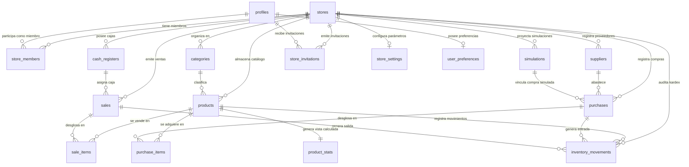

# Modelo Entidad-Relación de la Base de Datos (PostgreSQL v3.7.0)

Este documento presenta la arquitectura relacional completa implementada en `supabase/rentabill_schema_v3.7.sql`, compuesta por **16 tablas** normalizadas en Tercera Forma Normal (3FN) con desnormalización intencional en snapshots inmutables, y **1 vista de agregación** (`product_stats`).

---

## 1. Diagrama Entidad-Relación (Mermaid)

---

## 2. Descripción de las Entidades y Relaciones

### 2.1. Dominio de Organización y Acceso
1. **`stores` (Tiendas / Sucursales):**
   * Núcleo del aislamiento multi-inquilino (*multi-tenant*). Toda tabla del sistema (salvo `profiles` y `user_preferences`) posee una clave foránea `store_id` vinculada a esta tabla con política de cascada restrictiva.
   * Relación $1:N$ con `store_members`, `products`, `sales`, `purchases`, `cash_registers`, `categories`, `suppliers` e `inventory_movements`.
2. **`store_members` (Membresías de Tienda):**
   * Tabla intermedia que resuelve la relación muchos a muchos ($M:N$) entre `stores` y `profiles`.
   * Asocia a un usuario con una tienda y define su rol (`'ADMIN'`, `'CAJERO'`, `'REPOSITOR'`). Restricción `UNIQUE(store_id, user_id)`.
3. **`profiles` (Perfiles Públicos de Usuario):**
   * Extiende la tabla nativa de autenticación `auth.users` mediante una relación $1:1$ gobernada por la clave primaria `id` (UUID).
   * Almacena el `user_code` público (formato `RENT-XXXX`, 9 caracteres alfanuméricos en mayúsculas) y número telefónico validado con formato peruano de 9 dígitos comenzando en 9.
4. **`user_preferences` (Preferencias de Usuario):**
   * Relación $1:1$ con `profiles`. Almacena preferencias de interfaz como modo oscuro o notificaciones.
5. **`store_settings` (Configuración de Tienda):**
   * Relación $1:1$ con `stores`. Almacena la meta diaria porcentual (`daily_goal_percent`) y umbrales de alerta (`warn_slow_days`, `warn_low_stock`).
6. **`store_invitations` (Invitaciones de Equipo):**
   * Registra invitaciones emitidas por correo electrónico para afiliar colaboradores con un rol determinado. Vincula `store_id`, `email`, `role`, `token` aleatorio (48 hex), `status`, `invited_by`, `expires_at` (7 días) y `accepted_at`.

### 2.2. Dominio de Catálogo y Logística
7. **`categories` (Categorías):**
   * Agrupación taxonómica de productos por tienda. Restricción `UNIQUE(store_id, name)` que previene duplicidad de nombres en la misma sucursal.
8. **`suppliers` (Proveedores):**
   * Catálogo de distribuidores y empresas mayoristas con nombre, condición de pago, días de crédito, teléfono celular y rubro comercial.
9. **`products` (Catálogo de Productos y Existencias):**
   * Maestro de inventarios. Almacena existencias (`stock`), costo, precio de venta, código de barras (reutilizable si el producto está archivado mediante índice único parcial `WHERE archived_at IS NULL`), velocidad estimada y contadores acumulados de venta (`units_sold`, `sales_count`).
10. **`inventory_movements` (Kardex de Inventario):**
    * Bitácora contable inmutable de entradas y salidas de almacén. Registra `previous_stock`, `quantity` (positivo para compras/ajustes positivos, negativo para ventas/mermas) y `new_stock`. Vincula referencias externas `sale_id`, `purchase_id` o notas de ajuste.

### 2.3. Dominio Transaccional (Ventas y Compras)
11. **`cash_registers` (Cajas Registradoras):**
    * Aislamiento en Primera Forma Normal (1FN). Cada tienda dispone de sus propias cajas registradoras físicas o virtuales. Restricción `UNIQUE(store_id, name)`.
12. **`sales` (Cabecera de Ventas):**
    * Registro de la transacción en mostrador. Almacena el número de ticket (`ticket_number`), caja emisora (`register_id`), medio de pago, total cobrado y cajero responsable (`user_id`).
13. **`sale_items` (Partidas / Detalle de Venta):**
    * Líneas de producto vendidas. **Desnormalización intencional:** Almacena copias estáticas del nombre del producto (`product_name`) y del costo unitario al momento de la venta (`unit_cost`), garantizando que futuras ediciones de precios en el catálogo no alteren el margen histórico contable.
14. **`purchases` (Cabecera de Compras a Proveedores):**
    * Facturas o ingresos de mercadería. Registra `total`, condición de pago (`'contado'` o `'credito'`), días de crédito, fecha de vencimiento calculada (`due_date`), marca de liquidación (`paid_at`), usuario que registró (`created_by`) y nota (`note`).
15. **`purchase_items` (Partidas de Compra):**
    * Detalle de mercadería ingresada con `store_id`, cantidad adquirida, costo unitario pactado y subtotal generado automáticamente por la base de datos (`GENERATED ALWAYS AS (ROUND(quantity * unit_cost, 2)) STORED`). Posee claves foráneas compuestas con `purchases` y `products`.
16. **`simulations` (Simulaciones de Compra):**
    * Registros prospectivos de compras evaluadas mediante el motor de proyección.

### 2.4. Vista de Estadísticas
17. **`product_stats` (Vista SQL):**
    * Une `products` con `categories` y calcula al vuelo `created_days_ago` y el estado dinámico de rotación:
      * `REAL`: si `sales_count >= 5` o `created_days_ago >= 30`.
      * `ESTIMADO`: en caso contrario.
