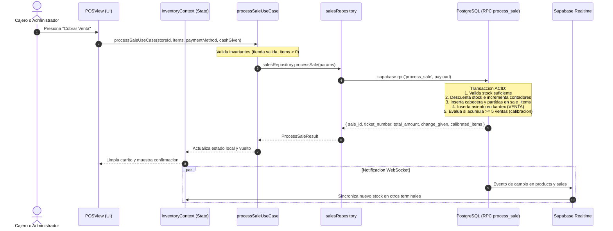
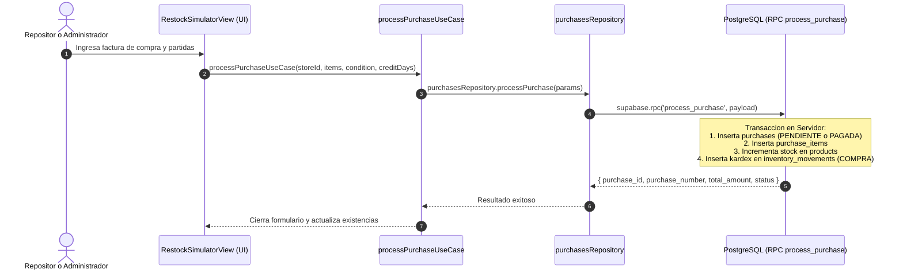
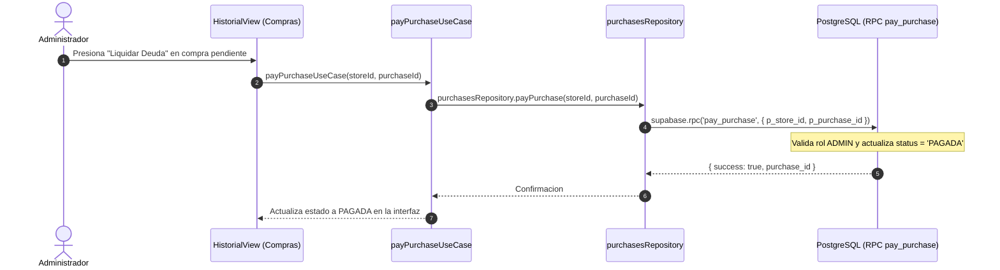
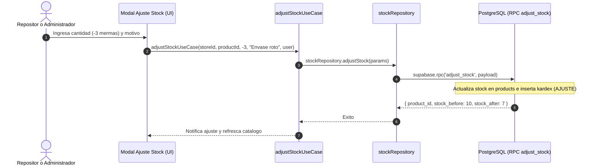
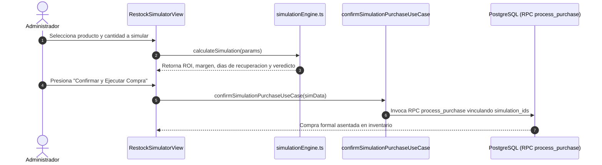
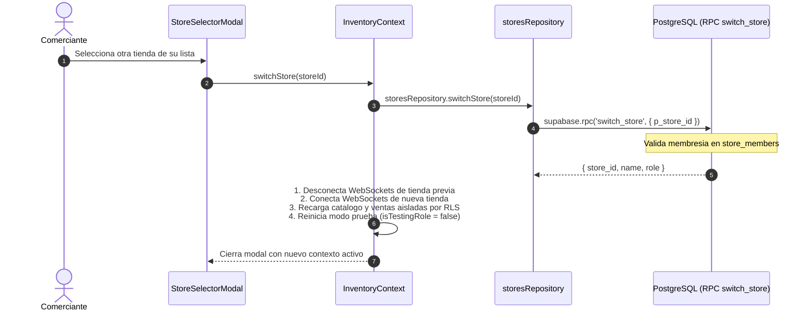
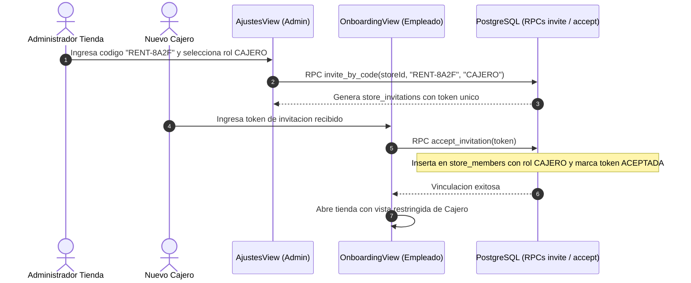
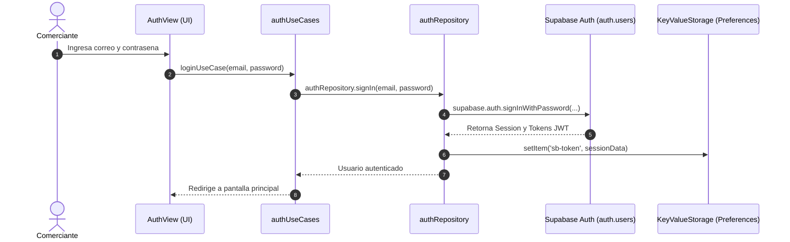
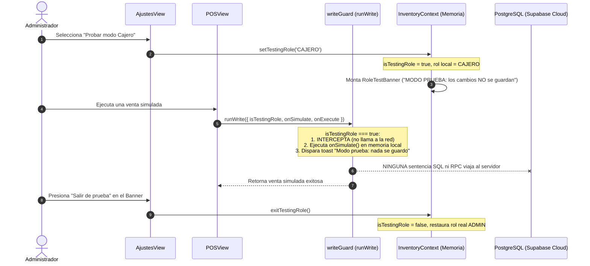

# Diagramas de Flujo y Secuencia del Sistema

Este documento describe mediante diagramas de secuencia en Mermaid los 9 flujos transaccionales y operativos críticos de Rentabill, modelando la interacción paso a paso entre el Usuario, la Interfaz (UI), la Capa de Aplicación, los Repositorios y la Base de Datos.

---

## 1. Flujo de Venta y Cobro en Mostrador (`processSale`)

---

## 2. Flujo de Ingreso de Compra a Proveedor (`processPurchase`)

---

## 3. Flujo de Liquidación de Compra a Crédito (`payPurchase`)

---

## 4. Flujo de Ajuste Manual de Inventario (`adjustStock`)

---

## 5. Flujo de Proyección y Confirmación de Compra

---

## 6. Flujo de Creación y Cambio de Sucursal

---

## 7. Flujo de Invitación y Aceptación de Equipo

---

## 8. Flujo de Autenticación y Recuperación de Clave

---

## 9. Flujo de Vista Previa de Roles (Modo Prueba y Guardia `runWrite`)

