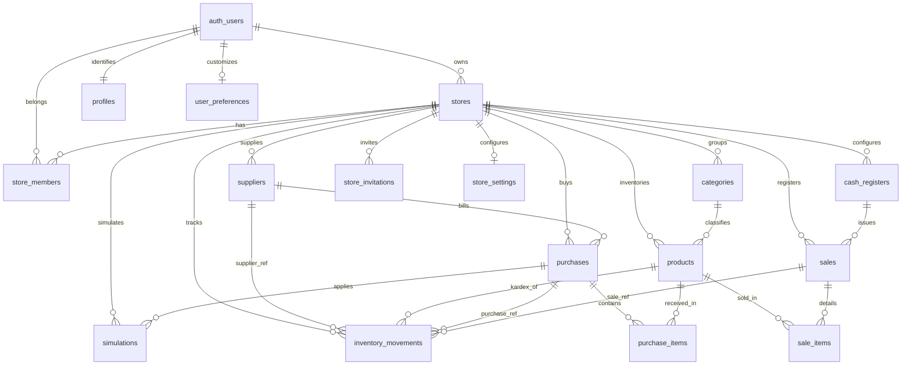

# INFORME TÉCNICO DE ARQUITECTURA Y DESARROLLO: RENTABILL
**Versión:** 3.7.0
**Fecha:** Octubre 2026  
**Autor:** Arquitectura de Software Senior & DBA Especialista en PostgreSQL  
**Destinatarios:** Equipo de Ingeniería, Docentes Evaluadores y Nuevos Desarrolladores  
**Tecnologías:** React 19, TypeScript, Vite, Tailwind CSS, Supabase (PostgreSQL 17 + Auth + Storage + Realtime + RPC), Capacitor 8 (Android Nativo)

---

## 1. RESUMEN DEL SISTEMA

**Rentabill** es una plataforma móvil progresiva convertida a Android nativo mediante Capacitor, diseñada específicamente para el microcomercio minorista tradicional peruano (bodegas, minimarkets, ferreterías, boticas y tiendas de abarrotes con productos de código de barras y artículos vendidos al peso).

A diferencia de los terminales punto de venta (POS) convencionales que operan como registradoras pasivas de cobro, Rentabill implementa un motor financiero algorítmico que traduce el inventario físico y las transacciones en mostrador en indicadores de liquidez, rotación y rendimiento del capital de trabajo en tiempo real.

### Principios Fundamentales del Sistema:
1. **Modelo de Rentabilidad Progresiva:** En el alta de un artículo, el margen unitario bruto es conocido con precisión matemática ($P_{\text{venta}} - P_{\text{costo}}$), pero la velocidad de rotación es una incógnita. El sistema resuelve el arranque en frío mediante una estimación manual inicial declarada por el comerciante (`estimatedSpeed`: Rápido 30%/semana, Normal 15%/semana, Lento 5%/semana), la cual es sustituida automáticamente por la velocidad real de mostrador en cuanto el producto alcanza **5 tickets de venta (`salesCount >= 5`) o 30 días de antigüedad** (transición a estado `REAL`).
2. **Puntaje de Salud Financiera (0–100):** Un índice heurístico compuesto que pondera en un 60% la calidad de los márgenes diarios y en un 40% la diversificación del capital sin estancamiento, clasificando la solvencia del negocio en un semáforo de tres estados: **Óptimo** ($\ge 80$), **Estable** ($50\text{–}79$) y **Crítico** ($< 50$).
3. **Arquitectura Multi-Tienda con RBAC por Sucursal:** Un único usuario autenticado puede pertenecer a múltiples bodegas simultáneamente con roles diferenciados e independientes (`ADMIN`, `CAJERO`, `REPOSITOR`), alternando de tienda sin cerrar sesión y con recálculo dinámico en caliente de vistas y contextos.
4. **3FN con Desnormalización Intencional en Totales y Snapshots:** Cajas registradoras aisladas en `cash_registers`, categorías por tienda en `categories`, proveedores en `suppliers`, compras en `purchases`, simulaciones en `simulations`, snapshots inmutables de costo, precio y nombres en `sale_items` y `inventory_movements`, totales derivados desnormalizados protegidos con constraints y validados en servidor por la función `process_sale()`.
5. **Localización Peruana Integral:** Moneda oficial en Soles (`PEN` en BD, formateado con `Intl.NumberFormat('es-PE', {style:'currency', currency:'PEN'})` mostrando `S/`), soporte para billeteras digitales (Yape, Plin, tarjeta, transferencia bancaria y QR del comercio `qr` configurado en `stores.qr_image_url`), y validación de celulares peruanos de 9 dígitos comenzando en 9 (`chk_profiles_phone_pe`).

---

## 2. INVENTARIO DE PANTALLAS Y COMPONENTES

### 2.1 Componente Header y Selector Multi-Tienda (Navegación Global)
* **Archivos:** [`src/components/Header.tsx`](file:///e:/Visitante/Downloads/Tarea-main/Tarea-main/src/components/Header.tsx), [`src/components/StoreSelectorModal.tsx`](file:///e:/Visitante/Downloads/Tarea-main/Tarea-main/src/components/StoreSelectorModal.tsx)
* **Función del componente:** `Header: React.FC`, `StoreSelectorModal: React.FC`
* **Elementos Visibles e Interacciones:**
  * **Cabecera Compacta:** Altura uniforme optimizada para pantallas táctiles de gama baja. Mantiene el logo corporativo con badge dinámico `EN VIVO` (o `OFFLINE`).
  * **Nombre de Tienda Activa:** Subtítulo interactivo bajo el rótulo "Rentabill" que muestra el nombre de la tienda activa acompañado de un glifo chevron (`ChevronDown`). Al pulsarlo despliega el bottom sheet `StoreSelectorModal`.
  * **Bottom Sheet "Mis Tiendas" (`createPortal`):** Renderizado en la raíz del documento (`document.body`) mediante `createPortal` con `z-index: 999`. Incluye lista de tiendas vinculadas con indicador de rol, rubro comercial, check verde en la activa y botón "Agregar tienda".
* **Lógica de Negocio y Transición:**
  * Al seleccionar una tienda distinta, se ejecuta `switchStore(storeId)` que invoca la función RPC remota `switch_store(p_store_id)` en Supabase.
  * **Purga y Recarga de Contexto:** Reinicia reactivamente los estados de `InventoryContext` vinculados al nuevo `store_id`.

---

### 2.2 Vista Pulso (Dashboard Financiero)
* **Archivo:** [`src/views/PulsoView.tsx`](file:///e:/Visitante/Downloads/Tarea-main/Tarea-main/src/views/PulsoView.tsx)
* **Función del componente:** `PulsoView: React.FC`
* **Elementos Visibles:**
  * Tacómetro radial SVG (`gauge`) con el Puntaje de Salud (0–100) y semáforo visual (`OPTIMAL`, `STABLE`, `CRITICAL`).
  * Indicador de Modo Semilla vs. Modo Calibrado (% de capital basado en datos reales vs. estimados).
  * Contador acumulado de tickets de venta emitidos.
  * **Tarjetas de Capital Disociado (Diseño Compacto Simétrico):**
    * **Dinero Invertido:** Título superior, badge "Total", monto monetario en Soles (`S/`) con formato `es-PE` y altura fija (`h-24 p-3.5`). Calculado como $\sum (\text{costPrice} \times \text{stockActual})$.
    * **Dinero Parado:** Título superior, badge "Sin vender", monto en Soles (`S/`) y porcentaje relativo inmovilizado en mercancía lenta.
  * Ganancia Diaria Promedio de la bodega comparada contra la meta diaria configurada.
  * Factores de Rendimiento: Ganancia por Venta (60% del peso) y Velocidad y Variedad (40% del peso).
  * Radar de Productos: Top 3 Productos Estrella (`starProducts`) y Top 3 Dinero Parado (`trappedCapitalProducts`).
* **Fórmulas Matemáticas:**
  * Dinero Invertido: $\sum (\text{costPrice} \times \text{stockActual})$. Si $\text{investedCapital} = 0$, $\text{dailyProfitPercent} = 0$.
  * Velocidad Real: $\frac{\text{unitsSold}}{\max(\text{días}, 1)}$.
  * Progreso a Calibración: $\min(100, \text{round}((\text{salesCount} / 5) \times 100))$.

---

### 2.3 Vista Inventario y Catálogo
* **Archivo:** [`src/views/InventarioView.tsx`](file:///e:/Visitante/Downloads/Tarea-main/Tarea-main/src/views/InventarioView.tsx)
* **Función del componente:** `InventarioView: React.FC`
* **Elementos Visibles:**
  * Buscador rápido por nombre, barcode y SKU. Filtro por categoría cargada relacionalmente desde `categories`.
  * Filtro por velocidad y ordenamiento multicriterio (Mayor ganancia diaria, Menor ganancia diaria, Mayor ganancia por venta).
  * Tarjetas de producto con badge de estado (`Real` vs `Estimado`), progreso de calibración (`salesCount / 5 tickets`), stock disponible, inversión actual y margen unitario.
  * Edición de producto y **Archivado Lógico (`archived_at`)**: Los productos con ventas previas no se borran físicamente para no corromper la integridad referencial, liberando el código de barras para ser reutilizado en el futuro.

---

### 2.4 Vista POS / Vender (Punto de Venta)
* **Archivo:** [`src/views/POSView.tsx`](file:///e:/Visitante/Downloads/Tarea-main/Tarea-main/src/views/POSView.tsx)
* **Función del componente:** `POSView: React.FC`
* **Elementos Visibles e Interacciones:**
  * Escáner de código de barras, búsqueda en tiempo real y selector de artículos rápidos.
  * Báscula digital (`BulkScaleWidget`) para artículos vendidos al peso (`kg`), permitiendo cantidades fraccionarias (ej. 0.333 kg).
  * Validación preventiva de stock en vivo: Si una línea supera el stock disponible, se muestra alerta ámbar y botón "Usar máximo disponible".
  * Cobro multi-método: Efectivo (con cálculo de vuelto en servidor), tarjeta, yape, plin, transferencia y QR del comercio (`qr`).
  * Invocación segura mediante RPC `process_sale` con 6 parámetros, delegando la generación del ticket y la asignación de caja al servidor.

---

### 2.5 Vista Historial y Kardex
* **Archivo:** [`src/views/HistorialView.tsx`](file:///e:/Visitante/Downloads/Tarea-main/Tarea-main/src/views/HistorialView.tsx)
* **Función del componente:** `HistorialView: React.FC`
* **Elementos Visibles:**
  * Sub-pestañas: **Ventas** (tickets emitidos, detalle de partidas, cajero responsable, ganancia neta) y **Movimientos de Stock / Kardex** (`VENTA`, `COMPRA`, `AJUSTE`).
  * Modal de Ajuste Manual de Inventario con motivo obligatorio (`note`), ejecutado atómicamente en servidor mediante la función `adjust_stock`.

---

## 3. MODELO DE DATOS TYPESCRIPT ACTUALIZADO

Definiciones de tipos sincronizadas en [`src/types.ts`](file:///e:/Visitante/Downloads/Tarea-main/Tarea-main/src/types.ts):

```typescript
export type SpeedCategory = 'RAPIDO' | 'NORMAL' | 'LENTO';
export type ProductStatus = 'ESTIMADO' | 'REAL';
export type ProductUnit = 'pza' | 'kg' | 'lt' | 'caja';
export type UserRole = 'ADMIN' | 'CAJERO' | 'REPOSITOR';
export type InvitationStatus = 'PENDIENTE' | 'ACEPTADA' | 'EXPIRADA' | 'CANCELADA';
export type MovementType = 'COMPRA' | 'VENTA' | 'AJUSTE';
export type PaymentMethod = 'efectivo' | 'tarjeta' | 'yape' | 'plin' | 'transferencia' | 'qr';

// 1. Cajas Registradoras (1FN)
export interface CashRegister {
  id: string;
  storeId: string;
  name: string;
  isActive: boolean;
  createdAt?: string;
}

// 2. Categorías por Tienda
export interface Category {
  id: string;
  storeId: string;
  name: string;
  createdAt?: string;
}

// 3. Catálogo de Productos (sin columna status en BD; el estado ESTIMADO/REAL se lee de product_stats)
export interface Product {
  id: string;
  storeId: string;
  categoryId: string;
  categoryName?: string;
  barcode?: string | null;      // Opcional en v3.7, null si está vacío
  name: string;
  unit: ProductUnit;
  costPrice: number;
  salePrice: number;
  stock: number;
  reorderPoint?: number;
  estimatedSpeed?: SpeedCategory | null;
  unitsSold: number;
  salesCount: number;
  createdDaysAgo: number;
  status: ProductStatus;        // Derivado dinámicamente de product_stats (5 tickets o 30 días)
  imageUrl?: string;
  sku?: string | null;          // Opcional en v3.7
  archivedAt?: string | null;
  createdAt?: string;
  updatedAt?: string;
}

// 4. Métricas Financieras Calculadas
export interface CalculatedProductMetrics extends Product {
  unitMarginDollar: number;
  unitMarginAmount: number;
  unitMarginPercent: number;
  investedCapital: number;
  dailyVelocity: number;
  dailyProfitDollar: number;
  dailyProfitAmount: number;
  dailyProfitPercent: number;
  isSlow: boolean;
  progressToReal: number;
  salesUntilReal: number;
  velocityLabel: string;
  hasManualClassification: boolean;
}

// 5. Configuración de Tienda
export interface StoreConfig {
  id?: string;
  name: string;
  type: 'Abarrotes' | 'Ropa' | 'Farmacia' | 'Ferretería' | 'Otro';
  logoUrl?: string;
  qrImageUrl?: string;
  currency: string;
  ownerId?: string;
  cashRegisters?: CashRegister[];
}

export interface AppSettings {
  dailyProfitGoal: number;      // Mapeado a daily_goal_percent (NUMERIC(5,2), 0-100%, default 2.00%)
  warnSlowMovingDays: number;
  warnLowStockUnits: number;
  autoBackup: boolean;
}

// 6. Tickets y Partidas de Venta
export interface SaleItem {
  productId: string;
  productName: string;
  quantity: number;
  unitPrice: number;
  unitCost: number;
  subtotal: number;
  profit: number;
}

export interface SaleRecord {
  id: string;
  registerId: string;
  ticketNumber: string;
  timestamp: string;
  items: SaleItem[];
  totalQuantity: number;
  totalAmount: number;
  totalProfit: number;
  paymentMethod: PaymentMethod;
  cashGiven?: number;
  changeGiven?: number;
  cashierName: string;
}

// 7. Kardex de Movimientos
export interface InventoryMovement {
  id: string;
  timestamp: string;
  type: MovementType;
  productId: string;
  productName: string;
  quantity: number;
  previousStock: number;
  newStock: number;
  userName: string;
  note?: string;
  supplierName?: string;
  supplierId?: string;
  saleId?: string;
  purchaseId?: string;
  userId?: string;
}

// 8. Proveedores y Compras
export interface Supplier {
  id: string;
  storeId: string;
  name: string;
  contactName?: string;
  phone?: string;
  email?: string;
  category?: string;
  paymentCondition?: 'contado' | 'credito';
  creditDays?: number;
  createdAt?: string;
}

export interface PurchaseItemRecord {
  productId: string;
  productName: string;
  quantity: number;
  unitCost: number;
  subtotal: number;
}

export interface PurchaseRecord {
  id: string;
  storeId: string;
  supplierId: string | null;
  supplierName: string;
  totalAmount: number;
  paymentCondition: 'contado' | 'credito';
  creditDays: number;
  dueDate: string | null;        // Generada en BD: fecha compra + credit_days
  paidAt: string | null;         // NULL = Cuenta por pagar pendiente
  createdAt: string;
  notes?: string | null;
  items: PurchaseItemRecord[];
}

// 9. Simulaciones Financieras Relacionales (v3.7)
export interface PastSimulation {
  id: string;
  date: string;
  productId?: string;
  productName: string;
  simulatedQuantity: number;
  unitCost: number;
  totalCost: number;
  supplierId?: string;
  supplierName?: string;
  paymentCondition?: 'contado' | 'credito';
  creditDays?: number;
  projectedDailyProfitGain: number;
  projectedScoreGain: number;
  projectedDaysToSell: number;
  verdict: 'CONVIENE' | 'RIESGOSO' | 'NO_CONVIENE';
  status: 'PENDIENTE' | 'APLICADA' | 'DESCARTADA' | 'comprado';
  purchaseId?: string;
  purchaseDate?: string;
  actualDailyProfitGain?: number;
  actualDaysToSell?: number;
  actualResultNote?: string;
}
```

---

## 4. ARQUITECTURA DE BASE DE DATOS POSTGRESQL (SUPABASE v3.7.0)

El esquema opera sobre **PostgreSQL 17 en Supabase (`hftklhnwinkzsgdcllmg`)**, integrando aislamiento estricto por tienda (`store_id`), normalización en Tercera Forma Normal (3FN), claves foráneas compuestas, índices parciales y de expresión, triggers de inmutabilidad y Row Level Security (RLS) forzado en todas las tablas públicas.

**Métricas del esquema de base de datos v3.7:**
* **16 Tablas relacionales normalizadas**
* **1 Vista con security_invoker (`product_stats`)**
* **18 Funciones en total** (7 funciones internas de trigger + 11 procedimientos RPC transaccionales)
* **42 Políticas de seguridad RLS (Row Level Security)**



### 4.1 Tablas (16 Entidades)

```sql
-- ============================================================================
-- 1. TABLAS
-- ============================================================================

-- NOTA sobre borrado de tiendas: las FK con ON DELETE NO ACTION que apuntan a
-- tablas hijas de stores (products->categories, purchase_items->products,
-- sales->cash_registers, inventory_movements->purchases) son DEFERRABLE
-- INITIALLY DEFERRED: se verifican al final de la transaccion, cuando el
-- borrado en cascada de la tienda ya limpio todas las tablas. Sin esto,
-- DELETE FROM stores falla si la tienda tiene compras (verificado).

-- 1.1 Tiendas / Sucursales
CREATE TABLE public.stores (
    id UUID PRIMARY KEY DEFAULT gen_random_uuid(),
    owner_id UUID REFERENCES auth.users(id) ON DELETE SET NULL,
    name TEXT NOT NULL,
    type TEXT NOT NULL DEFAULT 'Abarrotes' CHECK (type IN ('Abarrotes', 'Ropa', 'Farmacia', 'Ferretería', 'Otro')),
    currency TEXT NOT NULL DEFAULT 'PEN' CHECK (currency ~ '^[A-Z]{3}## 5. DECISIONES DE DISEÑO INTENCIONALES

| # | Decisión | Alternativa Descartada | Justificación Técnica | Riesgo y Mitigación |
|---|---|---|---|---|
| **1** | **Totales derivados desnormalizados** (`sales.total_amount`, `total_profit`, `total_quantity`, `change_given`, `products.stock`). | Calcular siempre con agregados `SUM()` al vuelo. | Evita cuellos de botella en dispositivos móviles de gama baja y consultas analíticas pesadas sobre miles de tickets. | Riesgo de desincronización; mitigado con `CHECK (new_stock = previous_stock + quantity)`, verificación atómica al final de `process_sale` y `COMMENT ON`. |
| **2** | **Snapshots históricos inmutables** (`sale_items.product_name/unit_price/unit_cost`, `inventory_movements.product_name/user_name`, `sales.cashier_name`). | Normalizar apuntando únicamente a la FK de producto y usuario. | El historial contable y legal no puede alterarse si el dueño cambia el precio, renombra el artículo o desvincula al cajero. | Espacio adicional mínimo; mitigado garantizando inmutabilidad mediante revocación de `UPDATE` en tablas de hechos. |
| **3** | **`profiles.email` como copia de `auth.users`**. | Consultar siempre el esquema `auth.users` mediante joins. | Supabase prohíbe exponer directamente `auth.users` a PostgREST por motivos de seguridad en API REST. | Desfase ante cambios de correo; mitigado con trigger sincronizador `sync_profile_email()`. |
| **4** | **`stores.owner_id` nullable con `ON DELETE SET NULL` y cascada de perfil**. | Borrar la tienda en cascada si se da de baja la cuenta de usuario. | El negocio sobrevive aunque el usuario fundador cierre su cuenta, permitiendo a otros administradores mantener el comercio. **Refuerzo v3.7:** al borrar un usuario se eliminan en cascada su perfil y sus preferencias; ventas, compras y kardex conservan el nombre en un snapshot, así que el historial contable no se pierde. | Tienda acéfala; mitigado impidiendo degradar o expulsar al dueño activo en `check_last_store_admin`. |
| **5** | **`CHECK` en lugar de `ENUM` o tabla de catálogo para roles y métodos de pago**. | PostgreSQL ENUM nativo o tablas foráneas `roles` y `payment_methods`. | Mayor flexibilidad para migraciones sin bloqueos DDL `ALTER TYPE` ni joins innecesarios en transacciones de mostrador. | Inserción de valores tipográficos; mitigado con `CHECK (role IN ('ADMIN', 'CAJERO', 'REPOSITOR'))` y tipos de TS. |
| **6** | **Método de cobro 'qr' como QR del comercio**. | Excluir pagos QR o forzar pasarelas externas costosas. | Permite a la bodega cobrar con su propio cartel QR físico o digital configurado en `stores.qr_image_url` sin fricción operativa. | Registro de confirmación de pago; mitigado en mostrador requiriendo validación por el cajero y registrado en `chk_sales_payment_exact`. |
| **7** | **Estado `product_stats` derivado exclusivamente en vista relacional (sin columna `products.status`)**. | Mantener columna sincronizada por la función de venta o derivar solo en cliente. | El paso por antigüedad (30 días) ocurre sin que haya ninguna escritura; la columna quedaría desactualizada sin un cron. Una única fuente de verdad evita dos respuestas distintas. | La app lee de la vista (`product_stats` con `security_invoker`) y escribe en `products`. |
| **8** | **Archivado lógico (`archived_at`) en vez de `DELETE` físico**. | Borrado físico `DELETE FROM products`. | Preserva la integridad referencial histórica en ventas, kardex y compras sin violar restricciones de FK. | Códigos de barra duplicados; mitigado con índice parcial `UNIQUE (store_id, barcode) WHERE archived_at IS NULL`. |
| **9** | **FK con `NO ACTION` y `DEFERRABLE INITIALLY DEFERRED`**. | `ON DELETE RESTRICT` forzado en todas las relaciones. | **Refuerzo v3.7:** cinco FK `NO ACTION` son `DEFERRABLE INITIALLY DEFERRED` (productos→categorías, partidas de compra→productos, ventas→cajas, kardex→compras, simulaciones→compras) para poder borrar una tienda completa en una sola transacción sin errores de orden de borrado. | Borrados accidentales; mitigado porque las tablas hijas tienen borrado en cascada atado únicamente a la tienda. |
| **10** | **Caja por defecto autocreada en `process_sale` con `ON CONFLICT DO NOTHING`**. | Fallar y obligar al usuario a configurar cajas antes de su primera venta. | Elimina fricción de onboarding en microcomerciantes que solo desean cobrar rápido desde el día 1. | Múltiples cajas creadas en paralelo; mitigado con `ON CONFLICT DO NOTHING` y re-lectura determinista. |
| **11** | **Normalización 3FN de Categorías (`category_id NOT NULL` y FK compuesta)**. | Mantener campo de texto libre `category` en productos. | Evita inconsistencias de tipeo, facilita reportes agrupados por rubro y desacopla la entidad categoría por tienda. | Migración de datos existentes; mitigado con backfill automático de categorías existentes y fallback a 'General'. |
| **12** | **Identidad de producto por `id` y códigos opcionales**. | `UNIQUE(store_id, lower(name))` y `barcode NOT NULL` obligatorio. | Hay productos sin código de barras (fruta suelta, plátano, artículos al peso) y presentaciones distintas con el mismo nombre. Forzar código obligaba a inventarlos. NULL no genera colisión. | Duplicados involuntarios; mitigado con búsqueda reactiva previa por nombre en UI y acceso rápido en POS. |
| **13** | **Prohibición de INSERT directo de cliente en Ventas y Kardex**. | Políticas RLS que permitan `INSERT` directo desde el cliente autenticado. | Las transacciones financieras y de stock exigen atomicidad, cálculo de vuelto, snapshots de precios y bloqueo por concurrencia (`FOR UPDATE`). | Inserciones directas no autorizadas; mitigado canalizando toda mutación vía funciones `SECURITY DEFINER` (`process_sale`, `process_purchase`, `adjust_stock`). |
| **14** | **Eliminación de `purchased_quantity` en favor de `purchases` (RF03)**. | Mantener un acumulador estático de lotes comprados por producto. | El modelo contable real registra compras como transacciones fechadas con proveedores, costos y comprobantes, no como una columna estática de catálogo. | Pérdida de lote inicial; mitigado registrando movimientos de Kardex tipo `COMPRA` y compras formales en `purchases`. |
| **15** | **`simulations` guarda las variables que se consultan y comparan como columnas reales con FK compuestas** (`product_id`, `supplier_id`, `quantity`, `unit_cost`, `unit_price`, `payment_condition`, `credit_days`, `projected_days_to_sell`, `projected_daily_profit`, `verdict`, `actual_*`, `purchase_id`). El JSONB queda solo para `details` (desglose adicional). | Guardar `parameters`, `projected_result` y `actual_result` completos en JSONB. | La propuesta de valor es contrastar lo proyectado con lo real y cruzar el plazo de pago con el tiempo de recuperación. Eso exige filtrar, agrupar y hacer JOIN con `products`, `suppliers` y `purchases`, con tipos y restricciones verificados por la BD. `status = 'APLICADA'` si y solo si existe `purchase_id` (CHECK), y solo `process_purchase()` puede aplicar una simulación. | Riesgo: agregar variables nuevas al simulador exige migración. Mitigación: lo no consultable va en `details` JSONB; `product_id` es NULL-able (producto aún no registrado) y `product_name` conserva el nombre. |
| **16** | **Desnormalización validada de `purchases.total` contra partidas**. | Calcular la compra mediante consulta agregada al vuelo. | Optimiza el rendimiento en consultas de cuentas por pagar y reportes contables mensuales. | Descuadre con partidas; mitigado con validación obligatoria en servidor dentro de `process_purchase` (`v_check_total <> v_total_amount`). |
| **17** | **Mutación de stock exclusivamente a través de funciones transaccionales**. | Permitir UPDATE directo a la columna `products.stock` desde clientes autenticados. | Asegura que cada alteración de stock tenga trazabilidad obligatoria e inmutable en el Kardex (`inventory_movements`) con bloqueo concurrente (`FOR UPDATE`). | Intento de bypass desde cliente; mitigado revocando privilegios de `UPDATE (stock)` y exigiendo motivo en `adjust_stock`. |
| **18** | **Actualización de `cost_price` al último costo de compra en `process_purchase`**. | Costo promedio ponderado (CPP) automático o mantener costo histórico fijo. | En bodegas minoristas de alta inflación o variación cambiaria, el comerciante fija su margen de venta sobre el costo de reposición inmediato. | Distorsión temporal si el lote fue una oferta atípica; mitigado permitiendo ajuste manual de catálogo por el administrador. |
| **19** | **Permisos de REPOSITOR: administración de catálogo e ingreso de mercadería**. | Otorgar rol ADMIN a todo el personal de almacén/reposición o degradarlo a CAJERO. | Permite al repositor dar de alta productos, actualizar precios de venta e ingresar mercadería (`process_purchase`) sin acceder a cuentas por pagar ni administración del negocio. | Modificación indebida de pagos; mitigado reservando `pay_purchase` estrictamente para `ADMIN`. |
| **20** | **Canalización obligatoria del alta de sucursales vía RPC `create_store`**. | Permitir INSERT directo en tabla `stores` vía PostgREST con triggers desarticulados. | Garantiza en una sola transacción atómica el alta de la tienda, la asignación de membresía ADMIN del creador, la configuración inicial, la caja registradora base y la categoría por defecto. | Tiendas huérfanas sin dueño ni caja; mitigado eliminando la política INSERT directa en `stores`. |
| **21** | **`inventory_movements.supplier_id` se mantiene aunque ya existe `purchase_id`**. | Eliminarlo y obtener el proveedor con JOIN a `purchases`. | Dependencia transitiva deliberada: el kardex se filtra y muestra por proveedor con frecuencia. Con `store_id` permite FK compuesta con `suppliers`. | Riesgo: desfase con el proveedor de la compra. Mitigación: solo lo escribe `process_purchase()`; el cliente no tiene INSERT/UPDATE sobre el kardex. |
| **22** | **`stores.owner_id` convive con el rol ADMIN de `store_members`**. | Deducir el dueño como "el primer ADMIN". | Dueño y ADMIN son conceptos distintos: puede haber varios ADMIN pero un solo dueño original, que no se puede degradar ni sacar (trigger `check_last_store_admin`). `ON DELETE SET NULL`: borrar la cuenta del dueño no destruye el negocio ni su contabilidad. | Riesgo: tienda con `owner_id` NULL. Mitigación: los demás ADMIN siguen operando y el trigger impide quedarse sin ningún ADMIN. |
| **23** | **Un usuario entra a una tienda solo por invitación aceptada** (`invite_by_code` o correo en `store_invitations`). | Alta directa de miembros por un ADMIN usando el código de usuario; o invitar solo escribiendo el correo completo. | El código es corto y se dicta o copia sin errores (`RENT-XXXX`), pero no se agrega a nadie sin su consentimiento. Mantiene un único camino de ingreso (la invitación con token de 7 días), fácil de auditar. No existe política INSERT en `store_members` ni la función `find_profile_by_code`. | Riesgo: probar códigos al azar para descubrir nombres. Mitigación: solo un ADMIN autenticado puede invitar, el nombre solo se devuelve al crearse la invitación hacia su correo y la persona puede ignorarla. |
| **24** | **`suppliers.credit_days` es el plazo habitual del proveedor**. | Forzar `CHECK` rígido en `suppliers` atado a `payment_condition`. | El proveedor aporta valores por defecto; cada compra puede negociar otra condición (ej. proveedor a crédito pagado de contado). La condición real vive en `purchases`. | Riesgo: dato incoherente en proveedor. Mitigación: `process_purchase()` valida la condición efectiva en cada compra. |
| **25** | **`purchases` registra `payment_condition`, `credit_days`, `due_date` y `paid_at`**. | Calcular el vencimiento en la app o guardarlo como texto libre. | Cumple el proceso TO-BE "registrar fecha límite de pago" y permite cuentas por pagar con un índice parcial (`paid_at IS NULL`). `due_date` es columna generada en hora de Lima (`America/Lima`) y el pago se efectúa con `pay_purchase()`. | Riesgo: desfase horario. Mitigación: zona horaria Lima fijada en la expresión. |
| **26** | **`products` no tiene columna `status`**. | Mantener columna sincronizada por trigger o cron. | El estado ESTIMADO/REAL se calcula en la vista `product_stats` (5 ventas o 30 días). Evita desincronizaciones cuando un producto cumple 30 días sin ventas. | Riesgo: consultar vista. Mitigación: `product_stats` tiene `security_invoker` y respeta RLS. |
| **27** | **`store_settings.daily_goal_percent` como porcentaje diario (0 a 100%, default 2.00%)**. | Meta en soles fijos. | Es la misma unidad que `dailyProfitPercent` calculado en Pulso, y permite comparabilidad entre tiendas de distinto volumen. | Riesgo: confusión de unidades. Mitigación: sufijo `_percent`, CHECK de rango y comentario en columna. |
| **28** | **Código de barras y SKU opcionales, sin unicidad por nombre**. | Obligar código de barras y forzar nombre único. | Bodegas peruanas venden frutas, verduras y artículos al peso sin código. Códigos vacíos se normalizan a NULL (trigger `normalize_product_codes`). Los NULL no colisionan en índices únicos parciales. | Riesgo: duplicados por tipeo. Mitigación: autocompletado y búsqueda por nombre en POS. |
| **29** | **Multi-tienda por pertenencia y aislamiento estricto**. | Un perfil o base de datos distinta por cada tienda. | Un usuario opera múltiples bodegas con distintos roles sin cerrar sesión. Cada tienda aísla catálogo, tickets y configuración. | Riesgo: consultas cruzadas. Mitigación: consultas front filtran por `store_id` y FK compuestas lo blindan. |
| **30** | **Matriz de roles operativa segregada (ADMIN, REPOSITOR, CAJERO)**. | Compras solo para ADMIN. | El REPOSITOR recibe mercadería en almacén y registra la compra (`process_purchase`). Pagar compras (`pay_purchase`), invitar y administrar finanzas queda reservado para el ADMIN. El CAJERO solo opera el POS. | Riesgo: compras indebidas por repositor. Mitigación: compras a su nombre en kardex, inmutables y pagadas solo por ADMIN. |

---

## 6. ESTADO DE AUDITORÍA Y VERIFICACIÓN TÉCNICA

| Ítem Auditado | Severidad Original | Estado Real | Resolución y Evidencia Técnica |
|---|---|---|---|
| **Métricas de Rotación: `units_sold` y `sales_count`** | CRÍTICA | ✅ RESUELTO | Columnas añadidas con `CHECK >= 0`. `product_stats` actualizado; `total_sales` migrado a `units_sold`. |
| **Firma Unificada de `process_sale` (6 params)** | CRÍTICA | ✅ RESUELTO | Reemplazada en BD con advisory locks, cálculo de vuelto en servidor y validación de totales contra partidas. |
| **Privilegios de Ejecución Estrictos** | CRÍTICA | ✅ RESUELTO | `REVOKE EXECUTE FROM PUBLIC, anon` verificado en todas las funciones; `GRANT TO authenticated` solo a las RPC del front. |
| **Aislamiento de Tienda en `sale_items` y FKs Compuestas** | ALTA | ✅ RESUELTO | `sale_items.store_id NOT NULL`, FK compuestas con `(store_id, id)` en ventas, productos y cajas registradoras. |
| **Inmutabilidad de `user_code`** | ALTA | ✅ RESUELTO | Trigger `trg_protect_user_code` en `profiles` rechaza cualquier alteración posterior a la creación. |
| **Protección de `stores.owner_id` y Dueño** | ALTA | ✅ RESUELTO | Privilegios de UPDATE restringidos por columnas (sin `owner_id`); `check_last_store_admin` blinda al dueño. |
| **Restricción de Métricas y Stock en `products`** | ALTA | ✅ RESUELTO | `stock`, `units_sold` y `sales_count` revocados de `GRANT UPDATE`; alteración exclusiva vía `process_sale`, `process_purchase` y `adjust_stock`. |
| **Módulo de Compras (RF03) y Normalización 3FN** | ALTA | ✅ RESUELTO | Tablas `purchases` y `purchase_items` creadas con FKs compuestas; `process_purchase` con `FOR UPDATE` y Kardex sincronizado. |
| **Índices de Unicidad con Expresión `lower(name)`** | MEDIA | ✅ RESUELTO | Creados índices únicos parciales en `categories`, `suppliers` y `products` para evitar duplicados por mayúsculas. |
| **Formato Monetario en Soles (`PEN`)** | MEDIA | ✅ RESUELTO | `stores.currency` DEFAULT 'PEN' con regex `^[A-Z]{3}$`; formateador frontend en Soles con `Intl.NumberFormat('es-PE')`. |
| **Archivado Lógico y Reutilización de Barcode** | MEDIA | ✅ RESUELTO | `deleteProduct` aplica soft delete (`archived_at`); índice único parcial permite reutilizar el código. |
| **Índices de Cobertura y Rendimiento** | MEDIA | ✅ RESUELTO | Creados índices en `sales`, `sale_items`, `inventory_movements`, `store_members`, `products` y `stores`. |
| **Suite Automatizada de Pruebas pgTAP** | ALTA | ✅ RESUELTO | Archivo `supabase/tests/smoke.sql` con 13 pruebas funcionales de aislamiento multi-inquilino, RLS, compras y ventas. |
),
    logo_url TEXT,
    qr_image_url TEXT,
    created_at TIMESTAMPTZ NOT NULL DEFAULT now(),
    updated_at TIMESTAMPTZ NOT NULL DEFAULT now()
);

-- 1.2 Membresias multi-tienda (RBAC)
CREATE TABLE public.store_members (
    store_id UUID NOT NULL REFERENCES public.stores(id) ON DELETE CASCADE,
    user_id UUID NOT NULL REFERENCES auth.users(id) ON DELETE CASCADE,
    role TEXT NOT NULL CHECK (role IN ('ADMIN', 'CAJERO', 'REPOSITOR')),
    joined_at TIMESTAMPTZ NOT NULL DEFAULT now(),
    PRIMARY KEY (user_id, store_id)
);

-- 1.3 Perfiles de usuario
CREATE TABLE public.profiles (
    id UUID PRIMARY KEY REFERENCES auth.users(id) ON DELETE CASCADE,
    user_code TEXT NOT NULL UNIQUE,
    name TEXT NOT NULL,
    email TEXT,
    phone TEXT,
    avatar TEXT,
    active_store_id UUID,
    created_at TIMESTAMPTZ NOT NULL DEFAULT now(),
    updated_at TIMESTAMPTZ NOT NULL DEFAULT now(),
    CONSTRAINT chk_profiles_user_code CHECK (user_code ~ '^RENT-[0-9A-Z]{4}## 5. DECISIONES DE DISEÑO INTENCIONALES

| # | Decisión | Alternativa Descartada | Justificación Técnica | Riesgo y Mitigación |
|---|---|---|---|---|
| **1** | **Totales derivados desnormalizados** (`sales.total_amount`, `total_profit`, `total_quantity`, `change_given`, `products.stock`, `status`). | Calcular siempre con agregados `SUM()` al vuelo. | Evita cuellos de botella en dispositivos móviles de gama baja y consultas analíticas pesadas sobre miles de tickets. | Riesgo de desincronización; mitigado con `CHECK (new_stock = previous_stock + quantity)`, verificación atómica al final de `process_sale` y `COMMENT ON`. |
| **2** | **Snapshots históricos inmutables** (`sale_items.product_name/unit_price/unit_cost`, `inventory_movements.product_name/user_name`, `sales.cashier_name`). | Normalizar apuntando únicamente a la FK de producto y usuario. | El historial contable y legal no puede alterarse si el dueño cambia el precio, renombra el artículo o desvincula al cajero. | Espacio adicional mínimo; mitigado garantizando inmutabilidad mediante revocación de `UPDATE` en tablas de hechos. |
| **3** | **`profiles.email` como copia de `auth.users`**. | Consultar siempre el esquema `auth.users` mediante joins. | Supabase prohíbe exponer directamente `auth.users` a PostgREST por motivos de seguridad en API REST. | Desfase ante cambios de correo; mitigado con trigger sincronizador `sync_profile_email()`. |
| **4** | **`stores.owner_id` nullable con `ON DELETE SET NULL`**. | Borrar la tienda en cascada si se da de baja la cuenta de usuario. | El negocio sobrevive aunque el usuario fundador cierre su cuenta, permitiendo a otros administradores mantener el comercio. | Tienda acéfala; mitigado impidiendo degradar o expulsar al dueño activo en `check_last_store_admin`. |
| **5** | **`CHECK` en lugar de `ENUM` o tabla de catálogo para roles y métodos de pago**. | PostgreSQL ENUM nativo o tablas foráneas `roles` y `payment_methods`. | Mayor flexibilidad para migraciones sin bloqueos DDL `ALTER TYPE` ni joins innecesarios en transacciones de mostrador. | Inserción de valores tipográficos; mitigado con `CHECK (role IN ('ADMIN', 'CAJERO', 'REPOSITOR'))` y tipos de TS. |
| **6** | **Método de cobro 'qr' como QR del comercio**. | Excluir pagos QR o forzar pasarelas externas costosas. | Permite a la bodega cobrar con su propio cartel QR físico o digital configurado en `stores.qr_image_url` sin fricción operativa. | Registro de confirmación de pago; mitigado en mostrador requiriendo validación por el cajero y registrado en `chk_sales_payment_exact`. |
| **7** | **`products.status` materializado + estado efectivo derivado en cliente**. | Solo derivar en cliente o solo guardar en BD. | Permite filtrar rápidamente en vistas de catálogo (`product_stats`) a la vez que el cliente reacciona en caliente sin esperar un refresco completo. | Inconsistencia de umbral; unificado exactamente a $\text{salesCount} \ge 5 \lor \text{días} \ge 30$. |
| **8** | **Archivado lógico (`archived_at`) en vez de `DELETE` físico**. | Borrado físico `DELETE FROM products`. | Preserva la integridad referencial histórica en ventas, kardex y compras sin violar restricciones de FK. | Códigos de barra duplicados; mitigado con índice parcial `UNIQUE (store_id, barcode) WHERE archived_at IS NULL`. |
| **9** | **FK con `NO ACTION` en lugar de `RESTRICT` en tablas que se borran en cascada**. | `ON DELETE RESTRICT` forzado en todas las relaciones. | `RESTRICT` impide que el borrado en cascada de la tienda padre (`stores`) limpie a sus hijos en el mismo commit. | Borrados accidentales; mitigado porque las tablas hijas tienen borrado en cascada atado únicamente a la tienda. |
| **10** | **Caja por defecto autocreada en `process_sale` con `ON CONFLICT DO NOTHING`**. | Fallar y obligar al usuario a configurar cajas antes de su primera venta. | Elimina fricción de onboarding en microcomerciantes que solo desean cobrar rápido desde el día 1. | Múltiples cajas creadas en paralelo; mitigado con `ON CONFLICT DO NOTHING` y re-lectura determinista. |
| **11** | **Normalización 3FN de Categorías (`category_id NOT NULL`)**. | Mantener campo de texto libre `category` en productos. | Evita inconsistencias de tipeo, facilita reportes agrupados por rubro y desacopla la entidad categoría por tienda. | Migración de datos existentes; mitigado con backfill automático de categorías existentes y fallback a 'General'. |
| **12** | **Índices de unicidad con expresión `lower(name)`**. | Restricción de tabla `UNIQUE(store_id, name)`. | Los comerciantes registran artículos con variaciones de mayúsculas ("Leche Gloria" vs "leche gloria"), causando duplicados en catálogo. | Consumo de memoria en índices; mitigado aplicando índices parciales `WHERE archived_at IS NULL`. |
| **13** | **Prohibición de INSERT directo de cliente en Ventas y Kardex**. | Políticas RLS que permitan `INSERT` directo desde el cliente autenticado. | Las transacciones financieras y de stock exigen atomicidad, cálculo de vuelto, snapshots de precios y bloqueo por concurrencia (`FOR UPDATE`). | Inserciones directas no autorizadas; mitigado canalizando toda mutación vía funciones `SECURITY DEFINER` (`process_sale`, `process_purchase`, `adjust_stock`). |
| **14** | **Eliminación de `purchased_quantity` en favor de `purchases` (RF03)**. | Mantener un acumulador estático de lotes comprados por producto. | El modelo contable real registra compras como transacciones fechadas con proveedores, costos y comprobantes, no como una columna estática de catálogo. | Pérdida de lote inicial; mitigado registrando movimientos de Kardex tipo `COMPRA` y compras formales en `purchases`. |
| **15** | **Uso de JSONB en `simulations` (`parameters`, `projected_result`, `actual_result`)**. | Columnas relacionales rígidas para cada variable del simulador de precios. | Otorga máxima flexibilidad al simulador financiero para incorporar nuevos modelos de elasticidad sin alterar el esquema relacional central. | Falta de tipado estricto en BD; mitigado validando la estructura del JSON en la capa TypeScript antes de persistir. |
| **16** | **Desnormalización validada de `purchases.total` contra partidas**. | Calcular la compra mediante consulta agregada al vuelo. | Optimiza el rendimiento en consultas de cuentas por pagar y reportes contables mensuales. | Descuadre con partidas; mitigado con validación obligatoria en servidor dentro de `process_purchase` (`v_check_total <> v_total_amount`). |
| **17** | **Mutación de stock exclusivamente a través de funciones transaccionales**. | Permitir UPDATE directo a la columna `products.stock` desde clientes autenticados. | Asegura que cada alteración de stock tenga trazabilidad obligatoria e inmutable en el Kardex (`inventory_movements`) con bloqueo concurrente (`FOR UPDATE`). | Intento de bypass desde cliente; mitigado revocando privilegios de `UPDATE (stock)` y exigiendo motivo en `adjust_stock`. |
| **18** | **Actualización de `cost_price` al último costo de compra en `process_purchase`**. | Costo promedio ponderado (CPP) automático o mantener costo histórico fijo. | En bodegas minoristas de alta inflación o variación cambiaria, el comerciante fija su margen de venta sobre el costo de reposición inmediato. | Distorsión temporal si el lote fue una oferta atípica; mitigado permitiendo ajuste manual de catálogo por el administrador. |
| **19** | **Permisos de REPOSITOR: administración de catálogo sin acceso a compras contables**. | Otorgar rol ADMIN a todo el personal de almacén/reposición o degradarlo a CAJERO. | Permite al repositor dar de alta productos, actualizar precios de venta y categorías sin acceder al módulo contable de facturación a proveedores. | Modificación no autorizada de costos; mitigado reservando `process_purchase` y DELETE estrictamente para `ADMIN`. |
| **20** | **Canalización obligatoria del alta de sucursales vía RPC `create_store`**. | Permitir INSERT directo en tabla `stores` vía PostgREST con triggers desarticulados. | Garantiza en una sola transacción atómica el alta de la tienda, la asignación de membresía ADMIN del creador, la configuración inicial, la caja registradora base y la categoría por defecto. | Tiendas huérfanas sin dueño ni caja; mitigado eliminando la política INSERT directa en `stores`. |

---

## 6. ESTADO DE AUDITORÍA Y VERIFICACIÓN TÉCNICA

| Ítem Auditado | Severidad Original | Estado Real | Resolución y Evidencia Técnica |
|---|---|---|---|
| **Métricas de Rotación: `units_sold` y `sales_count`** | CRÍTICA | ✅ RESUELTO | Columnas añadidas con `CHECK >= 0`. `product_stats` actualizado; `total_sales` migrado a `units_sold`. |
| **Firma Unificada de `process_sale` (6 params)** | CRÍTICA | ✅ RESUELTO | Reemplazada en BD con advisory locks, cálculo de vuelto en servidor y validación de totales contra partidas. |
| **Privilegios de Ejecución Estrictos** | CRÍTICA | ✅ RESUELTO | `REVOKE EXECUTE FROM PUBLIC, anon` verificado en todas las funciones; `GRANT TO authenticated` solo a las RPC del front. |
| **Aislamiento de Tienda en `sale_items` y FKs Compuestas** | ALTA | ✅ RESUELTO | `sale_items.store_id NOT NULL`, FK compuestas con `(store_id, id)` en ventas, productos y cajas registradoras. |
| **Inmutabilidad de `user_code`** | ALTA | ✅ RESUELTO | Trigger `trg_protect_user_code` en `profiles` rechaza cualquier alteración posterior a la creación. |
| **Protección de `stores.owner_id` y Dueño** | ALTA | ✅ RESUELTO | Privilegios de UPDATE restringidos por columnas (sin `owner_id`); `check_last_store_admin` blinda al dueño. |
| **Restricción de Métricas y Stock en `products`** | ALTA | ✅ RESUELTO | `stock`, `units_sold` y `sales_count` revocados de `GRANT UPDATE`; alteración exclusiva vía `process_sale`, `process_purchase` y `adjust_stock`. |
| **Módulo de Compras (RF03) y Normalización 3FN** | ALTA | ✅ RESUELTO | Tablas `purchases` y `purchase_items` creadas con FKs compuestas; `process_purchase` con `FOR UPDATE` y Kardex sincronizado. |
| **Índices de Unicidad con Expresión `lower(name)`** | MEDIA | ✅ RESUELTO | Creados índices únicos parciales en `categories`, `suppliers` y `products` para evitar duplicados por mayúsculas. |
| **Formato Monetario en Soles (`PEN`)** | MEDIA | ✅ RESUELTO | `stores.currency` DEFAULT 'PEN' con regex `^[A-Z]{3}$`; formateador frontend en Soles con `Intl.NumberFormat('es-PE')`. |
| **Archivado Lógico y Reutilización de Barcode** | MEDIA | ✅ RESUELTO | `deleteProduct` aplica soft delete (`archived_at`); índice único parcial permite reutilizar el código. |
| **Índices de Cobertura y Rendimiento** | MEDIA | ✅ RESUELTO | Creados índices en `sales`, `sale_items`, `inventory_movements`, `store_members`, `products` y `stores`. |
| **Suite Automatizada de Pruebas pgTAP** | ALTA | ✅ RESUELTO | Archivo `supabase/tests/smoke.sql` con 13 pruebas funcionales de aislamiento multi-inquilino, RLS, compras y ventas. |
),
    CONSTRAINT chk_profiles_phone_pe CHECK (phone IS NULL OR phone ~ '^9[0-9]{8}## 5. DECISIONES DE DISEÑO INTENCIONALES

| # | Decisión | Alternativa Descartada | Justificación Técnica | Riesgo y Mitigación |
|---|---|---|---|---|
| **1** | **Totales derivados desnormalizados** (`sales.total_amount`, `total_profit`, `total_quantity`, `change_given`, `products.stock`, `status`). | Calcular siempre con agregados `SUM()` al vuelo. | Evita cuellos de botella en dispositivos móviles de gama baja y consultas analíticas pesadas sobre miles de tickets. | Riesgo de desincronización; mitigado con `CHECK (new_stock = previous_stock + quantity)`, verificación atómica al final de `process_sale` y `COMMENT ON`. |
| **2** | **Snapshots históricos inmutables** (`sale_items.product_name/unit_price/unit_cost`, `inventory_movements.product_name/user_name`, `sales.cashier_name`). | Normalizar apuntando únicamente a la FK de producto y usuario. | El historial contable y legal no puede alterarse si el dueño cambia el precio, renombra el artículo o desvincula al cajero. | Espacio adicional mínimo; mitigado garantizando inmutabilidad mediante revocación de `UPDATE` en tablas de hechos. |
| **3** | **`profiles.email` como copia de `auth.users`**. | Consultar siempre el esquema `auth.users` mediante joins. | Supabase prohíbe exponer directamente `auth.users` a PostgREST por motivos de seguridad en API REST. | Desfase ante cambios de correo; mitigado con trigger sincronizador `sync_profile_email()`. |
| **4** | **`stores.owner_id` nullable con `ON DELETE SET NULL`**. | Borrar la tienda en cascada si se da de baja la cuenta de usuario. | El negocio sobrevive aunque el usuario fundador cierre su cuenta, permitiendo a otros administradores mantener el comercio. | Tienda acéfala; mitigado impidiendo degradar o expulsar al dueño activo en `check_last_store_admin`. |
| **5** | **`CHECK` en lugar de `ENUM` o tabla de catálogo para roles y métodos de pago**. | PostgreSQL ENUM nativo o tablas foráneas `roles` y `payment_methods`. | Mayor flexibilidad para migraciones sin bloqueos DDL `ALTER TYPE` ni joins innecesarios en transacciones de mostrador. | Inserción de valores tipográficos; mitigado con `CHECK (role IN ('ADMIN', 'CAJERO', 'REPOSITOR'))` y tipos de TS. |
| **6** | **Método de cobro 'qr' como QR del comercio**. | Excluir pagos QR o forzar pasarelas externas costosas. | Permite a la bodega cobrar con su propio cartel QR físico o digital configurado en `stores.qr_image_url` sin fricción operativa. | Registro de confirmación de pago; mitigado en mostrador requiriendo validación por el cajero y registrado en `chk_sales_payment_exact`. |
| **7** | **`products.status` materializado + estado efectivo derivado en cliente**. | Solo derivar en cliente o solo guardar en BD. | Permite filtrar rápidamente en vistas de catálogo (`product_stats`) a la vez que el cliente reacciona en caliente sin esperar un refresco completo. | Inconsistencia de umbral; unificado exactamente a $\text{salesCount} \ge 5 \lor \text{días} \ge 30$. |
| **8** | **Archivado lógico (`archived_at`) en vez de `DELETE` físico**. | Borrado físico `DELETE FROM products`. | Preserva la integridad referencial histórica en ventas, kardex y compras sin violar restricciones de FK. | Códigos de barra duplicados; mitigado con índice parcial `UNIQUE (store_id, barcode) WHERE archived_at IS NULL`. |
| **9** | **FK con `NO ACTION` en lugar de `RESTRICT` en tablas que se borran en cascada**. | `ON DELETE RESTRICT` forzado en todas las relaciones. | `RESTRICT` impide que el borrado en cascada de la tienda padre (`stores`) limpie a sus hijos en el mismo commit. | Borrados accidentales; mitigado porque las tablas hijas tienen borrado en cascada atado únicamente a la tienda. |
| **10** | **Caja por defecto autocreada en `process_sale` con `ON CONFLICT DO NOTHING`**. | Fallar y obligar al usuario a configurar cajas antes de su primera venta. | Elimina fricción de onboarding en microcomerciantes que solo desean cobrar rápido desde el día 1. | Múltiples cajas creadas en paralelo; mitigado con `ON CONFLICT DO NOTHING` y re-lectura determinista. |
| **11** | **Normalización 3FN de Categorías (`category_id NOT NULL`)**. | Mantener campo de texto libre `category` en productos. | Evita inconsistencias de tipeo, facilita reportes agrupados por rubro y desacopla la entidad categoría por tienda. | Migración de datos existentes; mitigado con backfill automático de categorías existentes y fallback a 'General'. |
| **12** | **Índices de unicidad con expresión `lower(name)`**. | Restricción de tabla `UNIQUE(store_id, name)`. | Los comerciantes registran artículos con variaciones de mayúsculas ("Leche Gloria" vs "leche gloria"), causando duplicados en catálogo. | Consumo de memoria en índices; mitigado aplicando índices parciales `WHERE archived_at IS NULL`. |
| **13** | **Prohibición de INSERT directo de cliente en Ventas y Kardex**. | Políticas RLS que permitan `INSERT` directo desde el cliente autenticado. | Las transacciones financieras y de stock exigen atomicidad, cálculo de vuelto, snapshots de precios y bloqueo por concurrencia (`FOR UPDATE`). | Inserciones directas no autorizadas; mitigado canalizando toda mutación vía funciones `SECURITY DEFINER` (`process_sale`, `process_purchase`, `adjust_stock`). |
| **14** | **Eliminación de `purchased_quantity` en favor de `purchases` (RF03)**. | Mantener un acumulador estático de lotes comprados por producto. | El modelo contable real registra compras como transacciones fechadas con proveedores, costos y comprobantes, no como una columna estática de catálogo. | Pérdida de lote inicial; mitigado registrando movimientos de Kardex tipo `COMPRA` y compras formales en `purchases`. |
| **15** | **Uso de JSONB en `simulations` (`parameters`, `projected_result`, `actual_result`)**. | Columnas relacionales rígidas para cada variable del simulador de precios. | Otorga máxima flexibilidad al simulador financiero para incorporar nuevos modelos de elasticidad sin alterar el esquema relacional central. | Falta de tipado estricto en BD; mitigado validando la estructura del JSON en la capa TypeScript antes de persistir. |
| **16** | **Desnormalización validada de `purchases.total` contra partidas**. | Calcular la compra mediante consulta agregada al vuelo. | Optimiza el rendimiento en consultas de cuentas por pagar y reportes contables mensuales. | Descuadre con partidas; mitigado con validación obligatoria en servidor dentro de `process_purchase` (`v_check_total <> v_total_amount`). |
| **17** | **Mutación de stock exclusivamente a través de funciones transaccionales**. | Permitir UPDATE directo a la columna `products.stock` desde clientes autenticados. | Asegura que cada alteración de stock tenga trazabilidad obligatoria e inmutable en el Kardex (`inventory_movements`) con bloqueo concurrente (`FOR UPDATE`). | Intento de bypass desde cliente; mitigado revocando privilegios de `UPDATE (stock)` y exigiendo motivo en `adjust_stock`. |
| **18** | **Actualización de `cost_price` al último costo de compra en `process_purchase`**. | Costo promedio ponderado (CPP) automático o mantener costo histórico fijo. | En bodegas minoristas de alta inflación o variación cambiaria, el comerciante fija su margen de venta sobre el costo de reposición inmediato. | Distorsión temporal si el lote fue una oferta atípica; mitigado permitiendo ajuste manual de catálogo por el administrador. |
| **19** | **Permisos de REPOSITOR: administración de catálogo sin acceso a compras contables**. | Otorgar rol ADMIN a todo el personal de almacén/reposición o degradarlo a CAJERO. | Permite al repositor dar de alta productos, actualizar precios de venta y categorías sin acceder al módulo contable de facturación a proveedores. | Modificación no autorizada de costos; mitigado reservando `process_purchase` y DELETE estrictamente para `ADMIN`. |
| **20** | **Canalización obligatoria del alta de sucursales vía RPC `create_store`**. | Permitir INSERT directo en tabla `stores` vía PostgREST con triggers desarticulados. | Garantiza en una sola transacción atómica el alta de la tienda, la asignación de membresía ADMIN del creador, la configuración inicial, la caja registradora base y la categoría por defecto. | Tiendas huérfanas sin dueño ni caja; mitigado eliminando la política INSERT directa en `stores`. |

---

## 6. ESTADO DE AUDITORÍA Y VERIFICACIÓN TÉCNICA

| Ítem Auditado | Severidad Original | Estado Real | Resolución y Evidencia Técnica |
|---|---|---|---|
| **Métricas de Rotación: `units_sold` y `sales_count`** | CRÍTICA | ✅ RESUELTO | Columnas añadidas con `CHECK >= 0`. `product_stats` actualizado; `total_sales` migrado a `units_sold`. |
| **Firma Unificada de `process_sale` (6 params)** | CRÍTICA | ✅ RESUELTO | Reemplazada en BD con advisory locks, cálculo de vuelto en servidor y validación de totales contra partidas. |
| **Privilegios de Ejecución Estrictos** | CRÍTICA | ✅ RESUELTO | `REVOKE EXECUTE FROM PUBLIC, anon` verificado en todas las funciones; `GRANT TO authenticated` solo a las RPC del front. |
| **Aislamiento de Tienda en `sale_items` y FKs Compuestas** | ALTA | ✅ RESUELTO | `sale_items.store_id NOT NULL`, FK compuestas con `(store_id, id)` en ventas, productos y cajas registradoras. |
| **Inmutabilidad de `user_code`** | ALTA | ✅ RESUELTO | Trigger `trg_protect_user_code` en `profiles` rechaza cualquier alteración posterior a la creación. |
| **Protección de `stores.owner_id` y Dueño** | ALTA | ✅ RESUELTO | Privilegios de UPDATE restringidos por columnas (sin `owner_id`); `check_last_store_admin` blinda al dueño. |
| **Restricción de Métricas y Stock en `products`** | ALTA | ✅ RESUELTO | `stock`, `units_sold` y `sales_count` revocados de `GRANT UPDATE`; alteración exclusiva vía `process_sale`, `process_purchase` y `adjust_stock`. |
| **Módulo de Compras (RF03) y Normalización 3FN** | ALTA | ✅ RESUELTO | Tablas `purchases` y `purchase_items` creadas con FKs compuestas; `process_purchase` con `FOR UPDATE` y Kardex sincronizado. |
| **Índices de Unicidad con Expresión `lower(name)`** | MEDIA | ✅ RESUELTO | Creados índices únicos parciales en `categories`, `suppliers` y `products` para evitar duplicados por mayúsculas. |
| **Formato Monetario en Soles (`PEN`)** | MEDIA | ✅ RESUELTO | `stores.currency` DEFAULT 'PEN' con regex `^[A-Z]{3}$`; formateador frontend en Soles con `Intl.NumberFormat('es-PE')`. |
| **Archivado Lógico y Reutilización de Barcode** | MEDIA | ✅ RESUELTO | `deleteProduct` aplica soft delete (`archived_at`); índice único parcial permite reutilizar el código. |
| **Índices de Cobertura y Rendimiento** | MEDIA | ✅ RESUELTO | Creados índices en `sales`, `sale_items`, `inventory_movements`, `store_members`, `products` y `stores`. |
| **Suite Automatizada de Pruebas pgTAP** | ALTA | ✅ RESUELTO | Archivo `supabase/tests/smoke.sql` con 13 pruebas funcionales de aislamiento multi-inquilino, RLS, compras y ventas. |
),
    -- La tienda activa debe ser una tienda de la que el usuario es miembro.
    CONSTRAINT fk_profiles_active_store FOREIGN KEY (id, active_store_id)
        REFERENCES public.store_members(user_id, store_id) ON DELETE SET NULL (active_store_id)
);

-- 1.4 Cajas registradoras
CREATE TABLE public.cash_registers (
    id UUID PRIMARY KEY DEFAULT gen_random_uuid(),
    store_id UUID NOT NULL REFERENCES public.stores(id) ON DELETE CASCADE,
    name TEXT NOT NULL,
    is_active BOOLEAN NOT NULL DEFAULT true,
    created_at TIMESTAMPTZ NOT NULL DEFAULT now(),
    updated_at TIMESTAMPTZ NOT NULL DEFAULT now(),
    CONSTRAINT uq_cash_registers_store_name UNIQUE (store_id, name),
    CONSTRAINT uq_cash_registers_store_id UNIQUE (store_id, id)
);

-- 1.5 Categorias por tienda
CREATE TABLE public.categories (
    id UUID PRIMARY KEY DEFAULT gen_random_uuid(),
    store_id UUID NOT NULL REFERENCES public.stores(id) ON DELETE CASCADE,
    name TEXT NOT NULL,
    created_at TIMESTAMPTZ NOT NULL DEFAULT now(),
    updated_at TIMESTAMPTZ NOT NULL DEFAULT now(),
    CONSTRAINT uq_categories_store_id UNIQUE (store_id, id)
);

-- 1.6 Proveedores
CREATE TABLE public.suppliers (
    id UUID PRIMARY KEY DEFAULT gen_random_uuid(),
    store_id UUID NOT NULL REFERENCES public.stores(id) ON DELETE CASCADE,
    name TEXT NOT NULL,
    payment_condition TEXT NOT NULL CHECK (payment_condition IN ('contado', 'credito')),
    credit_days INTEGER NOT NULL DEFAULT 0 CHECK (credit_days >= 0),
    contact_phone TEXT,
    rubro TEXT,
    archived_at TIMESTAMPTZ DEFAULT NULL,
    created_at TIMESTAMPTZ NOT NULL DEFAULT now(),
    updated_at TIMESTAMPTZ NOT NULL DEFAULT now(),
    CONSTRAINT uq_suppliers_store_id UNIQUE (store_id, id),
    CONSTRAINT chk_suppliers_contact_phone_pe CHECK (contact_phone IS NULL OR contact_phone ~ '^9[0-9]{8}## 5. DECISIONES DE DISEÑO INTENCIONALES

| # | Decisión | Alternativa Descartada | Justificación Técnica | Riesgo y Mitigación |
|---|---|---|---|---|
| **1** | **Totales derivados desnormalizados** (`sales.total_amount`, `total_profit`, `total_quantity`, `change_given`, `products.stock`, `status`). | Calcular siempre con agregados `SUM()` al vuelo. | Evita cuellos de botella en dispositivos móviles de gama baja y consultas analíticas pesadas sobre miles de tickets. | Riesgo de desincronización; mitigado con `CHECK (new_stock = previous_stock + quantity)`, verificación atómica al final de `process_sale` y `COMMENT ON`. |
| **2** | **Snapshots históricos inmutables** (`sale_items.product_name/unit_price/unit_cost`, `inventory_movements.product_name/user_name`, `sales.cashier_name`). | Normalizar apuntando únicamente a la FK de producto y usuario. | El historial contable y legal no puede alterarse si el dueño cambia el precio, renombra el artículo o desvincula al cajero. | Espacio adicional mínimo; mitigado garantizando inmutabilidad mediante revocación de `UPDATE` en tablas de hechos. |
| **3** | **`profiles.email` como copia de `auth.users`**. | Consultar siempre el esquema `auth.users` mediante joins. | Supabase prohíbe exponer directamente `auth.users` a PostgREST por motivos de seguridad en API REST. | Desfase ante cambios de correo; mitigado con trigger sincronizador `sync_profile_email()`. |
| **4** | **`stores.owner_id` nullable con `ON DELETE SET NULL`**. | Borrar la tienda en cascada si se da de baja la cuenta de usuario. | El negocio sobrevive aunque el usuario fundador cierre su cuenta, permitiendo a otros administradores mantener el comercio. | Tienda acéfala; mitigado impidiendo degradar o expulsar al dueño activo en `check_last_store_admin`. |
| **5** | **`CHECK` en lugar de `ENUM` o tabla de catálogo para roles y métodos de pago**. | PostgreSQL ENUM nativo o tablas foráneas `roles` y `payment_methods`. | Mayor flexibilidad para migraciones sin bloqueos DDL `ALTER TYPE` ni joins innecesarios en transacciones de mostrador. | Inserción de valores tipográficos; mitigado con `CHECK (role IN ('ADMIN', 'CAJERO', 'REPOSITOR'))` y tipos de TS. |
| **6** | **Método de cobro 'qr' como QR del comercio**. | Excluir pagos QR o forzar pasarelas externas costosas. | Permite a la bodega cobrar con su propio cartel QR físico o digital configurado en `stores.qr_image_url` sin fricción operativa. | Registro de confirmación de pago; mitigado en mostrador requiriendo validación por el cajero y registrado en `chk_sales_payment_exact`. |
| **7** | **`products.status` materializado + estado efectivo derivado en cliente**. | Solo derivar en cliente o solo guardar en BD. | Permite filtrar rápidamente en vistas de catálogo (`product_stats`) a la vez que el cliente reacciona en caliente sin esperar un refresco completo. | Inconsistencia de umbral; unificado exactamente a $\text{salesCount} \ge 5 \lor \text{días} \ge 30$. |
| **8** | **Archivado lógico (`archived_at`) en vez de `DELETE` físico**. | Borrado físico `DELETE FROM products`. | Preserva la integridad referencial histórica en ventas, kardex y compras sin violar restricciones de FK. | Códigos de barra duplicados; mitigado con índice parcial `UNIQUE (store_id, barcode) WHERE archived_at IS NULL`. |
| **9** | **FK con `NO ACTION` en lugar de `RESTRICT` en tablas que se borran en cascada**. | `ON DELETE RESTRICT` forzado en todas las relaciones. | `RESTRICT` impide que el borrado en cascada de la tienda padre (`stores`) limpie a sus hijos en el mismo commit. | Borrados accidentales; mitigado porque las tablas hijas tienen borrado en cascada atado únicamente a la tienda. |
| **10** | **Caja por defecto autocreada en `process_sale` con `ON CONFLICT DO NOTHING`**. | Fallar y obligar al usuario a configurar cajas antes de su primera venta. | Elimina fricción de onboarding en microcomerciantes que solo desean cobrar rápido desde el día 1. | Múltiples cajas creadas en paralelo; mitigado con `ON CONFLICT DO NOTHING` y re-lectura determinista. |
| **11** | **Normalización 3FN de Categorías (`category_id NOT NULL`)**. | Mantener campo de texto libre `category` en productos. | Evita inconsistencias de tipeo, facilita reportes agrupados por rubro y desacopla la entidad categoría por tienda. | Migración de datos existentes; mitigado con backfill automático de categorías existentes y fallback a 'General'. |
| **12** | **Índices de unicidad con expresión `lower(name)`**. | Restricción de tabla `UNIQUE(store_id, name)`. | Los comerciantes registran artículos con variaciones de mayúsculas ("Leche Gloria" vs "leche gloria"), causando duplicados en catálogo. | Consumo de memoria en índices; mitigado aplicando índices parciales `WHERE archived_at IS NULL`. |
| **13** | **Prohibición de INSERT directo de cliente en Ventas y Kardex**. | Políticas RLS que permitan `INSERT` directo desde el cliente autenticado. | Las transacciones financieras y de stock exigen atomicidad, cálculo de vuelto, snapshots de precios y bloqueo por concurrencia (`FOR UPDATE`). | Inserciones directas no autorizadas; mitigado canalizando toda mutación vía funciones `SECURITY DEFINER` (`process_sale`, `process_purchase`, `adjust_stock`). |
| **14** | **Eliminación de `purchased_quantity` en favor de `purchases` (RF03)**. | Mantener un acumulador estático de lotes comprados por producto. | El modelo contable real registra compras como transacciones fechadas con proveedores, costos y comprobantes, no como una columna estática de catálogo. | Pérdida de lote inicial; mitigado registrando movimientos de Kardex tipo `COMPRA` y compras formales en `purchases`. |
| **15** | **Uso de JSONB en `simulations` (`parameters`, `projected_result`, `actual_result`)**. | Columnas relacionales rígidas para cada variable del simulador de precios. | Otorga máxima flexibilidad al simulador financiero para incorporar nuevos modelos de elasticidad sin alterar el esquema relacional central. | Falta de tipado estricto en BD; mitigado validando la estructura del JSON en la capa TypeScript antes de persistir. |
| **16** | **Desnormalización validada de `purchases.total` contra partidas**. | Calcular la compra mediante consulta agregada al vuelo. | Optimiza el rendimiento en consultas de cuentas por pagar y reportes contables mensuales. | Descuadre con partidas; mitigado con validación obligatoria en servidor dentro de `process_purchase` (`v_check_total <> v_total_amount`). |
| **17** | **Mutación de stock exclusivamente a través de funciones transaccionales**. | Permitir UPDATE directo a la columna `products.stock` desde clientes autenticados. | Asegura que cada alteración de stock tenga trazabilidad obligatoria e inmutable en el Kardex (`inventory_movements`) con bloqueo concurrente (`FOR UPDATE`). | Intento de bypass desde cliente; mitigado revocando privilegios de `UPDATE (stock)` y exigiendo motivo en `adjust_stock`. |
| **18** | **Actualización de `cost_price` al último costo de compra en `process_purchase`**. | Costo promedio ponderado (CPP) automático o mantener costo histórico fijo. | En bodegas minoristas de alta inflación o variación cambiaria, el comerciante fija su margen de venta sobre el costo de reposición inmediato. | Distorsión temporal si el lote fue una oferta atípica; mitigado permitiendo ajuste manual de catálogo por el administrador. |
| **19** | **Permisos de REPOSITOR: administración de catálogo sin acceso a compras contables**. | Otorgar rol ADMIN a todo el personal de almacén/reposición o degradarlo a CAJERO. | Permite al repositor dar de alta productos, actualizar precios de venta y categorías sin acceder al módulo contable de facturación a proveedores. | Modificación no autorizada de costos; mitigado reservando `process_purchase` y DELETE estrictamente para `ADMIN`. |
| **20** | **Canalización obligatoria del alta de sucursales vía RPC `create_store`**. | Permitir INSERT directo en tabla `stores` vía PostgREST con triggers desarticulados. | Garantiza en una sola transacción atómica el alta de la tienda, la asignación de membresía ADMIN del creador, la configuración inicial, la caja registradora base y la categoría por defecto. | Tiendas huérfanas sin dueño ni caja; mitigado eliminando la política INSERT directa en `stores`. |

---

## 6. ESTADO DE AUDITORÍA Y VERIFICACIÓN TÉCNICA

| Ítem Auditado | Severidad Original | Estado Real | Resolución y Evidencia Técnica |
|---|---|---|---|
| **Métricas de Rotación: `units_sold` y `sales_count`** | CRÍTICA | ✅ RESUELTO | Columnas añadidas con `CHECK >= 0`. `product_stats` actualizado; `total_sales` migrado a `units_sold`. |
| **Firma Unificada de `process_sale` (6 params)** | CRÍTICA | ✅ RESUELTO | Reemplazada en BD con advisory locks, cálculo de vuelto en servidor y validación de totales contra partidas. |
| **Privilegios de Ejecución Estrictos** | CRÍTICA | ✅ RESUELTO | `REVOKE EXECUTE FROM PUBLIC, anon` verificado en todas las funciones; `GRANT TO authenticated` solo a las RPC del front. |
| **Aislamiento de Tienda en `sale_items` y FKs Compuestas** | ALTA | ✅ RESUELTO | `sale_items.store_id NOT NULL`, FK compuestas con `(store_id, id)` en ventas, productos y cajas registradoras. |
| **Inmutabilidad de `user_code`** | ALTA | ✅ RESUELTO | Trigger `trg_protect_user_code` en `profiles` rechaza cualquier alteración posterior a la creación. |
| **Protección de `stores.owner_id` y Dueño** | ALTA | ✅ RESUELTO | Privilegios de UPDATE restringidos por columnas (sin `owner_id`); `check_last_store_admin` blinda al dueño. |
| **Restricción de Métricas y Stock en `products`** | ALTA | ✅ RESUELTO | `stock`, `units_sold` y `sales_count` revocados de `GRANT UPDATE`; alteración exclusiva vía `process_sale`, `process_purchase` y `adjust_stock`. |
| **Módulo de Compras (RF03) y Normalización 3FN** | ALTA | ✅ RESUELTO | Tablas `purchases` y `purchase_items` creadas con FKs compuestas; `process_purchase` con `FOR UPDATE` y Kardex sincronizado. |
| **Índices de Unicidad con Expresión `lower(name)`** | MEDIA | ✅ RESUELTO | Creados índices únicos parciales en `categories`, `suppliers` y `products` para evitar duplicados por mayúsculas. |
| **Formato Monetario en Soles (`PEN`)** | MEDIA | ✅ RESUELTO | `stores.currency` DEFAULT 'PEN' con regex `^[A-Z]{3}$`; formateador frontend en Soles con `Intl.NumberFormat('es-PE')`. |
| **Archivado Lógico y Reutilización de Barcode** | MEDIA | ✅ RESUELTO | `deleteProduct` aplica soft delete (`archived_at`); índice único parcial permite reutilizar el código. |
| **Índices de Cobertura y Rendimiento** | MEDIA | ✅ RESUELTO | Creados índices en `sales`, `sale_items`, `inventory_movements`, `store_members`, `products` y `stores`. |
| **Suite Automatizada de Pruebas pgTAP** | ALTA | ✅ RESUELTO | Archivo `supabase/tests/smoke.sql` con 13 pruebas funcionales de aislamiento multi-inquilino, RLS, compras y ventas. |
)
);

-- 1.7 Catalogo de productos
CREATE TABLE public.products (
    id UUID PRIMARY KEY DEFAULT gen_random_uuid(),
    store_id UUID NOT NULL REFERENCES public.stores(id) ON DELETE CASCADE,
    category_id UUID NOT NULL,
    barcode TEXT,                -- opcional: NULL si el producto no tiene codigo
    sku TEXT,                    -- opcional
    name TEXT NOT NULL,
    unit TEXT NOT NULL DEFAULT 'pza' CHECK (unit IN ('pza', 'kg', 'lt', 'caja')),
    cost_price NUMERIC(12,2) NOT NULL CHECK (cost_price >= 0),
    sale_price NUMERIC(12,2) NOT NULL CHECK (sale_price >= 0),
    stock NUMERIC(12,3) NOT NULL DEFAULT 0 CHECK (stock >= 0),
    reorder_point NUMERIC(12,3) NOT NULL DEFAULT 0 CHECK (reorder_point >= 0),
    estimated_speed TEXT CHECK (estimated_speed IN ('RAPIDO', 'NORMAL', 'LENTO') OR estimated_speed IS NULL),
    units_sold NUMERIC(12,3) NOT NULL DEFAULT 0 CHECK (units_sold >= 0),
    sales_count INTEGER NOT NULL DEFAULT 0 CHECK (sales_count >= 0),
    image_url TEXT,
    archived_at TIMESTAMPTZ DEFAULT NULL,
    created_at TIMESTAMPTZ NOT NULL DEFAULT now(),
    updated_at TIMESTAMPTZ NOT NULL DEFAULT now(),
    CONSTRAINT uq_products_store_id UNIQUE (store_id, id),
    CONSTRAINT chk_products_barcode_not_blank CHECK (barcode IS NULL OR length(trim(barcode)) > 0),
    CONSTRAINT chk_products_sku_not_blank CHECK (sku IS NULL OR length(trim(sku)) > 0),
    CONSTRAINT fk_products_categories_store FOREIGN KEY (store_id, category_id)
        REFERENCES public.categories(store_id, id) ON DELETE NO ACTION DEFERRABLE INITIALLY DEFERRED
);

-- NOTA: products NO tiene columna "status" (ESTIMADO/REAL). Ese estado depende
-- del tiempo (30 dias) ademas de las ventas (5 tickets): una columna quedaria
-- desactualizada sin un cron. La unica fuente de verdad es public.product_stats.

COMMENT ON TABLE public.products IS
'Catalogo. El estado ESTIMADO/REAL NO se guarda aqui: se calcula en la vista product_stats (5 ventas o 30 dias).';

-- 1.8 Compras
CREATE TABLE public.purchases (
    id UUID PRIMARY KEY DEFAULT gen_random_uuid(),
    store_id UUID NOT NULL REFERENCES public.stores(id) ON DELETE CASCADE,
    supplier_id UUID,
    total NUMERIC(12,2) NOT NULL DEFAULT 0 CHECK (total >= 0),
    payment_condition TEXT NOT NULL DEFAULT 'contado' CHECK (payment_condition IN ('contado', 'credito')),
    credit_days INTEGER NOT NULL DEFAULT 0 CHECK (credit_days >= 0),
    -- Fecha limite de pago: dia de la compra (hora de Lima) + dias de credito.
    -- Es columna generada: no puede quedar inconsistente. Contado => mismo dia.
    due_date DATE GENERATED ALWAYS AS (((created_at AT TIME ZONE 'America/Lima')::date + credit_days)) STORED,
    paid_at TIMESTAMPTZ,
    created_by UUID REFERENCES auth.users(id) ON DELETE SET NULL,
    created_at TIMESTAMPTZ NOT NULL DEFAULT now(),
    note TEXT,
    CONSTRAINT uq_purchases_store_id UNIQUE (store_id, id),
    CONSTRAINT fk_purchases_suppliers_store FOREIGN KEY (store_id, supplier_id)
        REFERENCES public.suppliers(store_id, id) ON DELETE SET NULL (supplier_id),
    -- contado => 0 dias; credito => al menos 1 dia
    CONSTRAINT chk_purchases_credit_days CHECK (
        (payment_condition = 'contado' AND credit_days = 0)
        OR (payment_condition = 'credito' AND credit_days > 0)
    ),
    -- una compra al contado nace pagada; una a credito queda pendiente hasta pay_purchase()
    CONSTRAINT chk_purchases_paid CHECK (
        (payment_condition = 'contado' AND paid_at IS NOT NULL)
        OR payment_condition = 'credito'
    ),
    CONSTRAINT chk_purchases_paid_after_created CHECK (paid_at IS NULL OR paid_at >= created_at)
);

-- 1.9 Partidas de compra
CREATE TABLE public.purchase_items (
    id UUID PRIMARY KEY DEFAULT gen_random_uuid(),
    store_id UUID NOT NULL,
    purchase_id UUID NOT NULL,
    product_id UUID NOT NULL,
    quantity NUMERIC(12,3) NOT NULL CHECK (quantity > 0),
    unit_cost NUMERIC(12,2) NOT NULL CHECK (unit_cost >= 0),
    subtotal NUMERIC(12,2) GENERATED ALWAYS AS (ROUND(quantity * unit_cost, 2)) STORED,
    CONSTRAINT fk_purchase_items_purchases_store FOREIGN KEY (store_id, purchase_id)
        REFERENCES public.purchases(store_id, id) ON DELETE CASCADE,
    CONSTRAINT fk_purchase_items_products_store FOREIGN KEY (store_id, product_id)
        REFERENCES public.products(store_id, id) ON DELETE NO ACTION DEFERRABLE INITIALLY DEFERRED
);

-- 1.10 Tickets de venta
CREATE TABLE public.sales (
    id UUID PRIMARY KEY DEFAULT gen_random_uuid(),
    store_id UUID NOT NULL REFERENCES public.stores(id) ON DELETE CASCADE,
    register_id UUID NOT NULL,
    ticket_number TEXT NOT NULL,
    total_quantity NUMERIC(12,3) NOT NULL CHECK (total_quantity > 0),
    total_amount NUMERIC(12,2) NOT NULL CHECK (total_amount >= 0),
    total_profit NUMERIC(12,2) NOT NULL,
    payment_method TEXT NOT NULL,
    cash_given NUMERIC(12,2),
    change_given NUMERIC(12,2) DEFAULT 0,
    cashier_name TEXT NOT NULL,
    user_id UUID REFERENCES auth.users(id) ON DELETE SET NULL,
    created_at TIMESTAMPTZ NOT NULL DEFAULT now(),
    CONSTRAINT uq_sales_store_ticket UNIQUE (store_id, ticket_number),
    CONSTRAINT uq_sales_store_id UNIQUE (store_id, id),
    CONSTRAINT fk_sales_cash_registers_store FOREIGN KEY (store_id, register_id)
        REFERENCES public.cash_registers(store_id, id) ON DELETE NO ACTION DEFERRABLE INITIALLY DEFERRED,
    CONSTRAINT chk_sales_payment_exact CHECK (
        (payment_method = 'efectivo' AND cash_given IS NOT NULL AND cash_given >= total_amount AND change_given = cash_given - total_amount)
        OR
        (payment_method IN ('tarjeta', 'yape', 'plin', 'transferencia', 'qr') AND cash_given IS NULL AND change_given = 0)
    )
);

COMMENT ON COLUMN public.sales.payment_method IS
'Metodo de cobro: efectivo, tarjeta, yape, plin, transferencia o qr (QR del comercio basado en stores.qr_image_url).';

-- 1.11 Partidas de venta (snapshots inmutables)
CREATE TABLE public.sale_items (
    id UUID PRIMARY KEY DEFAULT gen_random_uuid(),
    store_id UUID NOT NULL,
    sale_id UUID NOT NULL,
    product_id UUID,
    product_name TEXT NOT NULL,
    quantity NUMERIC(12,3) NOT NULL CHECK (quantity > 0),
    unit_price NUMERIC(12,2) NOT NULL CHECK (unit_price >= 0),
    unit_cost NUMERIC(12,2) NOT NULL CHECK (unit_cost >= 0),
    subtotal NUMERIC(12,2) NOT NULL CHECK (subtotal = round(quantity * unit_price, 2)),
    profit NUMERIC(12,2) NOT NULL CHECK (profit = subtotal - round(quantity * unit_cost, 2)),
    CONSTRAINT fk_sale_items_sales_store FOREIGN KEY (store_id, sale_id)
        REFERENCES public.sales(store_id, id) ON DELETE CASCADE,
    CONSTRAINT fk_sale_items_products_store FOREIGN KEY (store_id, product_id)
        REFERENCES public.products(store_id, id) ON DELETE SET NULL (product_id)
);

-- 1.12 Kardex de movimientos
CREATE TABLE public.inventory_movements (
    id UUID PRIMARY KEY DEFAULT gen_random_uuid(),
    store_id UUID NOT NULL REFERENCES public.stores(id) ON DELETE CASCADE,
    product_id UUID,
    product_name TEXT NOT NULL,
    type TEXT NOT NULL CHECK (type IN ('COMPRA', 'VENTA', 'AJUSTE')),
    quantity NUMERIC(12,3) NOT NULL,
    previous_stock NUMERIC(12,3) NOT NULL,
    new_stock NUMERIC(12,3) NOT NULL,
    sale_id UUID,
    purchase_id UUID,
    supplier_id UUID,
    user_id UUID REFERENCES auth.users(id) ON DELETE SET NULL,
    user_name TEXT NOT NULL,
    note TEXT,
    created_at TIMESTAMPTZ NOT NULL DEFAULT now(),
    CONSTRAINT chk_kardex_stock_math CHECK (new_stock = previous_stock + quantity),
    CONSTRAINT chk_kardex_consistency CHECK (
        (type = 'VENTA' AND sale_id IS NOT NULL AND quantity < 0)
        OR
        (type = 'COMPRA' AND purchase_id IS NOT NULL AND quantity > 0)
        OR
        (type = 'AJUSTE' AND note IS NOT NULL AND length(trim(note)) > 0 AND quantity <> 0)
    ),
    CONSTRAINT fk_movements_products_store FOREIGN KEY (store_id, product_id)
        REFERENCES public.products(store_id, id) ON DELETE SET NULL (product_id),
    CONSTRAINT fk_movements_sales_store FOREIGN KEY (store_id, sale_id)
        REFERENCES public.sales(store_id, id) ON DELETE CASCADE,
    -- NO ACTION (no SET NULL): un movimiento COMPRA exige purchase_id NOT NULL,
    -- asi que ponerlo en NULL violaria chk_kardex_consistency.
    CONSTRAINT fk_movements_purchases_store FOREIGN KEY (store_id, purchase_id)
        REFERENCES public.purchases(store_id, id) ON DELETE NO ACTION DEFERRABLE INITIALLY DEFERRED,
    CONSTRAINT fk_movements_suppliers_store FOREIGN KEY (store_id, supplier_id)
        REFERENCES public.suppliers(store_id, id) ON DELETE SET NULL (supplier_id)
);

-- 1.13 Simulaciones (que pasaria si compro X): proyeccion vs. resultado real
-- Las variables que se consultan y comparan son columnas reales con FK; el JSONB
-- queda solo para el desglose adicional que no se filtra ni se cruza.
CREATE TABLE public.simulations (
    id UUID PRIMARY KEY DEFAULT gen_random_uuid(),
    store_id UUID NOT NULL REFERENCES public.stores(id) ON DELETE CASCADE,
    created_by UUID DEFAULT auth.uid() REFERENCES auth.users(id) ON DELETE SET NULL,
    -- Escenario simulado (entradas)
    product_id UUID,                       -- NULL si es un producto aun no registrado
    product_name TEXT NOT NULL,            -- snapshot del nombre
    supplier_id UUID,
    quantity NUMERIC(12,3) NOT NULL CHECK (quantity > 0),
    unit_cost NUMERIC(12,2) NOT NULL CHECK (unit_cost >= 0),
    unit_price NUMERIC(12,2) NOT NULL CHECK (unit_price >= 0),
    payment_condition TEXT NOT NULL CHECK (payment_condition IN ('contado', 'credito')),
    credit_days INTEGER NOT NULL DEFAULT 0 CHECK (credit_days >= 0),
    -- Proyeccion (salidas del simulador)
    projected_days_to_sell NUMERIC(8,2) NOT NULL CHECK (projected_days_to_sell > 0),
    projected_daily_profit NUMERIC(12,2) NOT NULL,
    verdict TEXT NOT NULL CHECK (verdict IN ('CONVIENE', 'RIESGOSO', 'NO_CONVIENE')),
    -- Ciclo de vida
    status TEXT NOT NULL DEFAULT 'PENDIENTE' CHECK (status IN ('PENDIENTE', 'APLICADA', 'DESCARTADA')),
    purchase_id UUID,                      -- compra que la materializo (solo si APLICADA)
    -- Resultado real medido despues de la compra
    actual_days_to_sell NUMERIC(8,2) CHECK (actual_days_to_sell > 0),
    actual_daily_profit NUMERIC(12,2),
    actual_measured_at TIMESTAMPTZ,
    details JSONB NOT NULL DEFAULT '{}'::jsonb,   -- desglose extra, no relacional
    created_at TIMESTAMPTZ NOT NULL DEFAULT now(),
    updated_at TIMESTAMPTZ NOT NULL DEFAULT now(),
    CONSTRAINT uq_simulations_store_id UNIQUE (store_id, id),
    CONSTRAINT fk_simulations_products_store FOREIGN KEY (store_id, product_id)
        REFERENCES public.products(store_id, id) ON DELETE SET NULL (product_id),
    CONSTRAINT fk_simulations_suppliers_store FOREIGN KEY (store_id, supplier_id)
        REFERENCES public.suppliers(store_id, id) ON DELETE SET NULL (supplier_id),
    -- NO ACTION (no SET NULL): APLICADA exige purchase_id (ver chk_simulations_applied)
    CONSTRAINT fk_simulations_purchases_store FOREIGN KEY (store_id, purchase_id)
        REFERENCES public.purchases(store_id, id) ON DELETE NO ACTION DEFERRABLE INITIALLY DEFERRED,
    CONSTRAINT chk_simulations_credit_days CHECK (
        (payment_condition = 'contado' AND credit_days = 0)
        OR (payment_condition = 'credito' AND credit_days > 0)
    ),
    -- APLICADA <=> tiene compra asociada
    CONSTRAINT chk_simulations_applied CHECK ((status = 'APLICADA') = (purchase_id IS NOT NULL)),
    -- el resultado real solo existe si la simulacion se aplico, y viene completo
    CONSTRAINT chk_simulations_actual CHECK (
        (actual_days_to_sell IS NULL AND actual_daily_profit IS NULL AND actual_measured_at IS NULL)
        OR (status = 'APLICADA' AND actual_days_to_sell IS NOT NULL
            AND actual_daily_profit IS NOT NULL AND actual_measured_at IS NOT NULL)
    )
);

-- 1.14 Invitaciones de equipo
CREATE TABLE public.store_invitations (
    id UUID PRIMARY KEY DEFAULT gen_random_uuid(),
    store_id UUID NOT NULL REFERENCES public.stores(id) ON DELETE CASCADE,
    email TEXT NOT NULL,
    role TEXT NOT NULL CHECK (role IN ('ADMIN', 'CAJERO', 'REPOSITOR')),
    -- 48 hex aleatorios sin depender de pgcrypto (gen_random_uuid es nativo).
    token TEXT NOT NULL DEFAULT replace(gen_random_uuid()::text || gen_random_uuid()::text, '-', ''),
    status TEXT NOT NULL DEFAULT 'PENDIENTE' CHECK (status IN ('PENDIENTE', 'ACEPTADA', 'EXPIRADA', 'CANCELADA')),
    invited_by UUID REFERENCES auth.users(id) ON DELETE SET NULL,
    expires_at TIMESTAMPTZ NOT NULL DEFAULT (now() + interval '7 days'),
    accepted_at TIMESTAMPTZ,
    created_at TIMESTAMPTZ NOT NULL DEFAULT now(),
    CONSTRAINT uq_store_invitations_token UNIQUE (token),
    CONSTRAINT uq_store_invitations_store_id UNIQUE (store_id, id)
);

-- 1.15 Configuracion de tienda
CREATE TABLE public.store_settings (
    store_id UUID PRIMARY KEY REFERENCES public.stores(id) ON DELETE CASCADE,
    -- Meta de ganancia diaria como % del capital invertido (2.00 = 2 % por dia).
    daily_goal_percent NUMERIC(5,2) NOT NULL DEFAULT 2.00 CHECK (daily_goal_percent >= 0 AND daily_goal_percent <= 100),
    warn_slow_days INTEGER NOT NULL DEFAULT 15 CHECK (warn_slow_days >= 0),
    warn_low_stock INTEGER NOT NULL DEFAULT 5 CHECK (warn_low_stock >= 0),
    auto_backup BOOLEAN NOT NULL DEFAULT true,
    updated_at TIMESTAMPTZ NOT NULL DEFAULT now()
);

-- 1.16 Preferencias de usuario (modo oscuro, idioma, recordatorio): una fila por usuario
CREATE TABLE public.user_preferences (
    user_id UUID PRIMARY KEY REFERENCES auth.users(id) ON DELETE CASCADE,
    dark_mode BOOLEAN NOT NULL DEFAULT false,
    language TEXT NOT NULL DEFAULT 'Español (Sencillo)',
    daily_reminder BOOLEAN NOT NULL DEFAULT true,
    created_at TIMESTAMPTZ NOT NULL DEFAULT now(),
    updated_at TIMESTAMPTZ NOT NULL DEFAULT now()
);
```

### 4.2 Índices y Vistas (1 Vista: product_stats)

```sql
-- ============================================================================
-- 2. INDICES Y VISTAS
-- ============================================================================

-- (store_members ya tiene indice por la PK (user_id, store_id))
CREATE INDEX idx_store_members_store_id ON public.store_members(store_id);

CREATE INDEX idx_profiles_active_store ON public.profiles(active_store_id);

CREATE INDEX idx_cash_registers_store_id ON public.cash_registers(store_id);

CREATE UNIQUE INDEX uq_categories_store_lower_name
    ON public.categories (store_id, lower(name));

CREATE UNIQUE INDEX uq_suppliers_store_lower_name
    ON public.suppliers (store_id, lower(name))
    WHERE (archived_at IS NULL);
CREATE INDEX idx_suppliers_store_id ON public.suppliers(store_id);

-- barcode y sku son opcionales; cuando existen, son unicos entre productos activos
CREATE UNIQUE INDEX uq_products_store_barcode
    ON public.products(store_id, barcode)
    WHERE (barcode IS NOT NULL AND archived_at IS NULL);
CREATE UNIQUE INDEX uq_products_store_sku
    ON public.products(store_id, sku)
    WHERE (sku IS NOT NULL AND archived_at IS NULL);
-- (sin UNIQUE por nombre: la identidad del producto es su codigo de barras / SKU;
-- dos presentaciones pueden compartir nombre comercial)
CREATE INDEX idx_products_store_id ON public.products(store_id);
CREATE INDEX idx_products_category_id ON public.products(store_id, category_id);

CREATE INDEX idx_purchases_supplier_id ON public.purchases(store_id, supplier_id);
CREATE INDEX idx_purchases_created_at ON public.purchases(store_id, created_at DESC);
-- cuentas por pagar: compras a credito aun sin pagar, ordenadas por vencimiento
CREATE INDEX idx_purchases_payable ON public.purchases(store_id, due_date) WHERE (paid_at IS NULL);

CREATE INDEX idx_purchase_items_purchase ON public.purchase_items(store_id, purchase_id);
CREATE INDEX idx_purchase_items_product ON public.purchase_items(store_id, product_id);

CREATE INDEX idx_sales_created_at ON public.sales(store_id, created_at DESC);
CREATE INDEX idx_sales_user_id ON public.sales(store_id, user_id);
CREATE INDEX idx_sales_register_id ON public.sales(store_id, register_id);

CREATE INDEX idx_sale_items_sale_id ON public.sale_items(store_id, sale_id);
CREATE INDEX idx_sale_items_product_id ON public.sale_items(store_id, product_id);

CREATE INDEX idx_movements_product_id ON public.inventory_movements(store_id, product_id);
CREATE INDEX idx_movements_created_at ON public.inventory_movements(store_id, created_at DESC);
CREATE INDEX idx_movements_sale_id ON public.inventory_movements(store_id, sale_id);
CREATE INDEX idx_movements_purchase_id ON public.inventory_movements(store_id, purchase_id);
CREATE INDEX idx_movements_supplier_id ON public.inventory_movements(store_id, supplier_id);

CREATE INDEX idx_simulations_created_at ON public.simulations(store_id, created_at DESC);
CREATE INDEX idx_simulations_product ON public.simulations(store_id, product_id);
CREATE INDEX idx_simulations_supplier ON public.simulations(store_id, supplier_id);
CREATE INDEX idx_simulations_purchase ON public.simulations(store_id, purchase_id);

CREATE UNIQUE INDEX uq_store_invitations_pending
    ON public.store_invitations (store_id, lower(email))
    WHERE (status = 'PENDIENTE');
CREATE INDEX idx_store_invitations_email ON public.store_invitations(lower(email));

-- Vista con las metricas derivadas (respeta RLS del usuario que consulta)
CREATE VIEW public.product_stats AS
SELECT
    p.id,
    p.store_id,
    p.category_id,
    c.name AS category_name,
    p.barcode,
    p.sku,
    p.name,
    p.unit,
    p.cost_price,
    p.sale_price,
    p.stock,
    p.reorder_point,
    p.estimated_speed,
    p.units_sold,
    p.sales_count,
    GREATEST(EXTRACT(day FROM now() - p.created_at)::integer, 0) AS created_days_ago,
    CASE
        WHEN p.sales_count >= 5 OR EXTRACT(day FROM now() - p.created_at) >= 30 THEN 'REAL'::text
        ELSE 'ESTIMADO'::text
    END AS status,
    p.image_url,
    p.archived_at,
    p.created_at,
    p.updated_at
FROM public.products p
LEFT JOIN public.categories c ON c.store_id = p.store_id AND c.id = p.category_id;

ALTER VIEW public.product_stats SET (security_invoker = true);
```

### 4.3 Funciones Internas y Triggers

```sql
-- ============================================================================
-- 3. FUNCIONES INTERNAS Y TRIGGERS
-- ============================================================================

-- 3.1 Codigo de usuario unico RENT-XXXX (sin depender de pgcrypto)
CREATE OR REPLACE FUNCTION public.generate_user_code()
RETURNS TEXT
LANGUAGE plpgsql
SET search_path = ''
AS $
DECLARE
    v_code TEXT;
    v_tries INTEGER := 0;
BEGIN
    LOOP
        v_code := 'RENT-' || upper(substr(replace(gen_random_uuid()::text, '-', ''), 1, 4));
        EXIT WHEN NOT EXISTS (SELECT 1 FROM public.profiles WHERE user_code = v_code);
        v_tries := v_tries + 1;
        IF v_tries > 100 THEN
            RAISE EXCEPTION 'No se pudo generar un codigo de usuario unico' USING ERRCODE = 'P0001';
        END IF;
    END LOOP;
    RETURN v_code;
END;
$;

-- 3.2 updated_at automatico
CREATE OR REPLACE FUNCTION public.set_updated_at()
RETURNS trigger
LANGUAGE plpgsql
SET search_path = ''
AS $
BEGIN
    NEW.updated_at := now();
    RETURN NEW;
END;
$;

DO $trg$
DECLARE
    t TEXT;
BEGIN
    FOREACH t IN ARRAY ARRAY['stores', 'profiles', 'cash_registers', 'categories', 'suppliers', 'products', 'simulations', 'store_settings', 'user_preferences']
    LOOP
        EXECUTE format('CREATE TRIGGER trg_set_updated_at BEFORE UPDATE ON public.%I FOR EACH ROW EXECUTE FUNCTION public.set_updated_at()', t);
    END LOOP;
END
$trg$;

-- 3.2b barcode / sku vacios -> NULL (el front puede mandar "" o espacios sin que falle)
CREATE OR REPLACE FUNCTION public.normalize_product_codes()
RETURNS trigger
LANGUAGE plpgsql
SET search_path = ''
AS $
BEGIN
    NEW.barcode := NULLIF(trim(NEW.barcode), '');
    NEW.sku := NULLIF(trim(NEW.sku), '');
    RETURN NEW;
END;
$;

CREATE TRIGGER trg_normalize_product_codes
BEFORE INSERT OR UPDATE OF barcode, sku ON public.products
FOR EACH ROW EXECUTE FUNCTION public.normalize_product_codes();

-- 3.3 Inmutabilidad de user_code
CREATE OR REPLACE FUNCTION public.protect_user_code()
RETURNS trigger
LANGUAGE plpgsql
SECURITY DEFINER
SET search_path = ''
AS $
BEGIN
    IF OLD.user_code IS NOT NULL AND NEW.user_code IS DISTINCT FROM OLD.user_code THEN
        RAISE EXCEPTION 'El codigo de usuario es inmutable' USING ERRCODE = 'P0001';
    END IF;
    RETURN NEW;
END;
$;

CREATE TRIGGER trg_protect_user_code
BEFORE UPDATE ON public.profiles
FOR EACH ROW EXECUTE FUNCTION public.protect_user_code();

-- 3.4 Proteccion del ultimo administrador y del propietario
CREATE OR REPLACE FUNCTION public.check_last_store_admin()
RETURNS trigger
LANGUAGE plpgsql
SECURITY DEFINER
SET search_path = ''
AS $
DECLARE
    v_owner_id UUID;
    v_account_gone BOOLEAN := false;
BEGIN
    -- Tienda en borrado en cascada: no hay nada que proteger.
    IF NOT EXISTS (SELECT 1 FROM public.stores WHERE id = OLD.store_id) THEN
        IF TG_OP = 'DELETE' THEN RETURN OLD; ELSE RETURN NEW; END IF;
    END IF;

    SELECT owner_id INTO v_owner_id FROM public.stores WHERE id = OLD.store_id;

    -- Si la cuenta de auth.users ya fue eliminada, la regla del propietario no
    -- aplica (si no, nadie podria cerrar su cuenta); la tienda sobrevive.
    IF TG_OP = 'DELETE' THEN
        v_account_gone := NOT EXISTS (SELECT 1 FROM auth.users WHERE id = OLD.user_id);
    END IF;

    IF OLD.user_id = v_owner_id AND NOT v_account_gone
       AND (TG_OP = 'DELETE' OR NEW.role <> 'ADMIN') THEN
        RAISE EXCEPTION 'No se puede eliminar ni degradar al propietario del negocio' USING ERRCODE = 'P0001';
    END IF;

    IF OLD.role = 'ADMIN' AND (TG_OP = 'DELETE' OR NEW.role <> 'ADMIN') THEN
        IF (
            SELECT count(*)
            FROM public.store_members
            WHERE store_id = OLD.store_id
              AND role = 'ADMIN'
              AND user_id <> OLD.user_id
        ) = 0 THEN
            RAISE EXCEPTION 'No se puede eliminar ni degradar al ultimo administrador de la tienda. Promueve a otro administrador o elimina la tienda primero.' USING ERRCODE = 'P0001';
        END IF;
    END IF;

    IF TG_OP = 'DELETE' THEN RETURN OLD; ELSE RETURN NEW; END IF;
END;
$;

CREATE TRIGGER trg_protect_last_admin
BEFORE UPDATE OR DELETE ON public.store_members
FOR EACH ROW EXECUTE FUNCTION public.check_last_store_admin();

-- 3.5 Sincronizacion de email desde auth.users
CREATE OR REPLACE FUNCTION public.sync_profile_email()
RETURNS trigger
LANGUAGE plpgsql
SECURITY DEFINER
SET search_path = ''
AS $
BEGIN
    UPDATE public.profiles
    SET email = NEW.email
    WHERE id = NEW.id;
    RETURN NEW;
END;
$;

CREATE TRIGGER trg_sync_profile_email
AFTER UPDATE OF email ON auth.users
FOR EACH ROW EXECUTE FUNCTION public.sync_profile_email();

-- 3.6 Alta automatica de perfil al registrarse
CREATE OR REPLACE FUNCTION public.handle_new_user()
RETURNS trigger
LANGUAGE plpgsql
SECURITY DEFINER
SET search_path = ''
AS $
DECLARE
    v_name TEXT;
    v_phone TEXT;
BEGIN
    v_name := COALESCE(
        NULLIF(trim(NEW.raw_user_meta_data->>'name'), ''),
        NULLIF(trim(NEW.raw_user_meta_data->>'full_name'), ''),
        NULLIF(split_part(NEW.email, '@', 1), ''),
        'Usuario'
    );

    -- Un telefono con formato invalido no debe impedir el registro.
    v_phone := CASE
        WHEN NEW.raw_user_meta_data->>'phone' ~ '^9[0-9]{8}## 5. DECISIONES DE DISEÑO INTENCIONALES

| # | Decisión | Alternativa Descartada | Justificación Técnica | Riesgo y Mitigación |
|---|---|---|---|---|
| **1** | **Totales derivados desnormalizados** (`sales.total_amount`, `total_profit`, `total_quantity`, `change_given`, `products.stock`, `status`). | Calcular siempre con agregados `SUM()` al vuelo. | Evita cuellos de botella en dispositivos móviles de gama baja y consultas analíticas pesadas sobre miles de tickets. | Riesgo de desincronización; mitigado con `CHECK (new_stock = previous_stock + quantity)`, verificación atómica al final de `process_sale` y `COMMENT ON`. |
| **2** | **Snapshots históricos inmutables** (`sale_items.product_name/unit_price/unit_cost`, `inventory_movements.product_name/user_name`, `sales.cashier_name`). | Normalizar apuntando únicamente a la FK de producto y usuario. | El historial contable y legal no puede alterarse si el dueño cambia el precio, renombra el artículo o desvincula al cajero. | Espacio adicional mínimo; mitigado garantizando inmutabilidad mediante revocación de `UPDATE` en tablas de hechos. |
| **3** | **`profiles.email` como copia de `auth.users`**. | Consultar siempre el esquema `auth.users` mediante joins. | Supabase prohíbe exponer directamente `auth.users` a PostgREST por motivos de seguridad en API REST. | Desfase ante cambios de correo; mitigado con trigger sincronizador `sync_profile_email()`. |
| **4** | **`stores.owner_id` nullable con `ON DELETE SET NULL`**. | Borrar la tienda en cascada si se da de baja la cuenta de usuario. | El negocio sobrevive aunque el usuario fundador cierre su cuenta, permitiendo a otros administradores mantener el comercio. | Tienda acéfala; mitigado impidiendo degradar o expulsar al dueño activo en `check_last_store_admin`. |
| **5** | **`CHECK` en lugar de `ENUM` o tabla de catálogo para roles y métodos de pago**. | PostgreSQL ENUM nativo o tablas foráneas `roles` y `payment_methods`. | Mayor flexibilidad para migraciones sin bloqueos DDL `ALTER TYPE` ni joins innecesarios en transacciones de mostrador. | Inserción de valores tipográficos; mitigado con `CHECK (role IN ('ADMIN', 'CAJERO', 'REPOSITOR'))` y tipos de TS. |
| **6** | **Método de cobro 'qr' como QR del comercio**. | Excluir pagos QR o forzar pasarelas externas costosas. | Permite a la bodega cobrar con su propio cartel QR físico o digital configurado en `stores.qr_image_url` sin fricción operativa. | Registro de confirmación de pago; mitigado en mostrador requiriendo validación por el cajero y registrado en `chk_sales_payment_exact`. |
| **7** | **`products.status` materializado + estado efectivo derivado en cliente**. | Solo derivar en cliente o solo guardar en BD. | Permite filtrar rápidamente en vistas de catálogo (`product_stats`) a la vez que el cliente reacciona en caliente sin esperar un refresco completo. | Inconsistencia de umbral; unificado exactamente a $\text{salesCount} \ge 5 \lor \text{días} \ge 30$. |
| **8** | **Archivado lógico (`archived_at`) en vez de `DELETE` físico**. | Borrado físico `DELETE FROM products`. | Preserva la integridad referencial histórica en ventas, kardex y compras sin violar restricciones de FK. | Códigos de barra duplicados; mitigado con índice parcial `UNIQUE (store_id, barcode) WHERE archived_at IS NULL`. |
| **9** | **FK con `NO ACTION` en lugar de `RESTRICT` en tablas que se borran en cascada**. | `ON DELETE RESTRICT` forzado en todas las relaciones. | `RESTRICT` impide que el borrado en cascada de la tienda padre (`stores`) limpie a sus hijos en el mismo commit. | Borrados accidentales; mitigado porque las tablas hijas tienen borrado en cascada atado únicamente a la tienda. |
| **10** | **Caja por defecto autocreada en `process_sale` con `ON CONFLICT DO NOTHING`**. | Fallar y obligar al usuario a configurar cajas antes de su primera venta. | Elimina fricción de onboarding en microcomerciantes que solo desean cobrar rápido desde el día 1. | Múltiples cajas creadas en paralelo; mitigado con `ON CONFLICT DO NOTHING` y re-lectura determinista. |
| **11** | **Normalización 3FN de Categorías (`category_id NOT NULL`)**. | Mantener campo de texto libre `category` en productos. | Evita inconsistencias de tipeo, facilita reportes agrupados por rubro y desacopla la entidad categoría por tienda. | Migración de datos existentes; mitigado con backfill automático de categorías existentes y fallback a 'General'. |
| **12** | **Índices de unicidad con expresión `lower(name)`**. | Restricción de tabla `UNIQUE(store_id, name)`. | Los comerciantes registran artículos con variaciones de mayúsculas ("Leche Gloria" vs "leche gloria"), causando duplicados en catálogo. | Consumo de memoria en índices; mitigado aplicando índices parciales `WHERE archived_at IS NULL`. |
| **13** | **Prohibición de INSERT directo de cliente en Ventas y Kardex**. | Políticas RLS que permitan `INSERT` directo desde el cliente autenticado. | Las transacciones financieras y de stock exigen atomicidad, cálculo de vuelto, snapshots de precios y bloqueo por concurrencia (`FOR UPDATE`). | Inserciones directas no autorizadas; mitigado canalizando toda mutación vía funciones `SECURITY DEFINER` (`process_sale`, `process_purchase`, `adjust_stock`). |
| **14** | **Eliminación de `purchased_quantity` en favor de `purchases` (RF03)**. | Mantener un acumulador estático de lotes comprados por producto. | El modelo contable real registra compras como transacciones fechadas con proveedores, costos y comprobantes, no como una columna estática de catálogo. | Pérdida de lote inicial; mitigado registrando movimientos de Kardex tipo `COMPRA` y compras formales en `purchases`. |
| **15** | **Uso de JSONB en `simulations` (`parameters`, `projected_result`, `actual_result`)**. | Columnas relacionales rígidas para cada variable del simulador de precios. | Otorga máxima flexibilidad al simulador financiero para incorporar nuevos modelos de elasticidad sin alterar el esquema relacional central. | Falta de tipado estricto en BD; mitigado validando la estructura del JSON en la capa TypeScript antes de persistir. |
| **16** | **Desnormalización validada de `purchases.total` contra partidas**. | Calcular la compra mediante consulta agregada al vuelo. | Optimiza el rendimiento en consultas de cuentas por pagar y reportes contables mensuales. | Descuadre con partidas; mitigado con validación obligatoria en servidor dentro de `process_purchase` (`v_check_total <> v_total_amount`). |
| **17** | **Mutación de stock exclusivamente a través de funciones transaccionales**. | Permitir UPDATE directo a la columna `products.stock` desde clientes autenticados. | Asegura que cada alteración de stock tenga trazabilidad obligatoria e inmutable en el Kardex (`inventory_movements`) con bloqueo concurrente (`FOR UPDATE`). | Intento de bypass desde cliente; mitigado revocando privilegios de `UPDATE (stock)` y exigiendo motivo en `adjust_stock`. |
| **18** | **Actualización de `cost_price` al último costo de compra en `process_purchase`**. | Costo promedio ponderado (CPP) automático o mantener costo histórico fijo. | En bodegas minoristas de alta inflación o variación cambiaria, el comerciante fija su margen de venta sobre el costo de reposición inmediato. | Distorsión temporal si el lote fue una oferta atípica; mitigado permitiendo ajuste manual de catálogo por el administrador. |
| **19** | **Permisos de REPOSITOR: administración de catálogo sin acceso a compras contables**. | Otorgar rol ADMIN a todo el personal de almacén/reposición o degradarlo a CAJERO. | Permite al repositor dar de alta productos, actualizar precios de venta y categorías sin acceder al módulo contable de facturación a proveedores. | Modificación no autorizada de costos; mitigado reservando `process_purchase` y DELETE estrictamente para `ADMIN`. |
| **20** | **Canalización obligatoria del alta de sucursales vía RPC `create_store`**. | Permitir INSERT directo en tabla `stores` vía PostgREST con triggers desarticulados. | Garantiza en una sola transacción atómica el alta de la tienda, la asignación de membresía ADMIN del creador, la configuración inicial, la caja registradora base y la categoría por defecto. | Tiendas huérfanas sin dueño ni caja; mitigado eliminando la política INSERT directa en `stores`. |

---

## 6. ESTADO DE AUDITORÍA Y VERIFICACIÓN TÉCNICA

| Ítem Auditado | Severidad Original | Estado Real | Resolución y Evidencia Técnica |
|---|---|---|---|
| **Métricas de Rotación: `units_sold` y `sales_count`** | CRÍTICA | ✅ RESUELTO | Columnas añadidas con `CHECK >= 0`. `product_stats` actualizado; `total_sales` migrado a `units_sold`. |
| **Firma Unificada de `process_sale` (6 params)** | CRÍTICA | ✅ RESUELTO | Reemplazada en BD con advisory locks, cálculo de vuelto en servidor y validación de totales contra partidas. |
| **Privilegios de Ejecución Estrictos** | CRÍTICA | ✅ RESUELTO | `REVOKE EXECUTE FROM PUBLIC, anon` verificado en todas las funciones; `GRANT TO authenticated` solo a las RPC del front. |
| **Aislamiento de Tienda en `sale_items` y FKs Compuestas** | ALTA | ✅ RESUELTO | `sale_items.store_id NOT NULL`, FK compuestas con `(store_id, id)` en ventas, productos y cajas registradoras. |
| **Inmutabilidad de `user_code`** | ALTA | ✅ RESUELTO | Trigger `trg_protect_user_code` en `profiles` rechaza cualquier alteración posterior a la creación. |
| **Protección de `stores.owner_id` y Dueño** | ALTA | ✅ RESUELTO | Privilegios de UPDATE restringidos por columnas (sin `owner_id`); `check_last_store_admin` blinda al dueño. |
| **Restricción de Métricas y Stock en `products`** | ALTA | ✅ RESUELTO | `stock`, `units_sold` y `sales_count` revocados de `GRANT UPDATE`; alteración exclusiva vía `process_sale`, `process_purchase` y `adjust_stock`. |
| **Módulo de Compras (RF03) y Normalización 3FN** | ALTA | ✅ RESUELTO | Tablas `purchases` y `purchase_items` creadas con FKs compuestas; `process_purchase` con `FOR UPDATE` y Kardex sincronizado. |
| **Índices de Unicidad con Expresión `lower(name)`** | MEDIA | ✅ RESUELTO | Creados índices únicos parciales en `categories`, `suppliers` y `products` para evitar duplicados por mayúsculas. |
| **Formato Monetario en Soles (`PEN`)** | MEDIA | ✅ RESUELTO | `stores.currency` DEFAULT 'PEN' con regex `^[A-Z]{3}$`; formateador frontend en Soles con `Intl.NumberFormat('es-PE')`. |
| **Archivado Lógico y Reutilización de Barcode** | MEDIA | ✅ RESUELTO | `deleteProduct` aplica soft delete (`archived_at`); índice único parcial permite reutilizar el código. |
| **Índices de Cobertura y Rendimiento** | MEDIA | ✅ RESUELTO | Creados índices en `sales`, `sale_items`, `inventory_movements`, `store_members`, `products` y `stores`. |
| **Suite Automatizada de Pruebas pgTAP** | ALTA | ✅ RESUELTO | Archivo `supabase/tests/smoke.sql` con 13 pruebas funcionales de aislamiento multi-inquilino, RLS, compras y ventas. |
 THEN NEW.raw_user_meta_data->>'phone'
        ELSE NULL
    END;

    INSERT INTO public.profiles (id, user_code, name, email, phone, avatar)
    VALUES (
        NEW.id,
        public.generate_user_code(),
        v_name,
        NEW.email,
        v_phone,
        NEW.raw_user_meta_data->>'avatar_url'
    )
    ON CONFLICT (id) DO NOTHING;

    RETURN NEW;
END;
$;

CREATE TRIGGER on_auth_user_created
AFTER INSERT ON auth.users
FOR EACH ROW EXECUTE FUNCTION public.handle_new_user();

-- 3.7 Stock inicial al crear un producto -> Kardex como AJUSTE
CREATE OR REPLACE FUNCTION public.trg_product_initial_stock()
RETURNS trigger
LANGUAGE plpgsql
SECURITY DEFINER
SET search_path = ''
AS $
DECLARE
    v_actor_name TEXT;
BEGIN
    IF NEW.stock > 0 THEN
        SELECT COALESCE(name, 'Administrador') INTO v_actor_name
        FROM public.profiles
        WHERE id = auth.uid();

        INSERT INTO public.inventory_movements (
            store_id, product_id, product_name, type, quantity,
            previous_stock, new_stock, user_id, user_name, note
        ) VALUES (
            NEW.store_id, NEW.id, NEW.name, 'AJUSTE', NEW.stock,
            0, NEW.stock, auth.uid(), COALESCE(v_actor_name, 'Sistema'), 'Stock inicial'
        );
    END IF;
    RETURN NEW;
END;
$;

CREATE TRIGGER trg_product_initial_stock_insert
AFTER INSERT ON public.products
FOR EACH ROW EXECUTE FUNCTION public.trg_product_initial_stock();
```

### 4.4 Funciones RPC (Procedimientos Transaccionales)

```sql
-- ============================================================================
-- 4. FUNCIONES RPC
-- ============================================================================

-- 4.1 is_store_member
CREATE OR REPLACE FUNCTION public.is_store_member(p_store_id UUID)
RETURNS BOOLEAN
LANGUAGE sql
SECURITY DEFINER
STABLE
SET search_path = ''
AS $
    SELECT EXISTS (
        SELECT 1
        FROM public.store_members
        WHERE store_id = p_store_id
          AND user_id = (SELECT auth.uid())
    );
$;

-- 4.2 has_store_role
CREATE OR REPLACE FUNCTION public.has_store_role(p_store_id UUID, p_roles TEXT[])
RETURNS BOOLEAN
LANGUAGE sql
SECURITY DEFINER
STABLE
SET search_path = ''
AS $
    SELECT EXISTS (
        SELECT 1
        FROM public.store_members
        WHERE store_id = p_store_id
          AND user_id = (SELECT auth.uid())
          AND role = ANY(p_roles)
    );
$;

-- 4.4 switch_store
CREATE OR REPLACE FUNCTION public.switch_store(
    p_store_id UUID
)
RETURNS JSONB
LANGUAGE plpgsql
SECURITY DEFINER
SET search_path = ''
AS $function$
DECLARE
    v_uid UUID := auth.uid();
    v_role TEXT;
BEGIN
    IF v_uid IS NULL THEN
        RAISE EXCEPTION 'Usuario no autenticado' USING ERRCODE = '42501';
    END IF;

    SELECT role INTO v_role
    FROM public.store_members
    WHERE store_id = p_store_id AND user_id = v_uid;

    IF v_role IS NULL THEN
        RAISE EXCEPTION 'No eres miembro de esta tienda' USING ERRCODE = '42501';
    END IF;

    UPDATE public.profiles
    SET active_store_id = p_store_id
    WHERE id = v_uid;

    RETURN jsonb_build_object(
        'success', true,
        'store_id', p_store_id,
        'role', v_role
    );
END;
$function$;

-- 4.5 create_store
-- #variable_conflict use_column: los parametros se llaman name/type/currency,
-- igual que columnas; sin esto ON CONFLICT (store_id, name) da "ambiguous".
CREATE OR REPLACE FUNCTION public.create_store(
    name TEXT,
    type TEXT DEFAULT 'Abarrotes',
    currency TEXT DEFAULT 'PEN'
)
RETURNS JSONB
LANGUAGE plpgsql
SECURITY DEFINER
SET search_path = ''
AS $function$
#variable_conflict use_column
DECLARE
    v_uid UUID := auth.uid();
    v_store_id UUID;
    v_currency TEXT := COALESCE(NULLIF(trim(currency), ''), 'PEN');
    v_type TEXT := COALESCE(NULLIF(trim(type), ''), 'Abarrotes');
BEGIN
    IF v_uid IS NULL THEN
        RAISE EXCEPTION 'Usuario no autenticado' USING ERRCODE = '42501';
    END IF;

    IF name IS NULL OR trim(name) = '' THEN
        RAISE EXCEPTION 'El nombre de la tienda es obligatorio' USING ERRCODE = '22023';
    END IF;

    IF v_currency = 'S/' OR v_currency = 'PEN' THEN
        v_currency := 'PEN';
    ELSIF v_currency = '## 5. DECISIONES DE DISEÑO INTENCIONALES

| # | Decisión | Alternativa Descartada | Justificación Técnica | Riesgo y Mitigación |
|---|---|---|---|---|
| **1** | **Totales derivados desnormalizados** (`sales.total_amount`, `total_profit`, `total_quantity`, `change_given`, `products.stock`, `status`). | Calcular siempre con agregados `SUM()` al vuelo. | Evita cuellos de botella en dispositivos móviles de gama baja y consultas analíticas pesadas sobre miles de tickets. | Riesgo de desincronización; mitigado con `CHECK (new_stock = previous_stock + quantity)`, verificación atómica al final de `process_sale` y `COMMENT ON`. |
| **2** | **Snapshots históricos inmutables** (`sale_items.product_name/unit_price/unit_cost`, `inventory_movements.product_name/user_name`, `sales.cashier_name`). | Normalizar apuntando únicamente a la FK de producto y usuario. | El historial contable y legal no puede alterarse si el dueño cambia el precio, renombra el artículo o desvincula al cajero. | Espacio adicional mínimo; mitigado garantizando inmutabilidad mediante revocación de `UPDATE` en tablas de hechos. |
| **3** | **`profiles.email` como copia de `auth.users`**. | Consultar siempre el esquema `auth.users` mediante joins. | Supabase prohíbe exponer directamente `auth.users` a PostgREST por motivos de seguridad en API REST. | Desfase ante cambios de correo; mitigado con trigger sincronizador `sync_profile_email()`. |
| **4** | **`stores.owner_id` nullable con `ON DELETE SET NULL`**. | Borrar la tienda en cascada si se da de baja la cuenta de usuario. | El negocio sobrevive aunque el usuario fundador cierre su cuenta, permitiendo a otros administradores mantener el comercio. | Tienda acéfala; mitigado impidiendo degradar o expulsar al dueño activo en `check_last_store_admin`. |
| **5** | **`CHECK` en lugar de `ENUM` o tabla de catálogo para roles y métodos de pago**. | PostgreSQL ENUM nativo o tablas foráneas `roles` y `payment_methods`. | Mayor flexibilidad para migraciones sin bloqueos DDL `ALTER TYPE` ni joins innecesarios en transacciones de mostrador. | Inserción de valores tipográficos; mitigado con `CHECK (role IN ('ADMIN', 'CAJERO', 'REPOSITOR'))` y tipos de TS. |
| **6** | **Método de cobro 'qr' como QR del comercio**. | Excluir pagos QR o forzar pasarelas externas costosas. | Permite a la bodega cobrar con su propio cartel QR físico o digital configurado en `stores.qr_image_url` sin fricción operativa. | Registro de confirmación de pago; mitigado en mostrador requiriendo validación por el cajero y registrado en `chk_sales_payment_exact`. |
| **7** | **`products.status` materializado + estado efectivo derivado en cliente**. | Solo derivar en cliente o solo guardar en BD. | Permite filtrar rápidamente en vistas de catálogo (`product_stats`) a la vez que el cliente reacciona en caliente sin esperar un refresco completo. | Inconsistencia de umbral; unificado exactamente a $\text{salesCount} \ge 5 \lor \text{días} \ge 30$. |
| **8** | **Archivado lógico (`archived_at`) en vez de `DELETE` físico**. | Borrado físico `DELETE FROM products`. | Preserva la integridad referencial histórica en ventas, kardex y compras sin violar restricciones de FK. | Códigos de barra duplicados; mitigado con índice parcial `UNIQUE (store_id, barcode) WHERE archived_at IS NULL`. |
| **9** | **FK con `NO ACTION` en lugar de `RESTRICT` en tablas que se borran en cascada**. | `ON DELETE RESTRICT` forzado en todas las relaciones. | `RESTRICT` impide que el borrado en cascada de la tienda padre (`stores`) limpie a sus hijos en el mismo commit. | Borrados accidentales; mitigado porque las tablas hijas tienen borrado en cascada atado únicamente a la tienda. |
| **10** | **Caja por defecto autocreada en `process_sale` con `ON CONFLICT DO NOTHING`**. | Fallar y obligar al usuario a configurar cajas antes de su primera venta. | Elimina fricción de onboarding en microcomerciantes que solo desean cobrar rápido desde el día 1. | Múltiples cajas creadas en paralelo; mitigado con `ON CONFLICT DO NOTHING` y re-lectura determinista. |
| **11** | **Normalización 3FN de Categorías (`category_id NOT NULL`)**. | Mantener campo de texto libre `category` en productos. | Evita inconsistencias de tipeo, facilita reportes agrupados por rubro y desacopla la entidad categoría por tienda. | Migración de datos existentes; mitigado con backfill automático de categorías existentes y fallback a 'General'. |
| **12** | **Índices de unicidad con expresión `lower(name)`**. | Restricción de tabla `UNIQUE(store_id, name)`. | Los comerciantes registran artículos con variaciones de mayúsculas ("Leche Gloria" vs "leche gloria"), causando duplicados en catálogo. | Consumo de memoria en índices; mitigado aplicando índices parciales `WHERE archived_at IS NULL`. |
| **13** | **Prohibición de INSERT directo de cliente en Ventas y Kardex**. | Políticas RLS que permitan `INSERT` directo desde el cliente autenticado. | Las transacciones financieras y de stock exigen atomicidad, cálculo de vuelto, snapshots de precios y bloqueo por concurrencia (`FOR UPDATE`). | Inserciones directas no autorizadas; mitigado canalizando toda mutación vía funciones `SECURITY DEFINER` (`process_sale`, `process_purchase`, `adjust_stock`). |
| **14** | **Eliminación de `purchased_quantity` en favor de `purchases` (RF03)**. | Mantener un acumulador estático de lotes comprados por producto. | El modelo contable real registra compras como transacciones fechadas con proveedores, costos y comprobantes, no como una columna estática de catálogo. | Pérdida de lote inicial; mitigado registrando movimientos de Kardex tipo `COMPRA` y compras formales en `purchases`. |
| **15** | **Uso de JSONB en `simulations` (`parameters`, `projected_result`, `actual_result`)**. | Columnas relacionales rígidas para cada variable del simulador de precios. | Otorga máxima flexibilidad al simulador financiero para incorporar nuevos modelos de elasticidad sin alterar el esquema relacional central. | Falta de tipado estricto en BD; mitigado validando la estructura del JSON en la capa TypeScript antes de persistir. |
| **16** | **Desnormalización validada de `purchases.total` contra partidas**. | Calcular la compra mediante consulta agregada al vuelo. | Optimiza el rendimiento en consultas de cuentas por pagar y reportes contables mensuales. | Descuadre con partidas; mitigado con validación obligatoria en servidor dentro de `process_purchase` (`v_check_total <> v_total_amount`). |
| **17** | **Mutación de stock exclusivamente a través de funciones transaccionales**. | Permitir UPDATE directo a la columna `products.stock` desde clientes autenticados. | Asegura que cada alteración de stock tenga trazabilidad obligatoria e inmutable en el Kardex (`inventory_movements`) con bloqueo concurrente (`FOR UPDATE`). | Intento de bypass desde cliente; mitigado revocando privilegios de `UPDATE (stock)` y exigiendo motivo en `adjust_stock`. |
| **18** | **Actualización de `cost_price` al último costo de compra en `process_purchase`**. | Costo promedio ponderado (CPP) automático o mantener costo histórico fijo. | En bodegas minoristas de alta inflación o variación cambiaria, el comerciante fija su margen de venta sobre el costo de reposición inmediato. | Distorsión temporal si el lote fue una oferta atípica; mitigado permitiendo ajuste manual de catálogo por el administrador. |
| **19** | **Permisos de REPOSITOR: administración de catálogo sin acceso a compras contables**. | Otorgar rol ADMIN a todo el personal de almacén/reposición o degradarlo a CAJERO. | Permite al repositor dar de alta productos, actualizar precios de venta y categorías sin acceder al módulo contable de facturación a proveedores. | Modificación no autorizada de costos; mitigado reservando `process_purchase` y DELETE estrictamente para `ADMIN`. |
| **20** | **Canalización obligatoria del alta de sucursales vía RPC `create_store`**. | Permitir INSERT directo en tabla `stores` vía PostgREST con triggers desarticulados. | Garantiza en una sola transacción atómica el alta de la tienda, la asignación de membresía ADMIN del creador, la configuración inicial, la caja registradora base y la categoría por defecto. | Tiendas huérfanas sin dueño ni caja; mitigado eliminando la política INSERT directa en `stores`. |

---

## 6. ESTADO DE AUDITORÍA Y VERIFICACIÓN TÉCNICA

| Ítem Auditado | Severidad Original | Estado Real | Resolución y Evidencia Técnica |
|---|---|---|---|
| **Métricas de Rotación: `units_sold` y `sales_count`** | CRÍTICA | ✅ RESUELTO | Columnas añadidas con `CHECK >= 0`. `product_stats` actualizado; `total_sales` migrado a `units_sold`. |
| **Firma Unificada de `process_sale` (6 params)** | CRÍTICA | ✅ RESUELTO | Reemplazada en BD con advisory locks, cálculo de vuelto en servidor y validación de totales contra partidas. |
| **Privilegios de Ejecución Estrictos** | CRÍTICA | ✅ RESUELTO | `REVOKE EXECUTE FROM PUBLIC, anon` verificado en todas las funciones; `GRANT TO authenticated` solo a las RPC del front. |
| **Aislamiento de Tienda en `sale_items` y FKs Compuestas** | ALTA | ✅ RESUELTO | `sale_items.store_id NOT NULL`, FK compuestas con `(store_id, id)` en ventas, productos y cajas registradoras. |
| **Inmutabilidad de `user_code`** | ALTA | ✅ RESUELTO | Trigger `trg_protect_user_code` en `profiles` rechaza cualquier alteración posterior a la creación. |
| **Protección de `stores.owner_id` y Dueño** | ALTA | ✅ RESUELTO | Privilegios de UPDATE restringidos por columnas (sin `owner_id`); `check_last_store_admin` blinda al dueño. |
| **Restricción de Métricas y Stock en `products`** | ALTA | ✅ RESUELTO | `stock`, `units_sold` y `sales_count` revocados de `GRANT UPDATE`; alteración exclusiva vía `process_sale`, `process_purchase` y `adjust_stock`. |
| **Módulo de Compras (RF03) y Normalización 3FN** | ALTA | ✅ RESUELTO | Tablas `purchases` y `purchase_items` creadas con FKs compuestas; `process_purchase` con `FOR UPDATE` y Kardex sincronizado. |
| **Índices de Unicidad con Expresión `lower(name)`** | MEDIA | ✅ RESUELTO | Creados índices únicos parciales en `categories`, `suppliers` y `products` para evitar duplicados por mayúsculas. |
| **Formato Monetario en Soles (`PEN`)** | MEDIA | ✅ RESUELTO | `stores.currency` DEFAULT 'PEN' con regex `^[A-Z]{3}$`; formateador frontend en Soles con `Intl.NumberFormat('es-PE')`. |
| **Archivado Lógico y Reutilización de Barcode** | MEDIA | ✅ RESUELTO | `deleteProduct` aplica soft delete (`archived_at`); índice único parcial permite reutilizar el código. |
| **Índices de Cobertura y Rendimiento** | MEDIA | ✅ RESUELTO | Creados índices en `sales`, `sale_items`, `inventory_movements`, `store_members`, `products` y `stores`. |
| **Suite Automatizada de Pruebas pgTAP** | ALTA | ✅ RESUELTO | Archivo `supabase/tests/smoke.sql` con 13 pruebas funcionales de aislamiento multi-inquilino, RLS, compras y ventas. |
 OR v_currency = 'USD' THEN
        v_currency := 'USD';
    ELSIF length(v_currency) <> 3 THEN
        v_currency := 'PEN';
    END IF;

    INSERT INTO public.stores (name, type, currency, owner_id)
    VALUES (trim(name), v_type, v_currency, v_uid)
    RETURNING id INTO v_store_id;

    INSERT INTO public.store_members (store_id, user_id, role, joined_at)
    VALUES (v_store_id, v_uid, 'ADMIN', now())
    ON CONFLICT (user_id, store_id) DO UPDATE SET role = 'ADMIN';

    -- Cada tienda arranca con su propia configuracion, caja y categoria
    -- (como si fuera una cuenta nueva); los valores salen de los DEFAULT de la tabla.
    INSERT INTO public.store_settings (store_id)
    VALUES (v_store_id)
    ON CONFLICT (store_id) DO NOTHING;

    INSERT INTO public.cash_registers (store_id, name, is_active)
    VALUES (v_store_id, 'Caja 01 - Mostrador', true)
    ON CONFLICT (store_id, name) DO NOTHING;

    INSERT INTO public.categories (store_id, name)
    VALUES (v_store_id, 'General')
    ON CONFLICT (store_id, lower(name)) DO NOTHING;

    UPDATE public.profiles
    SET active_store_id = v_store_id
    WHERE id = v_uid AND active_store_id IS NULL;

    RETURN jsonb_build_object(
        'success', true,
        'id', v_store_id,
        'store_id', v_store_id,
        'name', trim(name)
    );
END;
$function$;

-- 4.6 accept_invitation
CREATE OR REPLACE FUNCTION public.accept_invitation(
    p_token TEXT
)
RETURNS JSONB
LANGUAGE plpgsql
SECURITY DEFINER
SET search_path = ''
AS $function$
DECLARE
    v_uid UUID := auth.uid();
    v_jwt_email TEXT;
    v_inv RECORD;
    v_store RECORD;
BEGIN
    IF v_uid IS NULL THEN
        RAISE EXCEPTION 'Usuario no autenticado' USING ERRCODE = '42501';
    END IF;

    v_jwt_email := lower(auth.jwt() ->> 'email');

    SELECT * INTO v_inv
    FROM public.store_invitations
    WHERE token = trim(p_token)
    FOR UPDATE;

    IF NOT FOUND THEN
        RETURN jsonb_build_object('success', false, 'error', 'no_encontrada');
    END IF;

    IF v_inv.status <> 'PENDIENTE' THEN
        RETURN jsonb_build_object('success', false, 'error', 'no_pendiente', 'status', v_inv.status);
    END IF;

    IF v_inv.expires_at < now() THEN
        UPDATE public.store_invitations
        SET status = 'EXPIRADA'
        WHERE id = v_inv.id;

        RETURN jsonb_build_object('success', false, 'error', 'expirada');
    END IF;

    IF v_jwt_email IS NOT NULL AND lower(v_inv.email) <> v_jwt_email THEN
        RAISE EXCEPTION 'Esta invitacion esta dirigida a otro correo electronico' USING ERRCODE = '42501';
    END IF;

    SELECT * INTO v_store
    FROM public.stores
    WHERE id = v_inv.store_id;

    IF NOT FOUND THEN
        RETURN jsonb_build_object('success', false, 'error', 'tienda_inexistente');
    END IF;

    INSERT INTO public.store_members (store_id, user_id, role, joined_at)
    VALUES (v_inv.store_id, v_uid, v_inv.role, now())
    ON CONFLICT (user_id, store_id)
    DO UPDATE SET role = EXCLUDED.role;

    UPDATE public.profiles
    SET active_store_id = COALESCE(active_store_id, v_inv.store_id)
    WHERE id = v_uid;

    UPDATE public.store_invitations
    SET status = 'ACEPTADA',
        accepted_at = now()
    WHERE id = v_inv.id;

    RETURN jsonb_build_object(
        'success', true,
        'store_id', v_inv.store_id,
        'store_name', v_store.name,
        'role', v_inv.role
    );
END;
$function$;

-- 4.7 adjust_stock
-- p_user_name se conserva por compatibilidad con el front pero se IGNORA: el
-- nombre del responsable siempre sale de profiles (el Kardex no se puede falsear).
CREATE OR REPLACE FUNCTION public.adjust_stock(
    p_store_id UUID,
    p_product_id UUID,
    p_quantity_delta NUMERIC,
    p_note TEXT,
    p_user_name TEXT DEFAULT NULL
)
RETURNS JSONB
LANGUAGE plpgsql
SECURITY DEFINER
SET search_path = ''
AS $function$
DECLARE
    v_uid UUID := auth.uid();
    v_member_role TEXT;
    v_product RECORD;
    v_new_stock NUMERIC(12,3);
    v_actor_name TEXT;
BEGIN
    IF v_uid IS NULL THEN
        RAISE EXCEPTION 'Usuario no autenticado' USING ERRCODE = '42501';
    END IF;

    SELECT role INTO v_member_role
    FROM public.store_members
    WHERE store_id = p_store_id AND user_id = v_uid;

    IF v_member_role IS NULL OR v_member_role NOT IN ('ADMIN', 'REPOSITOR') THEN
        RAISE EXCEPTION 'Solo un Administrador o Repositor puede realizar ajustes de inventario' USING ERRCODE = '42501';
    END IF;

    IF p_note IS NULL OR length(trim(p_note)) = 0 THEN
        RAISE EXCEPTION 'El motivo o nota del ajuste es obligatorio' USING ERRCODE = '22023';
    END IF;

    IF p_quantity_delta IS NULL OR p_quantity_delta = 0 THEN
        RAISE EXCEPTION 'El delta de ajuste no puede ser cero' USING ERRCODE = '22023';
    END IF;

    SELECT COALESCE(name, 'Usuario') INTO v_actor_name
    FROM public.profiles
    WHERE id = v_uid;

    SELECT * INTO v_product
    FROM public.products
    WHERE store_id = p_store_id AND id = p_product_id
    FOR UPDATE;

    IF NOT FOUND THEN
        RAISE EXCEPTION 'Producto no encontrado en esta tienda' USING ERRCODE = '23503';
    END IF;

    v_new_stock := v_product.stock + p_quantity_delta;
    IF v_new_stock < 0 THEN
        RAISE EXCEPTION 'El ajuste resultaria en un stock negativo (%)', v_new_stock USING ERRCODE = '23514';
    END IF;

    INSERT INTO public.inventory_movements (
        store_id, product_id, product_name, type, quantity,
        previous_stock, new_stock, user_id, user_name, note
    ) VALUES (
        p_store_id, v_product.id, v_product.name, 'AJUSTE', p_quantity_delta,
        v_product.stock, v_new_stock, v_uid, COALESCE(v_actor_name, 'Usuario'), trim(p_note)
    );

    UPDATE public.products
    SET stock = v_new_stock
    WHERE id = v_product.id;

    RETURN jsonb_build_object(
        'success', true,
        'product_id', v_product.id,
        'previous_stock', v_product.stock,
        'new_stock', v_new_stock
    );
END;
$function$;

-- 4.8 process_sale (6 parametros)
CREATE OR REPLACE FUNCTION public.process_sale(
    p_store_id uuid,
    p_ticket_number text,
    p_payment_method text,
    p_cash_given numeric,
    p_items jsonb,
    p_register_id uuid DEFAULT NULL::uuid
)
RETURNS jsonb
LANGUAGE plpgsql
SECURITY DEFINER
SET search_path = ''
AS $function$
DECLARE
    v_uid UUID := auth.uid();
    v_member_role TEXT;
    v_cashier_name TEXT;
    v_reg_id UUID := p_register_id;
    v_sale_id UUID;
    v_item RECORD;
    v_product RECORD;
    v_total_amount NUMERIC(12,2) := 0;
    v_total_profit NUMERIC(12,2) := 0;
    v_total_qty NUMERIC(12,3) := 0;
    v_item_subtotal NUMERIC(12,2);
    v_item_profit NUMERIC(12,2);
    v_new_stock NUMERIC(12,3);
    v_new_units_sold NUMERIC(12,3);
    v_new_sales_count INTEGER;
    v_change_given NUMERIC(12,2) := 0;
    v_cash_given NUMERIC(12,2) := p_cash_given;
    v_ticket_num TEXT := p_ticket_number;
    v_calibrated_items JSONB := '[]'::jsonb;
    v_days_active INTEGER;
    v_becomes_real BOOLEAN;
    v_check_amount NUMERIC(12,2);
    v_check_profit NUMERIC(12,2);
    v_check_qty NUMERIC(12,3);
    v_product_ids UUID[];
    v_local_now TIMESTAMP := now() AT TIME ZONE 'America/Lima';
    v_prefix TEXT;
    v_seq INTEGER;
BEGIN
    IF v_uid IS NULL THEN
        RAISE EXCEPTION 'Usuario no autenticado' USING ERRCODE = '42501';
    END IF;

    SELECT role INTO v_member_role
    FROM public.store_members
    WHERE store_id = p_store_id AND user_id = v_uid;

    IF v_member_role IS NULL THEN
        RAISE EXCEPTION 'No perteneces a esta tienda' USING ERRCODE = '42501';
    END IF;

    SELECT COALESCE(name, 'Cajero') INTO v_cashier_name
    FROM public.profiles
    WHERE id = v_uid;

    IF p_items IS NULL OR jsonb_typeof(p_items) <> 'array' OR jsonb_array_length(p_items) = 0 THEN
        RAISE EXCEPTION 'La venta debe contener al menos un producto' USING ERRCODE = '22023';
    END IF;

    IF EXISTS (
        SELECT 1
        FROM jsonb_array_elements(p_items) AS x
        WHERE x->>'productId' IS NULL
           OR x->>'quantity' IS NULL
           OR (x->>'quantity')::NUMERIC <= 0
    ) THEN
        RAISE EXCEPTION 'Cada partida debe tener productId y una cantidad mayor a 0' USING ERRCODE = '22023';
    END IF;

    IF p_payment_method IS NULL OR p_payment_method NOT IN ('efectivo', 'tarjeta', 'yape', 'plin', 'transferencia', 'qr') THEN
        RAISE EXCEPTION 'Metodo de pago invalido: %', p_payment_method USING ERRCODE = '22023';
    END IF;

    -- Caja: la indicada, o la primera activa (se autocrea 'Caja 01' si no hay).
    IF v_reg_id IS NULL THEN
        SELECT id INTO v_reg_id
        FROM public.cash_registers
        WHERE store_id = p_store_id AND is_active = true
        ORDER BY created_at ASC
        LIMIT 1;

        IF v_reg_id IS NULL THEN
            INSERT INTO public.cash_registers (store_id, name, is_active)
            VALUES (p_store_id, 'Caja 01 - Mostrador', true)
            ON CONFLICT (store_id, name) DO NOTHING;

            SELECT id INTO v_reg_id
            FROM public.cash_registers
            WHERE store_id = p_store_id AND is_active = true
            ORDER BY created_at ASC
            LIMIT 1;
        END IF;
    ELSE
        IF NOT EXISTS (
            SELECT 1 FROM public.cash_registers
            WHERE id = v_reg_id AND store_id = p_store_id AND is_active = true
        ) THEN
            RAISE EXCEPTION 'La caja registradora % no existe o esta inactiva en esta tienda', v_reg_id USING ERRCODE = '23503';
        END IF;
    END IF;

    -- Numero de ticket T-YYMMDD-NNNN con el dia en hora de Lima (UTC-5).
    IF v_ticket_num IS NULL OR trim(v_ticket_num) = '' THEN
        PERFORM pg_advisory_xact_lock(hashtext('ticket_seq_' || p_store_id::text));
        v_prefix := 'T-' || to_char(v_local_now, 'YYMMDD') || '-';
        SELECT COALESCE(MAX(substring(ticket_number FROM '[0-9]+## 5. DECISIONES DE DISEÑO INTENCIONALES

| # | Decisión | Alternativa Descartada | Justificación Técnica | Riesgo y Mitigación |
|---|---|---|---|---|
| **1** | **Totales derivados desnormalizados** (`sales.total_amount`, `total_profit`, `total_quantity`, `change_given`, `products.stock`, `status`). | Calcular siempre con agregados `SUM()` al vuelo. | Evita cuellos de botella en dispositivos móviles de gama baja y consultas analíticas pesadas sobre miles de tickets. | Riesgo de desincronización; mitigado con `CHECK (new_stock = previous_stock + quantity)`, verificación atómica al final de `process_sale` y `COMMENT ON`. |
| **2** | **Snapshots históricos inmutables** (`sale_items.product_name/unit_price/unit_cost`, `inventory_movements.product_name/user_name`, `sales.cashier_name`). | Normalizar apuntando únicamente a la FK de producto y usuario. | El historial contable y legal no puede alterarse si el dueño cambia el precio, renombra el artículo o desvincula al cajero. | Espacio adicional mínimo; mitigado garantizando inmutabilidad mediante revocación de `UPDATE` en tablas de hechos. |
| **3** | **`profiles.email` como copia de `auth.users`**. | Consultar siempre el esquema `auth.users` mediante joins. | Supabase prohíbe exponer directamente `auth.users` a PostgREST por motivos de seguridad en API REST. | Desfase ante cambios de correo; mitigado con trigger sincronizador `sync_profile_email()`. |
| **4** | **`stores.owner_id` nullable con `ON DELETE SET NULL`**. | Borrar la tienda en cascada si se da de baja la cuenta de usuario. | El negocio sobrevive aunque el usuario fundador cierre su cuenta, permitiendo a otros administradores mantener el comercio. | Tienda acéfala; mitigado impidiendo degradar o expulsar al dueño activo en `check_last_store_admin`. |
| **5** | **`CHECK` en lugar de `ENUM` o tabla de catálogo para roles y métodos de pago**. | PostgreSQL ENUM nativo o tablas foráneas `roles` y `payment_methods`. | Mayor flexibilidad para migraciones sin bloqueos DDL `ALTER TYPE` ni joins innecesarios en transacciones de mostrador. | Inserción de valores tipográficos; mitigado con `CHECK (role IN ('ADMIN', 'CAJERO', 'REPOSITOR'))` y tipos de TS. |
| **6** | **Método de cobro 'qr' como QR del comercio**. | Excluir pagos QR o forzar pasarelas externas costosas. | Permite a la bodega cobrar con su propio cartel QR físico o digital configurado en `stores.qr_image_url` sin fricción operativa. | Registro de confirmación de pago; mitigado en mostrador requiriendo validación por el cajero y registrado en `chk_sales_payment_exact`. |
| **7** | **`products.status` materializado + estado efectivo derivado en cliente**. | Solo derivar en cliente o solo guardar en BD. | Permite filtrar rápidamente en vistas de catálogo (`product_stats`) a la vez que el cliente reacciona en caliente sin esperar un refresco completo. | Inconsistencia de umbral; unificado exactamente a $\text{salesCount} \ge 5 \lor \text{días} \ge 30$. |
| **8** | **Archivado lógico (`archived_at`) en vez de `DELETE` físico**. | Borrado físico `DELETE FROM products`. | Preserva la integridad referencial histórica en ventas, kardex y compras sin violar restricciones de FK. | Códigos de barra duplicados; mitigado con índice parcial `UNIQUE (store_id, barcode) WHERE archived_at IS NULL`. |
| **9** | **FK con `NO ACTION` en lugar de `RESTRICT` en tablas que se borran en cascada**. | `ON DELETE RESTRICT` forzado en todas las relaciones. | `RESTRICT` impide que el borrado en cascada de la tienda padre (`stores`) limpie a sus hijos en el mismo commit. | Borrados accidentales; mitigado porque las tablas hijas tienen borrado en cascada atado únicamente a la tienda. |
| **10** | **Caja por defecto autocreada en `process_sale` con `ON CONFLICT DO NOTHING`**. | Fallar y obligar al usuario a configurar cajas antes de su primera venta. | Elimina fricción de onboarding en microcomerciantes que solo desean cobrar rápido desde el día 1. | Múltiples cajas creadas en paralelo; mitigado con `ON CONFLICT DO NOTHING` y re-lectura determinista. |
| **11** | **Normalización 3FN de Categorías (`category_id NOT NULL`)**. | Mantener campo de texto libre `category` en productos. | Evita inconsistencias de tipeo, facilita reportes agrupados por rubro y desacopla la entidad categoría por tienda. | Migración de datos existentes; mitigado con backfill automático de categorías existentes y fallback a 'General'. |
| **12** | **Índices de unicidad con expresión `lower(name)`**. | Restricción de tabla `UNIQUE(store_id, name)`. | Los comerciantes registran artículos con variaciones de mayúsculas ("Leche Gloria" vs "leche gloria"), causando duplicados en catálogo. | Consumo de memoria en índices; mitigado aplicando índices parciales `WHERE archived_at IS NULL`. |
| **13** | **Prohibición de INSERT directo de cliente en Ventas y Kardex**. | Políticas RLS que permitan `INSERT` directo desde el cliente autenticado. | Las transacciones financieras y de stock exigen atomicidad, cálculo de vuelto, snapshots de precios y bloqueo por concurrencia (`FOR UPDATE`). | Inserciones directas no autorizadas; mitigado canalizando toda mutación vía funciones `SECURITY DEFINER` (`process_sale`, `process_purchase`, `adjust_stock`). |
| **14** | **Eliminación de `purchased_quantity` en favor de `purchases` (RF03)**. | Mantener un acumulador estático de lotes comprados por producto. | El modelo contable real registra compras como transacciones fechadas con proveedores, costos y comprobantes, no como una columna estática de catálogo. | Pérdida de lote inicial; mitigado registrando movimientos de Kardex tipo `COMPRA` y compras formales en `purchases`. |
| **15** | **Uso de JSONB en `simulations` (`parameters`, `projected_result`, `actual_result`)**. | Columnas relacionales rígidas para cada variable del simulador de precios. | Otorga máxima flexibilidad al simulador financiero para incorporar nuevos modelos de elasticidad sin alterar el esquema relacional central. | Falta de tipado estricto en BD; mitigado validando la estructura del JSON en la capa TypeScript antes de persistir. |
| **16** | **Desnormalización validada de `purchases.total` contra partidas**. | Calcular la compra mediante consulta agregada al vuelo. | Optimiza el rendimiento en consultas de cuentas por pagar y reportes contables mensuales. | Descuadre con partidas; mitigado con validación obligatoria en servidor dentro de `process_purchase` (`v_check_total <> v_total_amount`). |
| **17** | **Mutación de stock exclusivamente a través de funciones transaccionales**. | Permitir UPDATE directo a la columna `products.stock` desde clientes autenticados. | Asegura que cada alteración de stock tenga trazabilidad obligatoria e inmutable en el Kardex (`inventory_movements`) con bloqueo concurrente (`FOR UPDATE`). | Intento de bypass desde cliente; mitigado revocando privilegios de `UPDATE (stock)` y exigiendo motivo en `adjust_stock`. |
| **18** | **Actualización de `cost_price` al último costo de compra en `process_purchase`**. | Costo promedio ponderado (CPP) automático o mantener costo histórico fijo. | En bodegas minoristas de alta inflación o variación cambiaria, el comerciante fija su margen de venta sobre el costo de reposición inmediato. | Distorsión temporal si el lote fue una oferta atípica; mitigado permitiendo ajuste manual de catálogo por el administrador. |
| **19** | **Permisos de REPOSITOR: administración de catálogo sin acceso a compras contables**. | Otorgar rol ADMIN a todo el personal de almacén/reposición o degradarlo a CAJERO. | Permite al repositor dar de alta productos, actualizar precios de venta y categorías sin acceder al módulo contable de facturación a proveedores. | Modificación no autorizada de costos; mitigado reservando `process_purchase` y DELETE estrictamente para `ADMIN`. |
| **20** | **Canalización obligatoria del alta de sucursales vía RPC `create_store`**. | Permitir INSERT directo en tabla `stores` vía PostgREST con triggers desarticulados. | Garantiza en una sola transacción atómica el alta de la tienda, la asignación de membresía ADMIN del creador, la configuración inicial, la caja registradora base y la categoría por defecto. | Tiendas huérfanas sin dueño ni caja; mitigado eliminando la política INSERT directa en `stores`. |

---

## 6. ESTADO DE AUDITORÍA Y VERIFICACIÓN TÉCNICA

| Ítem Auditado | Severidad Original | Estado Real | Resolución y Evidencia Técnica |
|---|---|---|---|
| **Métricas de Rotación: `units_sold` y `sales_count`** | CRÍTICA | ✅ RESUELTO | Columnas añadidas con `CHECK >= 0`. `product_stats` actualizado; `total_sales` migrado a `units_sold`. |
| **Firma Unificada de `process_sale` (6 params)** | CRÍTICA | ✅ RESUELTO | Reemplazada en BD con advisory locks, cálculo de vuelto en servidor y validación de totales contra partidas. |
| **Privilegios de Ejecución Estrictos** | CRÍTICA | ✅ RESUELTO | `REVOKE EXECUTE FROM PUBLIC, anon` verificado en todas las funciones; `GRANT TO authenticated` solo a las RPC del front. |
| **Aislamiento de Tienda en `sale_items` y FKs Compuestas** | ALTA | ✅ RESUELTO | `sale_items.store_id NOT NULL`, FK compuestas con `(store_id, id)` en ventas, productos y cajas registradoras. |
| **Inmutabilidad de `user_code`** | ALTA | ✅ RESUELTO | Trigger `trg_protect_user_code` en `profiles` rechaza cualquier alteración posterior a la creación. |
| **Protección de `stores.owner_id` y Dueño** | ALTA | ✅ RESUELTO | Privilegios de UPDATE restringidos por columnas (sin `owner_id`); `check_last_store_admin` blinda al dueño. |
| **Restricción de Métricas y Stock en `products`** | ALTA | ✅ RESUELTO | `stock`, `units_sold` y `sales_count` revocados de `GRANT UPDATE`; alteración exclusiva vía `process_sale`, `process_purchase` y `adjust_stock`. |
| **Módulo de Compras (RF03) y Normalización 3FN** | ALTA | ✅ RESUELTO | Tablas `purchases` y `purchase_items` creadas con FKs compuestas; `process_purchase` con `FOR UPDATE` y Kardex sincronizado. |
| **Índices de Unicidad con Expresión `lower(name)`** | MEDIA | ✅ RESUELTO | Creados índices únicos parciales en `categories`, `suppliers` y `products` para evitar duplicados por mayúsculas. |
| **Formato Monetario en Soles (`PEN`)** | MEDIA | ✅ RESUELTO | `stores.currency` DEFAULT 'PEN' con regex `^[A-Z]{3}$`; formateador frontend en Soles con `Intl.NumberFormat('es-PE')`. |
| **Archivado Lógico y Reutilización de Barcode** | MEDIA | ✅ RESUELTO | `deleteProduct` aplica soft delete (`archived_at`); índice único parcial permite reutilizar el código. |
| **Índices de Cobertura y Rendimiento** | MEDIA | ✅ RESUELTO | Creados índices en `sales`, `sale_items`, `inventory_movements`, `store_members`, `products` y `stores`. |
| **Suite Automatizada de Pruebas pgTAP** | ALTA | ✅ RESUELTO | Archivo `supabase/tests/smoke.sql` con 13 pruebas funcionales de aislamiento multi-inquilino, RLS, compras y ventas. |
)::INTEGER), 0) + 1
        INTO v_seq
        FROM public.sales
        WHERE store_id = p_store_id
          AND ticket_number LIKE v_prefix || '%';
        v_ticket_num := v_prefix || lpad(v_seq::TEXT, 4, '0');
    END IF;

    -- Bloqueo ordenado de los productos (evita deadlocks entre ventas concurrentes).
    SELECT array_agg(DISTINCT (x->>'productId')::UUID ORDER BY (x->>'productId')::UUID)
    INTO v_product_ids
    FROM jsonb_array_elements(p_items) AS x;

    PERFORM 1
    FROM public.products
    WHERE store_id = p_store_id AND id = ANY(v_product_ids)
    ORDER BY id
    FOR UPDATE;

    -- Pasada 1: validar y calcular totales con los precios de la BD.
    FOR v_item IN
        SELECT (x->>'productId')::UUID AS product_id,
               SUM((x->>'quantity')::NUMERIC(12,3)) AS quantity
        FROM jsonb_array_elements(p_items) AS x
        GROUP BY (x->>'productId')::UUID
        ORDER BY (x->>'productId')::UUID
    LOOP
        SELECT * INTO v_product
        FROM public.products
        WHERE store_id = p_store_id AND id = v_item.product_id;

        IF NOT FOUND THEN
            RAISE EXCEPTION 'Producto % no encontrado en esta tienda', v_item.product_id USING ERRCODE = '23503';
        END IF;

        IF v_product.archived_at IS NOT NULL THEN
            RAISE EXCEPTION 'El producto "%" esta archivado y no se puede vender', v_product.name USING ERRCODE = 'P0001';
        END IF;

        IF v_product.stock < v_item.quantity THEN
            RAISE EXCEPTION 'Stock insuficiente para el producto "%" (disponible: %, solicitado: %)',
                v_product.name, v_product.stock, v_item.quantity USING ERRCODE = 'P0001';
        END IF;

        v_item_subtotal := ROUND(v_product.sale_price * v_item.quantity, 2);
        v_item_profit   := v_item_subtotal - ROUND(v_product.cost_price * v_item.quantity, 2);

        v_total_amount := v_total_amount + v_item_subtotal;
        v_total_profit := v_total_profit + v_item_profit;
        v_total_qty    := v_total_qty + v_item.quantity;
    END LOOP;

    IF p_payment_method = 'efectivo' THEN
        IF v_cash_given IS NULL OR v_cash_given < v_total_amount THEN
            RAISE EXCEPTION 'Monto en efectivo insuficiente (recibido: %, total: %)', v_cash_given, v_total_amount USING ERRCODE = '22023';
        END IF;
        v_change_given := v_cash_given - v_total_amount;
    ELSE
        v_cash_given := NULL;
        v_change_given := 0;
    END IF;

    INSERT INTO public.sales (
        store_id, register_id, ticket_number, total_quantity, total_amount,
        total_profit, payment_method, cash_given, change_given, cashier_name, user_id
    ) VALUES (
        p_store_id, v_reg_id, v_ticket_num, v_total_qty, v_total_amount,
        v_total_profit, p_payment_method, v_cash_given, v_change_given, v_cashier_name, v_uid
    ) RETURNING id INTO v_sale_id;

    -- Pasada 2: partidas, kardex y actualizacion de producto.
    FOR v_item IN
        SELECT (x->>'productId')::UUID AS product_id,
               SUM((x->>'quantity')::NUMERIC(12,3)) AS quantity
        FROM jsonb_array_elements(p_items) AS x
        GROUP BY (x->>'productId')::UUID
        ORDER BY (x->>'productId')::UUID
    LOOP
        SELECT * INTO v_product
        FROM public.products
        WHERE store_id = p_store_id AND id = v_item.product_id;

        v_item_subtotal   := ROUND(v_product.sale_price * v_item.quantity, 2);
        v_item_profit     := v_item_subtotal - ROUND(v_product.cost_price * v_item.quantity, 2);
        v_new_stock       := v_product.stock - v_item.quantity;
        v_new_units_sold  := v_product.units_sold + v_item.quantity;
        v_new_sales_count := v_product.sales_count + 1;
        v_days_active     := GREATEST(EXTRACT(DAY FROM (now() - v_product.created_at))::INTEGER, 1);
        -- Calibracion por ventas: esta venta es la que completa el 5to ticket.
        -- (El paso a REAL por antiguedad lo muestra product_stats; no es un evento.)
        v_becomes_real    := (v_product.sales_count < 5 AND v_new_sales_count >= 5);

        IF v_becomes_real THEN
            v_calibrated_items := v_calibrated_items || jsonb_build_object(
                'id', v_product.id,
                'name', v_product.name,
                'newUnitsSold', v_new_units_sold,
                'newSalesCount', v_new_sales_count,
                'newVelocity', ROUND((v_new_units_sold / v_days_active), 2)
            );
        END IF;

        INSERT INTO public.sale_items (
            sale_id, store_id, product_id, product_name, quantity,
            unit_price, unit_cost, subtotal, profit
        ) VALUES (
            v_sale_id, p_store_id, v_product.id, v_product.name, v_item.quantity,
            v_product.sale_price, v_product.cost_price, v_item_subtotal, v_item_profit
        );

        INSERT INTO public.inventory_movements (
            store_id, product_id, product_name, type, quantity,
            previous_stock, new_stock, sale_id, user_id, user_name, note
        ) VALUES (
            p_store_id, v_product.id, v_product.name, 'VENTA', -v_item.quantity,
            v_product.stock, v_new_stock, v_sale_id, v_uid, v_cashier_name,
            'Venta ' || v_ticket_num
        );

        UPDATE public.products
        SET stock = v_new_stock,
            units_sold = v_new_units_sold,
            sales_count = v_new_sales_count
        WHERE id = v_product.id;
    END LOOP;

    -- Verificacion atomica: los totales del ticket deben cuadrar con las partidas.
    SELECT
        COALESCE(SUM(subtotal), 0),
        COALESCE(SUM(profit), 0),
        COALESCE(SUM(quantity), 0)
    INTO v_check_amount, v_check_profit, v_check_qty
    FROM public.sale_items
    WHERE sale_id = v_sale_id;

    IF v_check_amount <> v_total_amount OR v_check_profit <> v_total_profit OR v_check_qty <> v_total_qty THEN
        RAISE EXCEPTION 'Error de integridad: los totales de la venta no coinciden con los items' USING ERRCODE = 'P0001';
    END IF;

    RETURN jsonb_build_object(
        'success', true,
        'sale_id', v_sale_id,
        'ticket_number', v_ticket_num,
        'total_amount', v_total_amount,
        'total_profit', v_total_profit,
        'change_given', v_change_given,
        'calibrated_items', v_calibrated_items
    );
END;
$function$;

-- 4.9 process_purchase
-- Una compra no puede traer el mismo producto con costos distintos (el costo
-- final del producto seria ambiguo): se agrupa por producto y se valida.
--
-- Condicion de pago (nuevos parametros, todos opcionales para no romper llamadas
-- antiguas):
--   p_payment_condition  'contado' | 'credito'. Si es NULL se usa la del proveedor
--                        (o 'contado' si la compra no tiene proveedor).
--   p_credit_days        dias de credito. 'contado' => debe ser NULL o 0.
--                        'credito' => > 0; si es NULL se toma el del proveedor.
--   p_simulation_ids     simulaciones PENDIENTES que esta compra materializa:
--                        pasan a APLICADA y quedan ligadas a esta compra.
-- Una compra al contado nace pagada; una a credito queda pendiente hasta que se
-- llame a pay_purchase().
-- Roles: ADMIN y REPOSITOR ingresan mercaderia; solo ADMIN aplica simulaciones.
CREATE OR REPLACE FUNCTION public.process_purchase(
    p_store_id UUID,
    p_supplier_id UUID,
    p_items JSONB,
    p_note TEXT DEFAULT NULL,
    p_payment_condition TEXT DEFAULT NULL,
    p_credit_days INTEGER DEFAULT NULL,
    p_simulation_ids UUID[] DEFAULT NULL
)
RETURNS JSONB
LANGUAGE plpgsql
SECURITY DEFINER
SET search_path = ''
AS $function$
DECLARE
    v_uid UUID := auth.uid();
    v_member_role TEXT;
    v_creator_name TEXT;
    v_purchase_id UUID;
    v_due_date DATE;
    v_item RECORD;
    v_product RECORD;
    v_total_amount NUMERIC(12,2) := 0;
    v_new_stock NUMERIC(12,3);
    v_check_total NUMERIC(12,2);
    v_product_ids UUID[];
    v_sup_cond TEXT;
    v_sup_days INTEGER;
    v_cond TEXT;
    v_days INTEGER;
    v_sim_ids UUID[];
    v_bad_sim UUID;
BEGIN
    IF v_uid IS NULL THEN
        RAISE EXCEPTION 'Usuario no autenticado' USING ERRCODE = '42501';
    END IF;

    SELECT role INTO v_member_role
    FROM public.store_members
    WHERE store_id = p_store_id AND user_id = v_uid;

    IF v_member_role IS NULL OR v_member_role NOT IN ('ADMIN', 'REPOSITOR') THEN
        RAISE EXCEPTION 'Solo un Administrador o Repositor puede registrar compras de inventario' USING ERRCODE = '42501';
    END IF;

    IF p_simulation_ids IS NOT NULL AND cardinality(p_simulation_ids) > 0 AND v_member_role <> 'ADMIN' THEN
        RAISE EXCEPTION 'Solo un Administrador puede aplicar simulaciones a una compra' USING ERRCODE = '42501';
    END IF;

    SELECT COALESCE(name, 'Administrador') INTO v_creator_name
    FROM public.profiles
    WHERE id = v_uid;

    IF p_items IS NULL OR jsonb_typeof(p_items) <> 'array' OR jsonb_array_length(p_items) = 0 THEN
        RAISE EXCEPTION 'La compra debe contener al menos un producto' USING ERRCODE = '22023';
    END IF;

    IF EXISTS (
        SELECT 1
        FROM jsonb_array_elements(p_items) AS x
        WHERE x->>'product_id' IS NULL
           OR x->>'quantity' IS NULL
           OR x->>'unit_cost' IS NULL
           OR (x->>'quantity')::NUMERIC <= 0
           OR (x->>'unit_cost')::NUMERIC < 0
    ) THEN
        RAISE EXCEPTION 'Cada partida requiere product_id, cantidad mayor a 0 y costo unitario no negativo' USING ERRCODE = '22023';
    END IF;

    IF p_supplier_id IS NOT NULL THEN
        SELECT payment_condition, credit_days INTO v_sup_cond, v_sup_days
        FROM public.suppliers
        WHERE store_id = p_store_id AND id = p_supplier_id;

        IF NOT FOUND THEN
            RAISE EXCEPTION 'El proveedor no existe o no pertenece a esta tienda' USING ERRCODE = '23503';
        END IF;
    END IF;

    -- Condicion de pago efectiva
    v_cond := lower(trim(COALESCE(p_payment_condition, v_sup_cond, 'contado')));
    IF v_cond NOT IN ('contado', 'credito') THEN
        RAISE EXCEPTION 'Condicion de pago invalida: %', v_cond USING ERRCODE = '22023';
    END IF;

    IF v_cond = 'contado' THEN
        IF COALESCE(p_credit_days, 0) <> 0 THEN
            RAISE EXCEPTION 'Una compra al contado no puede tener dias de credito' USING ERRCODE = '22023';
        END IF;
        v_days := 0;
    ELSE
        v_days := COALESCE(p_credit_days, NULLIF(v_sup_days, 0));
        IF v_days IS NULL OR v_days <= 0 THEN
            RAISE EXCEPTION 'Una compra a credito requiere dias de credito mayores a 0' USING ERRCODE = '22023';
        END IF;
    END IF;

    SELECT array_agg(DISTINCT (x->>'product_id')::UUID ORDER BY (x->>'product_id')::UUID)
    INTO v_product_ids
    FROM jsonb_array_elements(p_items) AS x;

    PERFORM 1
    FROM public.products
    WHERE store_id = p_store_id AND id = ANY(v_product_ids)
    ORDER BY id
    FOR UPDATE;

    -- Simulaciones que esta compra materializa (se bloquean tras los productos).
    IF p_simulation_ids IS NOT NULL AND cardinality(p_simulation_ids) > 0 THEN
        SELECT array_agg(DISTINCT sid ORDER BY sid) INTO v_sim_ids
        FROM unnest(p_simulation_ids) AS sid;

        PERFORM 1
        FROM public.simulations
        WHERE store_id = p_store_id AND id = ANY(v_sim_ids)
        ORDER BY id
        FOR UPDATE;

        IF (SELECT count(*) FROM public.simulations
            WHERE store_id = p_store_id AND id = ANY(v_sim_ids)) <> cardinality(v_sim_ids) THEN
            RAISE EXCEPTION 'Alguna simulacion no existe en esta tienda' USING ERRCODE = '23503';
        END IF;

        IF EXISTS (SELECT 1 FROM public.simulations
                   WHERE store_id = p_store_id AND id = ANY(v_sim_ids) AND status <> 'PENDIENTE') THEN
            RAISE EXCEPTION 'Solo se pueden aplicar simulaciones en estado PENDIENTE' USING ERRCODE = 'P0001';
        END IF;

        SELECT id INTO v_bad_sim
        FROM public.simulations
        WHERE store_id = p_store_id AND id = ANY(v_sim_ids)
          AND product_id IS NOT NULL AND NOT (product_id = ANY(v_product_ids))
        LIMIT 1;

        IF v_bad_sim IS NOT NULL THEN
            RAISE EXCEPTION 'La simulacion % es de un producto que no esta en esta compra', v_bad_sim USING ERRCODE = 'P0001';
        END IF;
    END IF;

    -- Pasada 1: validar y totalizar (misma agrupacion que usaran las partidas).
    FOR v_item IN
        SELECT (x->>'product_id')::UUID AS product_id,
               SUM((x->>'quantity')::NUMERIC(12,3)) AS quantity,
               MIN((x->>'unit_cost')::NUMERIC(12,2)) AS unit_cost,
               COUNT(DISTINCT (x->>'unit_cost')::NUMERIC(12,2)) AS n_costs
        FROM jsonb_array_elements(p_items) AS x
        GROUP BY (x->>'product_id')::UUID
        ORDER BY (x->>'product_id')::UUID
    LOOP
        IF v_item.n_costs > 1 THEN
            RAISE EXCEPTION 'El producto % aparece con costos unitarios distintos en la misma compra', v_item.product_id USING ERRCODE = '22023';
        END IF;

        SELECT * INTO v_product
        FROM public.products
        WHERE store_id = p_store_id AND id = v_item.product_id;

        IF NOT FOUND THEN
            RAISE EXCEPTION 'Producto % no encontrado en esta tienda', v_item.product_id USING ERRCODE = '23503';
        END IF;

        IF v_product.archived_at IS NOT NULL THEN
            RAISE EXCEPTION 'No se puede registrar compra para el producto archivado "%"', v_product.name USING ERRCODE = 'P0001';
        END IF;

        v_total_amount := v_total_amount + ROUND(v_item.quantity * v_item.unit_cost, 2);
    END LOOP;

    INSERT INTO public.purchases (
        store_id, supplier_id, total, payment_condition, credit_days, paid_at, created_by, note
    ) VALUES (
        p_store_id, p_supplier_id, v_total_amount, v_cond, v_days,
        CASE WHEN v_cond = 'contado' THEN now() ELSE NULL END,
        v_uid, p_note
    )
    RETURNING id, due_date INTO v_purchase_id, v_due_date;

    -- Pasada 2: partidas, kardex y stock / ultimo costo.
    FOR v_item IN
        SELECT (x->>'product_id')::UUID AS product_id,
               SUM((x->>'quantity')::NUMERIC(12,3)) AS quantity,
               MIN((x->>'unit_cost')::NUMERIC(12,2)) AS unit_cost
        FROM jsonb_array_elements(p_items) AS x
        GROUP BY (x->>'product_id')::UUID
        ORDER BY (x->>'product_id')::UUID
    LOOP
        SELECT * INTO v_product
        FROM public.products
        WHERE store_id = p_store_id AND id = v_item.product_id;

        v_new_stock := v_product.stock + v_item.quantity;

        INSERT INTO public.purchase_items (store_id, purchase_id, product_id, quantity, unit_cost)
        VALUES (p_store_id, v_purchase_id, v_product.id, v_item.quantity, v_item.unit_cost);

        INSERT INTO public.inventory_movements (
            store_id, product_id, product_name, type, quantity,
            previous_stock, new_stock, purchase_id, supplier_id,
            user_id, user_name, note
        ) VALUES (
            p_store_id, v_product.id, v_product.name, 'COMPRA', v_item.quantity,
            v_product.stock, v_new_stock, v_purchase_id, p_supplier_id,
            v_uid, v_creator_name, COALESCE(p_note, 'Ingreso por compra')
        );

        -- Regla de negocio: el costo del producto pasa a ser el ULTIMO costo de
        -- compra (no se calcula costo promedio ponderado).
        UPDATE public.products
        SET stock = v_new_stock,
            cost_price = v_item.unit_cost
        WHERE id = v_product.id;
    END LOOP;

    SELECT COALESCE(SUM(subtotal), 0) INTO v_check_total
    FROM public.purchase_items
    WHERE purchase_id = v_purchase_id;

    IF v_check_total <> v_total_amount THEN
        RAISE EXCEPTION 'Error de integridad: el total de la compra (%) no coincide con las partidas (%)', v_total_amount, v_check_total
        USING ERRCODE = 'P0001';
    END IF;

    IF v_sim_ids IS NOT NULL THEN
        UPDATE public.simulations
        SET status = 'APLICADA',
            purchase_id = v_purchase_id
        WHERE store_id = p_store_id AND id = ANY(v_sim_ids);
    END IF;

    RETURN jsonb_build_object(
        'success', true,
        'purchase_id', v_purchase_id,
        'total', v_total_amount,
        'payment_condition', v_cond,
        'credit_days', v_days,
        'due_date', v_due_date,
        'simulations_applied', COALESCE(cardinality(v_sim_ids), 0)
    );
END;
$function$;

-- 4.10 pay_purchase: registra el pago de una compra a credito (solo ADMIN)
CREATE OR REPLACE FUNCTION public.pay_purchase(
    p_store_id UUID,
    p_purchase_id UUID
)
RETURNS JSONB
LANGUAGE plpgsql
SECURITY DEFINER
SET search_path = ''
AS $function$
DECLARE
    v_uid UUID := auth.uid();
    v_member_role TEXT;
    v_purchase RECORD;
BEGIN
    IF v_uid IS NULL THEN
        RAISE EXCEPTION 'Usuario no autenticado' USING ERRCODE = '42501';
    END IF;

    SELECT role INTO v_member_role
    FROM public.store_members
    WHERE store_id = p_store_id AND user_id = v_uid;

    IF v_member_role IS NULL OR v_member_role <> 'ADMIN' THEN
        RAISE EXCEPTION 'Solo un Administrador puede registrar pagos de compras' USING ERRCODE = '42501';
    END IF;

    SELECT * INTO v_purchase
    FROM public.purchases
    WHERE store_id = p_store_id AND id = p_purchase_id
    FOR UPDATE;

    IF NOT FOUND THEN
        RAISE EXCEPTION 'Compra no encontrada en esta tienda' USING ERRCODE = '23503';
    END IF;

    IF v_purchase.paid_at IS NOT NULL THEN
        RETURN jsonb_build_object('success', false, 'error', 'ya_pagada', 'paid_at', v_purchase.paid_at);
    END IF;

    UPDATE public.purchases
    SET paid_at = now()
    WHERE id = v_purchase.id;

    RETURN jsonb_build_object(
        'success', true,
        'purchase_id', v_purchase.id,
        'paid_at', now(),
        'was_overdue', (now() AT TIME ZONE 'America/Lima')::date > v_purchase.due_date
    );
END;
$function$;


-- 4.11 invite_by_code: invitar por CODIGO DE USUARIO (RENT-XXXX) en vez de escribir el correo
-- No agrega a nadie "a la fuerza": crea una invitacion dirigida al correo de ese
-- perfil y la persona debe aceptarla (accept_invitation), igual que una invitacion
-- por correo. Solo ADMIN. El codigo es el que cada usuario ve en su perfil.
CREATE OR REPLACE FUNCTION public.invite_by_code(
    p_store_id UUID,
    p_user_code TEXT,
    p_role TEXT DEFAULT 'CAJERO'
)
RETURNS JSONB
LANGUAGE plpgsql
SECURITY DEFINER
SET search_path = ''
AS $function$
DECLARE
    v_uid UUID := auth.uid();
    v_code TEXT := upper(trim(COALESCE(p_user_code, '')));
    v_profile RECORD;
    v_inv RECORD;
    v_inv_id UUID;
    v_expires TIMESTAMPTZ;
BEGIN
    IF v_uid IS NULL THEN
        RAISE EXCEPTION 'Usuario no autenticado' USING ERRCODE = '42501';
    END IF;

    IF NOT public.has_store_role(p_store_id, ARRAY['ADMIN']) THEN
        RAISE EXCEPTION 'Solo un Administrador puede invitar personas a la tienda' USING ERRCODE = '42501';
    END IF;

    IF p_role IS NULL OR p_role NOT IN ('ADMIN', 'CAJERO', 'REPOSITOR') THEN
        RAISE EXCEPTION 'Rol invalido: %', p_role USING ERRCODE = '22023';
    END IF;

    SELECT id, name, email INTO v_profile
    FROM public.profiles
    WHERE user_code = v_code;

    IF NOT FOUND OR v_profile.email IS NULL THEN
        RAISE EXCEPTION 'No existe un usuario con ese codigo' USING ERRCODE = '22023';
    END IF;

    IF EXISTS (SELECT 1 FROM public.store_members WHERE store_id = p_store_id AND user_id = v_profile.id) THEN
        RETURN jsonb_build_object('success', false, 'error', 'ya_es_miembro');
    END IF;

    -- Invitacion pendiente: si ya vencio se marca EXPIRADA y se crea una nueva.
    SELECT id, expires_at INTO v_inv
    FROM public.store_invitations
    WHERE store_id = p_store_id AND lower(email) = lower(v_profile.email) AND status = 'PENDIENTE'
    FOR UPDATE;

    IF FOUND THEN
        IF v_inv.expires_at >= now() THEN
            RETURN jsonb_build_object('success', false, 'error', 'invitacion_pendiente');
        END IF;
        UPDATE public.store_invitations SET status = 'EXPIRADA' WHERE id = v_inv.id;
    END IF;

    INSERT INTO public.store_invitations (store_id, email, role, invited_by)
    VALUES (p_store_id, v_profile.email, p_role, v_uid)
    RETURNING id, expires_at INTO v_inv_id, v_expires;

    RETURN jsonb_build_object(
        'success', true,
        'invitation_id', v_inv_id,
        'invited_name', v_profile.name,
        'invited_code', v_code,
        'role', p_role,
        'expires_at', v_expires
    );
END;
$function$;
```

### 4.5 Políticas RLS y Privilegios (42 Políticas de Seguridad)

```sql
-- ============================================================================
-- 5. RLS Y PRIVILEGIOS
-- ============================================================================

ALTER TABLE public.stores              ENABLE ROW LEVEL SECURITY;
ALTER TABLE public.stores              FORCE  ROW LEVEL SECURITY;
ALTER TABLE public.store_members       ENABLE ROW LEVEL SECURITY;
ALTER TABLE public.store_members       FORCE  ROW LEVEL SECURITY;
ALTER TABLE public.profiles            ENABLE ROW LEVEL SECURITY;
ALTER TABLE public.profiles            FORCE  ROW LEVEL SECURITY;
ALTER TABLE public.cash_registers      ENABLE ROW LEVEL SECURITY;
ALTER TABLE public.cash_registers      FORCE  ROW LEVEL SECURITY;
ALTER TABLE public.categories          ENABLE ROW LEVEL SECURITY;
ALTER TABLE public.categories          FORCE  ROW LEVEL SECURITY;
ALTER TABLE public.suppliers           ENABLE ROW LEVEL SECURITY;
ALTER TABLE public.suppliers           FORCE  ROW LEVEL SECURITY;
ALTER TABLE public.products            ENABLE ROW LEVEL SECURITY;
ALTER TABLE public.products            FORCE  ROW LEVEL SECURITY;
ALTER TABLE public.sales               ENABLE ROW LEVEL SECURITY;
ALTER TABLE public.sales               FORCE  ROW LEVEL SECURITY;
ALTER TABLE public.sale_items          ENABLE ROW LEVEL SECURITY;
ALTER TABLE public.sale_items          FORCE  ROW LEVEL SECURITY;
ALTER TABLE public.inventory_movements ENABLE ROW LEVEL SECURITY;
ALTER TABLE public.inventory_movements FORCE  ROW LEVEL SECURITY;
ALTER TABLE public.purchases           ENABLE ROW LEVEL SECURITY;
ALTER TABLE public.purchases           FORCE  ROW LEVEL SECURITY;
ALTER TABLE public.purchase_items      ENABLE ROW LEVEL SECURITY;
ALTER TABLE public.purchase_items      FORCE  ROW LEVEL SECURITY;
ALTER TABLE public.simulations         ENABLE ROW LEVEL SECURITY;
ALTER TABLE public.simulations         FORCE  ROW LEVEL SECURITY;
ALTER TABLE public.store_invitations   ENABLE ROW LEVEL SECURITY;
ALTER TABLE public.store_invitations   FORCE  ROW LEVEL SECURITY;
ALTER TABLE public.store_settings      ENABLE ROW LEVEL SECURITY;
ALTER TABLE public.store_settings      FORCE  ROW LEVEL SECURITY;
ALTER TABLE public.user_preferences    ENABLE ROW LEVEL SECURITY;
ALTER TABLE public.user_preferences    FORCE  ROW LEVEL SECURITY;

-- stores (el alta solo se hace con el RPC create_store: no hay politica INSERT)
CREATE POLICY stores_select ON public.stores FOR SELECT TO authenticated
    USING (public.is_store_member(id) OR owner_id = (SELECT auth.uid()));
CREATE POLICY stores_update ON public.stores FOR UPDATE TO authenticated
    USING (public.has_store_role(id, ARRAY['ADMIN']))
    WITH CHECK (public.has_store_role(id, ARRAY['ADMIN']));
CREATE POLICY stores_delete ON public.stores FOR DELETE TO authenticated
    USING (owner_id = (SELECT auth.uid()));

-- store_members
CREATE POLICY members_select ON public.store_members FOR SELECT TO authenticated
    USING (public.is_store_member(store_id) OR user_id = (SELECT auth.uid()));
-- (sin politica INSERT: nadie se une "a la fuerza". Se ingresa solo por
-- accept_invitation() -con el correo invitado, creada por correo o por
-- invite_by_code()- o create_store() para el creador.)
CREATE POLICY members_update ON public.store_members FOR UPDATE TO authenticated
    USING (public.has_store_role(store_id, ARRAY['ADMIN']))
    WITH CHECK (public.has_store_role(store_id, ARRAY['ADMIN']));
CREATE POLICY members_delete ON public.store_members FOR DELETE TO authenticated
    USING (public.has_store_role(store_id, ARRAY['ADMIN']));

-- profiles (propio perfil o miembros de tiendas compartidas)
CREATE POLICY profiles_select ON public.profiles FOR SELECT TO authenticated
    USING (
        id = (SELECT auth.uid())
        OR EXISTS (
            SELECT 1
            FROM public.store_members sm1
            JOIN public.store_members sm2 ON sm1.store_id = sm2.store_id
            WHERE sm1.user_id = (SELECT auth.uid())
              AND sm2.user_id = public.profiles.id
        )
    );
CREATE POLICY profiles_insert ON public.profiles FOR INSERT TO authenticated
    WITH CHECK (id = (SELECT auth.uid()));
CREATE POLICY profiles_update ON public.profiles FOR UPDATE TO authenticated
    USING (id = (SELECT auth.uid()))
    WITH CHECK (id = (SELECT auth.uid()));

-- cash_registers
CREATE POLICY cash_registers_select ON public.cash_registers FOR SELECT TO authenticated
    USING (public.is_store_member(store_id));
CREATE POLICY cash_registers_insert ON public.cash_registers FOR INSERT TO authenticated
    WITH CHECK (public.has_store_role(store_id, ARRAY['ADMIN']));
CREATE POLICY cash_registers_update ON public.cash_registers FOR UPDATE TO authenticated
    USING (public.has_store_role(store_id, ARRAY['ADMIN']))
    WITH CHECK (public.has_store_role(store_id, ARRAY['ADMIN']));
CREATE POLICY cash_registers_delete ON public.cash_registers FOR DELETE TO authenticated
    USING (public.has_store_role(store_id, ARRAY['ADMIN']));

-- categories
CREATE POLICY categories_select ON public.categories FOR SELECT TO authenticated
    USING (public.is_store_member(store_id));
CREATE POLICY categories_insert ON public.categories FOR INSERT TO authenticated
    WITH CHECK (public.has_store_role(store_id, ARRAY['ADMIN', 'REPOSITOR']));
CREATE POLICY categories_update ON public.categories FOR UPDATE TO authenticated
    USING (public.has_store_role(store_id, ARRAY['ADMIN', 'REPOSITOR']))
    WITH CHECK (public.has_store_role(store_id, ARRAY['ADMIN', 'REPOSITOR']));
CREATE POLICY categories_delete ON public.categories FOR DELETE TO authenticated
    USING (public.has_store_role(store_id, ARRAY['ADMIN']));

-- suppliers
CREATE POLICY suppliers_select ON public.suppliers FOR SELECT TO authenticated
    USING (public.is_store_member(store_id));
CREATE POLICY suppliers_insert ON public.suppliers FOR INSERT TO authenticated
    WITH CHECK (public.has_store_role(store_id, ARRAY['ADMIN', 'REPOSITOR']));
CREATE POLICY suppliers_update ON public.suppliers FOR UPDATE TO authenticated
    USING (public.has_store_role(store_id, ARRAY['ADMIN', 'REPOSITOR']))
    WITH CHECK (public.has_store_role(store_id, ARRAY['ADMIN', 'REPOSITOR']));
CREATE POLICY suppliers_delete ON public.suppliers FOR DELETE TO authenticated
    USING (public.has_store_role(store_id, ARRAY['ADMIN']));

-- products (al crear, las metricas de rotacion deben arrancar en cero)
CREATE POLICY products_select ON public.products FOR SELECT TO authenticated
    USING (public.is_store_member(store_id));
CREATE POLICY products_insert ON public.products FOR INSERT TO authenticated
    WITH CHECK (
        public.has_store_role(store_id, ARRAY['ADMIN', 'REPOSITOR'])
        AND units_sold = 0
        AND sales_count = 0
        AND archived_at IS NULL
    );
CREATE POLICY products_update ON public.products FOR UPDATE TO authenticated
    USING (public.has_store_role(store_id, ARRAY['ADMIN', 'REPOSITOR']))
    WITH CHECK (public.has_store_role(store_id, ARRAY['ADMIN', 'REPOSITOR']));
CREATE POLICY products_delete ON public.products FOR DELETE TO authenticated
    USING (public.has_store_role(store_id, ARRAY['ADMIN']));

-- ventas, kardex y compras: solo lectura (la escritura va por RPC)
CREATE POLICY sales_select ON public.sales FOR SELECT TO authenticated
    USING (public.is_store_member(store_id));
CREATE POLICY sale_items_select ON public.sale_items FOR SELECT TO authenticated
    USING (public.is_store_member(store_id));
CREATE POLICY movements_select ON public.inventory_movements FOR SELECT TO authenticated
    USING (public.is_store_member(store_id));
CREATE POLICY purchases_select ON public.purchases FOR SELECT TO authenticated
    USING (public.is_store_member(store_id));
CREATE POLICY purchase_items_select ON public.purchase_items FOR SELECT TO authenticated
    USING (public.is_store_member(store_id));

-- simulations
CREATE POLICY simulations_select ON public.simulations FOR SELECT TO authenticated
    USING (public.is_store_member(store_id));
CREATE POLICY simulations_insert ON public.simulations FOR INSERT TO authenticated
    WITH CHECK (public.has_store_role(store_id, ARRAY['ADMIN']));
CREATE POLICY simulations_update ON public.simulations FOR UPDATE TO authenticated
    USING (public.has_store_role(store_id, ARRAY['ADMIN']))
    WITH CHECK (public.has_store_role(store_id, ARRAY['ADMIN']));
-- una simulacion APLICADA es evidencia (proyectado vs real): no se borra
CREATE POLICY simulations_delete ON public.simulations FOR DELETE TO authenticated
    USING (public.has_store_role(store_id, ARRAY['ADMIN']) AND status <> 'APLICADA');

-- store_invitations
CREATE POLICY invitations_select ON public.store_invitations FOR SELECT TO authenticated
    USING (
        public.has_store_role(store_id, ARRAY['ADMIN'])
        OR lower(email) = lower((SELECT auth.jwt() ->> 'email'))
    );
CREATE POLICY invitations_insert ON public.store_invitations FOR INSERT TO authenticated
    WITH CHECK (public.has_store_role(store_id, ARRAY['ADMIN']));
CREATE POLICY invitations_update ON public.store_invitations FOR UPDATE TO authenticated
    USING (public.has_store_role(store_id, ARRAY['ADMIN']))
    WITH CHECK (public.has_store_role(store_id, ARRAY['ADMIN']));
CREATE POLICY invitations_delete ON public.store_invitations FOR DELETE TO authenticated
    USING (public.has_store_role(store_id, ARRAY['ADMIN']));

-- store_settings
CREATE POLICY store_settings_select ON public.store_settings FOR SELECT TO authenticated
    USING (public.is_store_member(store_id));
CREATE POLICY store_settings_insert ON public.store_settings FOR INSERT TO authenticated
    WITH CHECK (public.has_store_role(store_id, ARRAY['ADMIN']));
CREATE POLICY store_settings_update ON public.store_settings FOR UPDATE TO authenticated
    USING (public.has_store_role(store_id, ARRAY['ADMIN']))
    WITH CHECK (public.has_store_role(store_id, ARRAY['ADMIN']));

-- user_preferences: cada usuario ve y modifica solo su propia fila
CREATE POLICY user_prefs_own ON public.user_preferences FOR ALL TO authenticated
    USING (user_id = (SELECT auth.uid()))
    WITH CHECK (user_id = (SELECT auth.uid()));

-- ---- Privilegios de tabla --------------------------------------------------
REVOKE ALL ON ALL TABLES    IN SCHEMA public FROM anon;
REVOKE ALL ON ALL SEQUENCES IN SCHEMA public FROM anon;

-- Tablas de hechos: el cliente solo lee. Toda escritura pasa por las RPC
-- SECURITY DEFINER (process_sale, process_purchase, adjust_stock).
REVOKE INSERT, UPDATE, DELETE ON
    public.sales,
    public.sale_items,
    public.inventory_movements,
    public.purchases,
    public.purchase_items
FROM authenticated;

REVOKE INSERT ON public.stores FROM authenticated;
REVOKE INSERT ON public.store_members FROM authenticated;

-- simulations: el cliente crea y descarta; status APLICADA y purchase_id solo los
-- escribe process_purchase(). created_by lo pone el servidor (DEFAULT auth.uid()).
REVOKE INSERT, UPDATE ON public.simulations FROM authenticated;
GRANT INSERT (
    store_id, product_id, product_name, supplier_id, quantity, unit_cost, unit_price,
    payment_condition, credit_days, projected_days_to_sell, projected_daily_profit,
    verdict, details
) ON public.simulations TO authenticated;
GRANT UPDATE (status, actual_days_to_sell, actual_daily_profit, actual_measured_at, details)
    ON public.simulations TO authenticated;

-- Columnas que el cliente SI puede modificar
REVOKE UPDATE ON public.stores FROM authenticated;
GRANT UPDATE (name, type, currency, logo_url, qr_image_url) ON public.stores TO authenticated;

REVOKE UPDATE ON public.profiles FROM authenticated;
GRANT UPDATE (name, phone, avatar, active_store_id) ON public.profiles TO authenticated;

REVOKE UPDATE ON public.products FROM authenticated;
GRANT UPDATE (
    name, barcode, sku, unit, cost_price, sale_price,
    reorder_point, estimated_speed, image_url, category_id, archived_at
) ON public.products TO authenticated;

GRANT SELECT ON public.product_stats TO authenticated;

-- ---- Privilegios de funciones ---------------------------------------------
REVOKE EXECUTE ON ALL FUNCTIONS IN SCHEMA public FROM PUBLIC, anon, authenticated;

GRANT EXECUTE ON FUNCTION public.is_store_member(UUID) TO authenticated;
GRANT EXECUTE ON FUNCTION public.has_store_role(UUID, TEXT[]) TO authenticated;
GRANT EXECUTE ON FUNCTION public.switch_store(UUID) TO authenticated;
GRANT EXECUTE ON FUNCTION public.create_store(TEXT, TEXT, TEXT) TO authenticated;
GRANT EXECUTE ON FUNCTION public.accept_invitation(TEXT) TO authenticated;
GRANT EXECUTE ON FUNCTION public.adjust_stock(UUID, UUID, NUMERIC, TEXT, TEXT) TO authenticated;
GRANT EXECUTE ON FUNCTION public.process_sale(UUID, TEXT, TEXT, NUMERIC, JSONB, UUID) TO authenticated;
GRANT EXECUTE ON FUNCTION public.process_purchase(UUID, UUID, JSONB, TEXT, TEXT, INTEGER, UUID[]) TO authenticated;
GRANT EXECUTE ON FUNCTION public.pay_purchase(UUID, UUID) TO authenticated;
GRANT EXECUTE ON FUNCTION public.invite_by_code(UUID, TEXT, TEXT) TO authenticated;

GRANT EXECUTE ON ALL FUNCTIONS IN SCHEMA public TO service_role;
```

### 4.6 Matriz de Control de Acceso Basado en Roles (RBAC)

La base de datos hace cumplir la matriz de roles mediante RLS y directivas en funciones RPC transaccionales, mientras que la interfaz móvil restringe la visibilidad según el rol activo de la sesión:

| Acción | ADMIN | REPOSITOR | CAJERO |
|---|:-:|:-:|:-:|
| Cobrar (`process_sale`) y ver la caja | sí | sí | **sí (es lo único que ve en la UI)** |
| Ingresar mercadería (`process_purchase`) | sí | **sí** | no |
| Ajustar stock, crear/editar productos, categorías y proveedores | sí | sí | no |
| Pagar compras a crédito (`pay_purchase`), aplicar simulaciones, crear simulaciones | sí | no | no |
| Invitar, cambiar roles, quitar miembros, configuración de la tienda, cajas | sí | no | no |

*Nota de seguridad y UI:* En la BD cualquier miembro puede leer productos (incluido el costo), compras y ventas de su tienda. Que el **CAJERO** solo vea la pantalla de caja (POS) se controla estrictamente en la interfaz (`POSView`); el **REPOSITOR** gestiona el inventario e ingresa compras a almacén; y el **ADMIN** tiene el control total financiero, configuración, miembros y cuentas por pagar.

### 4.7 Sincronización Inicial de Perfiles (Backfill)

```sql
-- ============================================================================
-- 6. PERFILES DE USUARIOS YA EXISTENTES
-- ============================================================================
-- Al borrar public.profiles, los usuarios que ya estaban en auth.users se
-- quedaron sin perfil (el trigger solo actua en altas nuevas). Se recrean aqui.
DO $backfill$
DECLARE
    u RECORD;
BEGIN
    FOR u IN
        SELECT id, email, raw_user_meta_data
        FROM auth.users
        WHERE NOT EXISTS (SELECT 1 FROM public.profiles p WHERE p.id = auth.users.id)
    LOOP
        INSERT INTO public.profiles (id, user_code, name, email, phone, avatar)
        VALUES (
            u.id,
            public.generate_user_code(),
            COALESCE(
                NULLIF(trim(u.raw_user_meta_data->>'name'), ''),
                NULLIF(trim(u.raw_user_meta_data->>'full_name'), ''),
                NULLIF(split_part(u.email, '@', 1), ''),
                'Usuario'
            ),
            u.email,
            CASE WHEN u.raw_user_meta_data->>'phone' ~ '^9[0-9]{8}## 5. DECISIONES DE DISEÑO INTENCIONALES

| # | Decisión | Alternativa Descartada | Justificación Técnica | Riesgo y Mitigación |
|---|---|---|---|---|
| **1** | **Totales derivados desnormalizados** (`sales.total_amount`, `total_profit`, `total_quantity`, `change_given`, `products.stock`, `status`). | Calcular siempre con agregados `SUM()` al vuelo. | Evita cuellos de botella en dispositivos móviles de gama baja y consultas analíticas pesadas sobre miles de tickets. | Riesgo de desincronización; mitigado con `CHECK (new_stock = previous_stock + quantity)`, verificación atómica al final de `process_sale` y `COMMENT ON`. |
| **2** | **Snapshots históricos inmutables** (`sale_items.product_name/unit_price/unit_cost`, `inventory_movements.product_name/user_name`, `sales.cashier_name`). | Normalizar apuntando únicamente a la FK de producto y usuario. | El historial contable y legal no puede alterarse si el dueño cambia el precio, renombra el artículo o desvincula al cajero. | Espacio adicional mínimo; mitigado garantizando inmutabilidad mediante revocación de `UPDATE` en tablas de hechos. |
| **3** | **`profiles.email` como copia de `auth.users`**. | Consultar siempre el esquema `auth.users` mediante joins. | Supabase prohíbe exponer directamente `auth.users` a PostgREST por motivos de seguridad en API REST. | Desfase ante cambios de correo; mitigado con trigger sincronizador `sync_profile_email()`. |
| **4** | **`stores.owner_id` nullable con `ON DELETE SET NULL`**. | Borrar la tienda en cascada si se da de baja la cuenta de usuario. | El negocio sobrevive aunque el usuario fundador cierre su cuenta, permitiendo a otros administradores mantener el comercio. | Tienda acéfala; mitigado impidiendo degradar o expulsar al dueño activo en `check_last_store_admin`. |
| **5** | **`CHECK` en lugar de `ENUM` o tabla de catálogo para roles y métodos de pago**. | PostgreSQL ENUM nativo o tablas foráneas `roles` y `payment_methods`. | Mayor flexibilidad para migraciones sin bloqueos DDL `ALTER TYPE` ni joins innecesarios en transacciones de mostrador. | Inserción de valores tipográficos; mitigado con `CHECK (role IN ('ADMIN', 'CAJERO', 'REPOSITOR'))` y tipos de TS. |
| **6** | **Método de cobro 'qr' como QR del comercio**. | Excluir pagos QR o forzar pasarelas externas costosas. | Permite a la bodega cobrar con su propio cartel QR físico o digital configurado en `stores.qr_image_url` sin fricción operativa. | Registro de confirmación de pago; mitigado en mostrador requiriendo validación por el cajero y registrado en `chk_sales_payment_exact`. |
| **7** | **`products.status` materializado + estado efectivo derivado en cliente**. | Solo derivar en cliente o solo guardar en BD. | Permite filtrar rápidamente en vistas de catálogo (`product_stats`) a la vez que el cliente reacciona en caliente sin esperar un refresco completo. | Inconsistencia de umbral; unificado exactamente a $\text{salesCount} \ge 5 \lor \text{días} \ge 30$. |
| **8** | **Archivado lógico (`archived_at`) en vez de `DELETE` físico**. | Borrado físico `DELETE FROM products`. | Preserva la integridad referencial histórica en ventas, kardex y compras sin violar restricciones de FK. | Códigos de barra duplicados; mitigado con índice parcial `UNIQUE (store_id, barcode) WHERE archived_at IS NULL`. |
| **9** | **FK con `NO ACTION` en lugar de `RESTRICT` en tablas que se borran en cascada**. | `ON DELETE RESTRICT` forzado en todas las relaciones. | `RESTRICT` impide que el borrado en cascada de la tienda padre (`stores`) limpie a sus hijos en el mismo commit. | Borrados accidentales; mitigado porque las tablas hijas tienen borrado en cascada atado únicamente a la tienda. |
| **10** | **Caja por defecto autocreada en `process_sale` con `ON CONFLICT DO NOTHING`**. | Fallar y obligar al usuario a configurar cajas antes de su primera venta. | Elimina fricción de onboarding en microcomerciantes que solo desean cobrar rápido desde el día 1. | Múltiples cajas creadas en paralelo; mitigado con `ON CONFLICT DO NOTHING` y re-lectura determinista. |
| **11** | **Normalización 3FN de Categorías (`category_id NOT NULL`)**. | Mantener campo de texto libre `category` en productos. | Evita inconsistencias de tipeo, facilita reportes agrupados por rubro y desacopla la entidad categoría por tienda. | Migración de datos existentes; mitigado con backfill automático de categorías existentes y fallback a 'General'. |
| **12** | **Índices de unicidad con expresión `lower(name)`**. | Restricción de tabla `UNIQUE(store_id, name)`. | Los comerciantes registran artículos con variaciones de mayúsculas ("Leche Gloria" vs "leche gloria"), causando duplicados en catálogo. | Consumo de memoria en índices; mitigado aplicando índices parciales `WHERE archived_at IS NULL`. |
| **13** | **Prohibición de INSERT directo de cliente en Ventas y Kardex**. | Políticas RLS que permitan `INSERT` directo desde el cliente autenticado. | Las transacciones financieras y de stock exigen atomicidad, cálculo de vuelto, snapshots de precios y bloqueo por concurrencia (`FOR UPDATE`). | Inserciones directas no autorizadas; mitigado canalizando toda mutación vía funciones `SECURITY DEFINER` (`process_sale`, `process_purchase`, `adjust_stock`). |
| **14** | **Eliminación de `purchased_quantity` en favor de `purchases` (RF03)**. | Mantener un acumulador estático de lotes comprados por producto. | El modelo contable real registra compras como transacciones fechadas con proveedores, costos y comprobantes, no como una columna estática de catálogo. | Pérdida de lote inicial; mitigado registrando movimientos de Kardex tipo `COMPRA` y compras formales en `purchases`. |
| **15** | **Uso de JSONB en `simulations` (`parameters`, `projected_result`, `actual_result`)**. | Columnas relacionales rígidas para cada variable del simulador de precios. | Otorga máxima flexibilidad al simulador financiero para incorporar nuevos modelos de elasticidad sin alterar el esquema relacional central. | Falta de tipado estricto en BD; mitigado validando la estructura del JSON en la capa TypeScript antes de persistir. |
| **16** | **Desnormalización validada de `purchases.total` contra partidas**. | Calcular la compra mediante consulta agregada al vuelo. | Optimiza el rendimiento en consultas de cuentas por pagar y reportes contables mensuales. | Descuadre con partidas; mitigado con validación obligatoria en servidor dentro de `process_purchase` (`v_check_total <> v_total_amount`). |
| **17** | **Mutación de stock exclusivamente a través de funciones transaccionales**. | Permitir UPDATE directo a la columna `products.stock` desde clientes autenticados. | Asegura que cada alteración de stock tenga trazabilidad obligatoria e inmutable en el Kardex (`inventory_movements`) con bloqueo concurrente (`FOR UPDATE`). | Intento de bypass desde cliente; mitigado revocando privilegios de `UPDATE (stock)` y exigiendo motivo en `adjust_stock`. |
| **18** | **Actualización de `cost_price` al último costo de compra en `process_purchase`**. | Costo promedio ponderado (CPP) automático o mantener costo histórico fijo. | En bodegas minoristas de alta inflación o variación cambiaria, el comerciante fija su margen de venta sobre el costo de reposición inmediato. | Distorsión temporal si el lote fue una oferta atípica; mitigado permitiendo ajuste manual de catálogo por el administrador. |
| **19** | **Permisos de REPOSITOR: administración de catálogo sin acceso a compras contables**. | Otorgar rol ADMIN a todo el personal de almacén/reposición o degradarlo a CAJERO. | Permite al repositor dar de alta productos, actualizar precios de venta y categorías sin acceder al módulo contable de facturación a proveedores. | Modificación no autorizada de costos; mitigado reservando `process_purchase` y DELETE estrictamente para `ADMIN`. |
| **20** | **Canalización obligatoria del alta de sucursales vía RPC `create_store`**. | Permitir INSERT directo en tabla `stores` vía PostgREST con triggers desarticulados. | Garantiza en una sola transacción atómica el alta de la tienda, la asignación de membresía ADMIN del creador, la configuración inicial, la caja registradora base y la categoría por defecto. | Tiendas huérfanas sin dueño ni caja; mitigado eliminando la política INSERT directa en `stores`. |

---

## 6. ESTADO DE AUDITORÍA Y VERIFICACIÓN TÉCNICA

| Ítem Auditado | Severidad Original | Estado Real | Resolución y Evidencia Técnica |
|---|---|---|---|
| **Métricas de Rotación: `units_sold` y `sales_count`** | CRÍTICA | ✅ RESUELTO | Columnas añadidas con `CHECK >= 0`. `product_stats` actualizado; `total_sales` migrado a `units_sold`. |
| **Firma Unificada de `process_sale` (6 params)** | CRÍTICA | ✅ RESUELTO | Reemplazada en BD con advisory locks, cálculo de vuelto en servidor y validación de totales contra partidas. |
| **Privilegios de Ejecución Estrictos** | CRÍTICA | ✅ RESUELTO | `REVOKE EXECUTE FROM PUBLIC, anon` verificado en todas las funciones; `GRANT TO authenticated` solo a las RPC del front. |
| **Aislamiento de Tienda en `sale_items` y FKs Compuestas** | ALTA | ✅ RESUELTO | `sale_items.store_id NOT NULL`, FK compuestas con `(store_id, id)` en ventas, productos y cajas registradoras. |
| **Inmutabilidad de `user_code`** | ALTA | ✅ RESUELTO | Trigger `trg_protect_user_code` en `profiles` rechaza cualquier alteración posterior a la creación. |
| **Protección de `stores.owner_id` y Dueño** | ALTA | ✅ RESUELTO | Privilegios de UPDATE restringidos por columnas (sin `owner_id`); `check_last_store_admin` blinda al dueño. |
| **Restricción de Métricas y Stock en `products`** | ALTA | ✅ RESUELTO | `stock`, `units_sold` y `sales_count` revocados de `GRANT UPDATE`; alteración exclusiva vía `process_sale`, `process_purchase` y `adjust_stock`. |
| **Módulo de Compras (RF03) y Normalización 3FN** | ALTA | ✅ RESUELTO | Tablas `purchases` y `purchase_items` creadas con FKs compuestas; `process_purchase` con `FOR UPDATE` y Kardex sincronizado. |
| **Índices de Unicidad con Expresión `lower(name)`** | MEDIA | ✅ RESUELTO | Creados índices únicos parciales en `categories`, `suppliers` y `products` para evitar duplicados por mayúsculas. |
| **Formato Monetario en Soles (`PEN`)** | MEDIA | ✅ RESUELTO | `stores.currency` DEFAULT 'PEN' con regex `^[A-Z]{3}$`; formateador frontend en Soles con `Intl.NumberFormat('es-PE')`. |
| **Archivado Lógico y Reutilización de Barcode** | MEDIA | ✅ RESUELTO | `deleteProduct` aplica soft delete (`archived_at`); índice único parcial permite reutilizar el código. |
| **Índices de Cobertura y Rendimiento** | MEDIA | ✅ RESUELTO | Creados índices en `sales`, `sale_items`, `inventory_movements`, `store_members`, `products` y `stores`. |
| **Suite Automatizada de Pruebas pgTAP** | ALTA | ✅ RESUELTO | Archivo `supabase/tests/smoke.sql` con 13 pruebas funcionales de aislamiento multi-inquilino, RLS, compras y ventas. |
 THEN u.raw_user_meta_data->>'phone' ELSE NULL END,
            u.raw_user_meta_data->>'avatar_url'
        )
        ON CONFLICT (id) DO NOTHING;
    END LOOP;
END
$backfill$;
```

### 4.8 Configuración Realtime (Opcional)

```sql
-- ============================================================================
-- 7. OPCIONAL: Realtime (indicador "EN VIVO")
-- ============================================================================
-- Supabase solo emite cambios de las tablas que estan en la publicacion
-- supabase_realtime. Si tu app se suscribe a alguna, quita los "--" de las
-- lineas de las tablas que necesites (las vistas NO emiten eventos: suscribete a
-- products y vuelve a consultar product_stats). RLS se aplica por suscriptor.
-- ALTER PUBLICATION supabase_realtime ADD TABLE public.products;
-- ALTER PUBLICATION supabase_realtime ADD TABLE public.sales;
-- ALTER PUBLICATION supabase_realtime ADD TABLE public.inventory_movements;
-- ALTER PUBLICATION supabase_realtime ADD TABLE public.purchases;
-- ALTER PUBLICATION supabase_realtime ADD TABLE public.store_members;

NOTIFY pgrst, 'reload schema';
```

---

## 5. DECISIONES DE DISEÑO INTENCIONALES

| # | Decisión | Alternativa Descartada | Justificación Técnica | Riesgo y Mitigación |
|---|---|---|---|---|
| **1** | **Totales derivados desnormalizados** (`sales.total_amount`, `total_profit`, `total_quantity`, `change_given`, `products.stock`, `status`). | Calcular siempre con agregados `SUM()` al vuelo. | Evita cuellos de botella en dispositivos móviles de gama baja y consultas analíticas pesadas sobre miles de tickets. | Riesgo de desincronización; mitigado con `CHECK (new_stock = previous_stock + quantity)`, verificación atómica al final de `process_sale` y `COMMENT ON`. |
| **2** | **Snapshots históricos inmutables** (`sale_items.product_name/unit_price/unit_cost`, `inventory_movements.product_name/user_name`, `sales.cashier_name`). | Normalizar apuntando únicamente a la FK de producto y usuario. | El historial contable y legal no puede alterarse si el dueño cambia el precio, renombra el artículo o desvincula al cajero. | Espacio adicional mínimo; mitigado garantizando inmutabilidad mediante revocación de `UPDATE` en tablas de hechos. |
| **3** | **`profiles.email` como copia de `auth.users`**. | Consultar siempre el esquema `auth.users` mediante joins. | Supabase prohíbe exponer directamente `auth.users` a PostgREST por motivos de seguridad en API REST. | Desfase ante cambios de correo; mitigado con trigger sincronizador `sync_profile_email()`. |
| **4** | **`stores.owner_id` nullable con `ON DELETE SET NULL`**. | Borrar la tienda en cascada si se da de baja la cuenta de usuario. | El negocio sobrevive aunque el usuario fundador cierre su cuenta, permitiendo a otros administradores mantener el comercio. | Tienda acéfala; mitigado impidiendo degradar o expulsar al dueño activo en `check_last_store_admin`. |
| **5** | **`CHECK` en lugar de `ENUM` o tabla de catálogo para roles y métodos de pago**. | PostgreSQL ENUM nativo o tablas foráneas `roles` y `payment_methods`. | Mayor flexibilidad para migraciones sin bloqueos DDL `ALTER TYPE` ni joins innecesarios en transacciones de mostrador. | Inserción de valores tipográficos; mitigado con `CHECK (role IN ('ADMIN', 'CAJERO', 'REPOSITOR'))` y tipos de TS. |
| **6** | **Método de cobro 'qr' como QR del comercio**. | Excluir pagos QR o forzar pasarelas externas costosas. | Permite a la bodega cobrar con su propio cartel QR físico o digital configurado en `stores.qr_image_url` sin fricción operativa. | Registro de confirmación de pago; mitigado en mostrador requiriendo validación por el cajero y registrado en `chk_sales_payment_exact`. |
| **7** | **`products.status` materializado + estado efectivo derivado en cliente**. | Solo derivar en cliente o solo guardar en BD. | Permite filtrar rápidamente en vistas de catálogo (`product_stats`) a la vez que el cliente reacciona en caliente sin esperar un refresco completo. | Inconsistencia de umbral; unificado exactamente a $\text{salesCount} \ge 5 \lor \text{días} \ge 30$. |
| **8** | **Archivado lógico (`archived_at`) en vez de `DELETE` físico**. | Borrado físico `DELETE FROM products`. | Preserva la integridad referencial histórica en ventas, kardex y compras sin violar restricciones de FK. | Códigos de barra duplicados; mitigado con índice parcial `UNIQUE (store_id, barcode) WHERE archived_at IS NULL`. |
| **9** | **FK con `NO ACTION` en lugar de `RESTRICT` en tablas que se borran en cascada**. | `ON DELETE RESTRICT` forzado en todas las relaciones. | `RESTRICT` impide que el borrado en cascada de la tienda padre (`stores`) limpie a sus hijos en el mismo commit. | Borrados accidentales; mitigado porque las tablas hijas tienen borrado en cascada atado únicamente a la tienda. |
| **10** | **Caja por defecto autocreada en `process_sale` con `ON CONFLICT DO NOTHING`**. | Fallar y obligar al usuario a configurar cajas antes de su primera venta. | Elimina fricción de onboarding en microcomerciantes que solo desean cobrar rápido desde el día 1. | Múltiples cajas creadas en paralelo; mitigado con `ON CONFLICT DO NOTHING` y re-lectura determinista. |
| **11** | **Normalización 3FN de Categorías (`category_id NOT NULL`)**. | Mantener campo de texto libre `category` en productos. | Evita inconsistencias de tipeo, facilita reportes agrupados por rubro y desacopla la entidad categoría por tienda. | Migración de datos existentes; mitigado con backfill automático de categorías existentes y fallback a 'General'. |
| **12** | **Índices de unicidad con expresión `lower(name)`**. | Restricción de tabla `UNIQUE(store_id, name)`. | Los comerciantes registran artículos con variaciones de mayúsculas ("Leche Gloria" vs "leche gloria"), causando duplicados en catálogo. | Consumo de memoria en índices; mitigado aplicando índices parciales `WHERE archived_at IS NULL`. |
| **13** | **Prohibición de INSERT directo de cliente en Ventas y Kardex**. | Políticas RLS que permitan `INSERT` directo desde el cliente autenticado. | Las transacciones financieras y de stock exigen atomicidad, cálculo de vuelto, snapshots de precios y bloqueo por concurrencia (`FOR UPDATE`). | Inserciones directas no autorizadas; mitigado canalizando toda mutación vía funciones `SECURITY DEFINER` (`process_sale`, `process_purchase`, `adjust_stock`). |
| **14** | **Eliminación de `purchased_quantity` en favor de `purchases` (RF03)**. | Mantener un acumulador estático de lotes comprados por producto. | El modelo contable real registra compras como transacciones fechadas con proveedores, costos y comprobantes, no como una columna estática de catálogo. | Pérdida de lote inicial; mitigado registrando movimientos de Kardex tipo `COMPRA` y compras formales en `purchases`. |
| **15** | **Uso de JSONB en `simulations` (`parameters`, `projected_result`, `actual_result`)**. | Columnas relacionales rígidas para cada variable del simulador de precios. | Otorga máxima flexibilidad al simulador financiero para incorporar nuevos modelos de elasticidad sin alterar el esquema relacional central. | Falta de tipado estricto en BD; mitigado validando la estructura del JSON en la capa TypeScript antes de persistir. |
| **16** | **Desnormalización validada de `purchases.total` contra partidas**. | Calcular la compra mediante consulta agregada al vuelo. | Optimiza el rendimiento en consultas de cuentas por pagar y reportes contables mensuales. | Descuadre con partidas; mitigado con validación obligatoria en servidor dentro de `process_purchase` (`v_check_total <> v_total_amount`). |
| **17** | **Mutación de stock exclusivamente a través de funciones transaccionales**. | Permitir UPDATE directo a la columna `products.stock` desde clientes autenticados. | Asegura que cada alteración de stock tenga trazabilidad obligatoria e inmutable en el Kardex (`inventory_movements`) con bloqueo concurrente (`FOR UPDATE`). | Intento de bypass desde cliente; mitigado revocando privilegios de `UPDATE (stock)` y exigiendo motivo en `adjust_stock`. |
| **18** | **Actualización de `cost_price` al último costo de compra en `process_purchase`**. | Costo promedio ponderado (CPP) automático o mantener costo histórico fijo. | En bodegas minoristas de alta inflación o variación cambiaria, el comerciante fija su margen de venta sobre el costo de reposición inmediato. | Distorsión temporal si el lote fue una oferta atípica; mitigado permitiendo ajuste manual de catálogo por el administrador. |
| **19** | **Permisos de REPOSITOR: administración de catálogo sin acceso a compras contables**. | Otorgar rol ADMIN a todo el personal de almacén/reposición o degradarlo a CAJERO. | Permite al repositor dar de alta productos, actualizar precios de venta y categorías sin acceder al módulo contable de facturación a proveedores. | Modificación no autorizada de costos; mitigado reservando `process_purchase` y DELETE estrictamente para `ADMIN`. |
| **20** | **Canalización obligatoria del alta de sucursales vía RPC `create_store`**. | Permitir INSERT directo en tabla `stores` vía PostgREST con triggers desarticulados. | Garantiza en una sola transacción atómica el alta de la tienda, la asignación de membresía ADMIN del creador, la configuración inicial, la caja registradora base y la categoría por defecto. | Tiendas huérfanas sin dueño ni caja; mitigado eliminando la política INSERT directa en `stores`. |

---

## 6. ESTADO DE AUDITORÍA Y VERIFICACIÓN TÉCNICA

| Ítem Auditado | Severidad Original | Estado Real | Resolución y Evidencia Técnica |
|---|---|---|---|
| **Métricas de Rotación: `units_sold` y `sales_count`** | CRÍTICA | ✅ RESUELTO | Columnas añadidas con `CHECK >= 0`. `product_stats` actualizado; `total_sales` migrado a `units_sold`. |
| **Firma Unificada de `process_sale` (6 params)** | CRÍTICA | ✅ RESUELTO | Reemplazada en BD con advisory locks, cálculo de vuelto en servidor y validación de totales contra partidas. |
| **Privilegios de Ejecución Estrictos** | CRÍTICA | ✅ RESUELTO | `REVOKE EXECUTE FROM PUBLIC, anon` verificado en todas las funciones; `GRANT TO authenticated` solo a las RPC del front. |
| **Aislamiento de Tienda en `sale_items` y FKs Compuestas** | ALTA | ✅ RESUELTO | `sale_items.store_id NOT NULL`, FK compuestas con `(store_id, id)` en ventas, productos y cajas registradoras. |
| **Inmutabilidad de `user_code`** | ALTA | ✅ RESUELTO | Trigger `trg_protect_user_code` en `profiles` rechaza cualquier alteración posterior a la creación. |
| **Protección de `stores.owner_id` y Dueño** | ALTA | ✅ RESUELTO | Privilegios de UPDATE restringidos por columnas (sin `owner_id`); `check_last_store_admin` blinda al dueño. |
| **Restricción de Métricas y Stock en `products`** | ALTA | ✅ RESUELTO | `stock`, `units_sold` y `sales_count` revocados de `GRANT UPDATE`; alteración exclusiva vía `process_sale`, `process_purchase` y `adjust_stock`. |
| **Módulo de Compras (RF03) y Normalización 3FN** | ALTA | ✅ RESUELTO | Tablas `purchases` y `purchase_items` creadas con FKs compuestas; `process_purchase` con `FOR UPDATE` y Kardex sincronizado. |
| **Índices de Unicidad con Expresión `lower(name)`** | MEDIA | ✅ RESUELTO | Creados índices únicos parciales en `categories`, `suppliers` y `products` para evitar duplicados por mayúsculas. |
| **Formato Monetario en Soles (`PEN`)** | MEDIA | ✅ RESUELTO | `stores.currency` DEFAULT 'PEN' con regex `^[A-Z]{3}$`; formateador frontend en Soles con `Intl.NumberFormat('es-PE')`. |
| **Archivado Lógico y Reutilización de Barcode** | MEDIA | ✅ RESUELTO | `deleteProduct` aplica soft delete (`archived_at`); índice único parcial permite reutilizar el código. |
| **Índices de Cobertura y Rendimiento** | MEDIA | ✅ RESUELTO | Creados índices en `sales`, `sale_items`, `inventory_movements`, `store_members`, `products` y `stores`. |
| **Suite Automatizada de Pruebas pgTAP** | ALTA | ✅ RESUELTO | Archivo `supabase/tests/smoke.sql` con 13 pruebas funcionales de aislamiento multi-inquilino, RLS, compras y ventas. |
