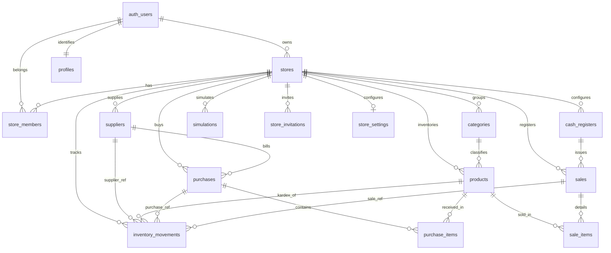

# INFORME TÉCNICO DE ARQUITECTURA Y DESARROLLO: RENTABILL
**Versión:** 3.3.0  
**Fecha:** Octubre 2026  
**Autor:** Arquitectura de Software Senior & DBA Especialista en PostgreSQL  
**Destinatarios:** Equipo de Ingeniería, Docentes Evaluadores y Nuevos Desarrolladores  
**Tecnologías:** React 19, TypeScript, Vite, Tailwind CSS, Supabase (PostgreSQL 17 + Auth + Storage + Realtime + RPC), Capacitor 8 (Android Nativo)

---

## 1. RESUMEN DEL SISTEMA

**Rentabill** es una plataforma móvil progresiva convertida a Android nativo mediante Capacitor, diseñada específicamente para el microcomercio minorista tradicional peruano (bodegas, minimarkets, ferreterías, boticas y tiendas de abarrotes con productos de código de barras y artículos vendidos al peso).

A diferencia de los terminales punto de venta (POS) convencionales que operan como registradoras pasivas de cobro, Rentabill implementa un motor financiero algorítmico que traduce el inventario físico y las transacciones en mostrador en indicadores de liquidez, rotación y rendimiento del capital de trabajo en tiempo real.

### Principios Fundamentales del Sistema:
1. **Modelo de Rentabilidad Progresiva:** En el alta de un artículo, el margen unitario bruto es conocido con precisión matemática ($P_{\text{venta}} - P_{\text{costo}}$), pero la velocidad de rotación es una incógnita. El sistema resuelve el arranque en frío mediante una estimación manual inicial declarada por el comerciante (`estimatedSpeed`: Rápido 30%/semana, Normal 15%/semana, Lento 5%/semana), la cual es sustituida automáticamente por la velocidad real de mostrador en cuanto el producto alcanza **5 tickets de venta (`salesCount >= 5`) o 30 días de antigüedad** (transición a estado `REAL`).
2. **Puntaje de Salud Financiera (0–100):** Un índice heurístico compuesto que pondera en un 60% la calidad de los márgenes diarios y en un 40% la diversificación del capital sin estancamiento, clasificando la solvencia del negocio en un semáforo de tres estados: **Óptimo** ($\ge 80$), **Estable** ($50\text{–}79$) y **Crítico** ($< 50$).
3. **Arquitectura Multi-Tienda con RBAC por Sucursal:** Un único usuario autenticado puede pertenecer a múltiples bodegas simultáneamente con roles diferenciados e independientes (`ADMIN`, `CAJERO`, `REPOSITOR`), alternando de tienda sin cerrar sesión y con recálculo dinámico en caliente de vistas y contextos.
4. **3FN con Desnormalización Intencional en Totales y Snapshots:** Cajas registradoras aisladas en `cash_registers`, categorías por tienda en `categories`, proveedores en `suppliers`, compras en `purchases`, simulaciones en `simulations`, snapshots inmutables de costo, precio y nombres en `sale_items` y `inventory_movements`, totales derivados desnormalizados protegidos con constraints y validados en servidor por la función `process_sale()`.
5. **Localización Peruana Integral:** Moneda oficial en Soles (`PEN` en BD, formateado con `Intl.NumberFormat('es-PE', {style:'currency', currency:'PEN'})` mostrando `S/`), soporte para billeteras digitales (Yape, Plin, tarjeta, transferencia bancaria y QR del comercio `qr` configurado en `stores.qr_image_url`), y validación de celulares peruanos de 9 dígitos comenzando en 9 (`chk_profiles_phone_pe`).

---

## 2. INVENTARIO DE PANTALLAS Y COMPONENTES

### 2.1 Componente Header y Selector Multi-Tienda (Navegación Global)
* **Archivos:** [`src/components/Header.tsx`](file:///e:/Visitante/Downloads/Tarea-main/Tarea-main/src/components/Header.tsx), [`src/components/StoreSelectorModal.tsx`](file:///e:/Visitante/Downloads/Tarea-main/Tarea-main/src/components/StoreSelectorModal.tsx)
* **Función del componente:** `Header: React.FC`, `StoreSelectorModal: React.FC`
* **Elementos Visibles e Interacciones:**
  * **Cabecera Compacta:** Altura uniforme optimizada para pantallas táctiles de gama baja. Mantiene el logo corporativo con badge dinámico `EN VIVO` (o `OFFLINE`).
  * **Nombre de Tienda Activa:** Subtítulo interactivo bajo el rótulo "Rentabill" que muestra el nombre de la tienda activa acompañado de un glifo chevron (`ChevronDown`). Al pulsarlo despliega el bottom sheet `StoreSelectorModal`.
  * **Bottom Sheet "Mis Tiendas" (`createPortal`):** Renderizado en la raíz del documento (`document.body`) mediante `createPortal` con `z-index: 999`. Incluye lista de tiendas vinculadas con indicador de rol, rubro comercial, check verde en la activa y botón "Agregar tienda".
* **Lógica de Negocio y Transición:**
  * Al seleccionar una tienda distinta, se ejecuta `switchStore(storeId)` que invoca la función RPC remota `switch_store(p_store_id)` en Supabase.
  * **Purga y Recarga de Contexto:** Reinicia reactivamente los estados de `InventoryContext` vinculados al nuevo `store_id`.

---

### 2.2 Vista Pulso (Dashboard Financiero)
* **Archivo:** [`src/views/PulsoView.tsx`](file:///e:/Visitante/Downloads/Tarea-main/Tarea-main/src/views/PulsoView.tsx)
* **Función del componente:** `PulsoView: React.FC`
* **Elementos Visibles:**
  * Tacómetro radial SVG (`gauge`) con el Puntaje de Salud (0–100) y semáforo visual (`OPTIMAL`, `STABLE`, `CRITICAL`).
  * Indicador de Modo Semilla vs. Modo Calibrado (% de capital basado en datos reales vs. estimados).
  * Contador acumulado de tickets de venta emitidos.
  * **Tarjetas de Capital Disociado (Diseño Compacto Simétrico):**
    * **Dinero Invertido:** Título superior, badge "Total", monto monetario en Soles (`S/`) con formato `es-PE` y altura fija (`h-24 p-3.5`). Calculado como $\sum (\text{costPrice} \times \text{stockActual})$.
    * **Dinero Parado:** Título superior, badge "Sin vender", monto en Soles (`S/`) y porcentaje relativo inmovilizado en mercancía lenta.
  * Ganancia Diaria Promedio de la bodega comparada contra la meta diaria configurada.
  * Factores de Rendimiento: Ganancia por Venta (60% del peso) y Velocidad y Variedad (40% del peso).
  * Radar de Productos: Top 3 Productos Estrella (`starProducts`) y Top 3 Dinero Parado (`trappedCapitalProducts`).
* **Fórmulas Matemáticas:**
  * Dinero Invertido: $\sum (\text{costPrice} \times \text{stockActual})$. Si $\text{investedCapital} = 0$, $\text{dailyProfitPercent} = 0$.
  * Velocidad Real: $\frac{\text{unitsSold}}{\max(\text{días}, 1)}$.
  * Progreso a Calibración: $\min(100, \text{round}((\text{salesCount} / 5) \times 100))$.

---

### 2.3 Vista Inventario y Catálogo
* **Archivo:** [`src/views/InventarioView.tsx`](file:///e:/Visitante/Downloads/Tarea-main/Tarea-main/src/views/InventarioView.tsx)
* **Función del componente:** `InventarioView: React.FC`
* **Elementos Visibles:**
  * Buscador rápido por nombre, barcode y SKU. Filtro por categoría cargada relacionalmente desde `categories`.
  * Filtro por velocidad y ordenamiento multicriterio (Mayor ganancia diaria, Menor ganancia diaria, Mayor ganancia por venta).
  * Tarjetas de producto con badge de estado (`Real` vs `Estimado`), progreso de calibración (`salesCount / 5 tickets`), stock disponible, inversión actual y margen unitario.
  * Edición de producto y **Archivado Lógico (`archived_at`)**: Los productos con ventas previas no se borran físicamente para no corromper la integridad referencial, liberando el código de barras para ser reutilizado en el futuro.

---

### 2.4 Vista POS / Vender (Punto de Venta)
* **Archivo:** [`src/views/POSView.tsx`](file:///e:/Visitante/Downloads/Tarea-main/Tarea-main/src/views/POSView.tsx)
* **Función del componente:** `POSView: React.FC`
* **Elementos Visibles e Interacciones:**
  * Escáner de código de barras, búsqueda en tiempo real y selector de artículos rápidos.
  * Báscula digital (`BulkScaleWidget`) para artículos vendidos al peso (`kg`), permitiendo cantidades fraccionarias (ej. 0.333 kg).
  * Validación preventiva de stock en vivo: Si una línea supera el stock disponible, se muestra alerta ámbar y botón "Usar máximo disponible".
  * Cobro multi-método: Efectivo (con cálculo de vuelto en servidor), tarjeta, yape, plin, transferencia y QR del comercio (`qr`).
  * Invocación segura mediante RPC `process_sale` con 6 parámetros, delegando la generación del ticket y la asignación de caja al servidor.

---

### 2.5 Vista Historial y Kardex
* **Archivo:** [`src/views/HistorialView.tsx`](file:///e:/Visitante/Downloads/Tarea-main/Tarea-main/src/views/HistorialView.tsx)
* **Función del componente:** `HistorialView: React.FC`
* **Elementos Visibles:**
  * Sub-pestañas: **Ventas** (tickets emitidos, detalle de partidas, cajero responsable, ganancia neta) y **Movimientos de Stock / Kardex** (`VENTA`, `COMPRA`, `AJUSTE`).
  * Modal de Ajuste Manual de Inventario con motivo obligatorio (`note`), ejecutado atómicamente en servidor mediante la función `adjust_stock`.

---

## 3. MODELO DE DATOS TYPESCRIPT ACTUALIZADO

Definiciones de tipos sincronizadas en [`src/types.ts`](file:///e:/Visitante/Downloads/Tarea-main/Tarea-main/src/types.ts):

```typescript
export type SpeedCategory = 'RAPIDO' | 'NORMAL' | 'LENTO';
export type ProductStatus = 'ESTIMADO' | 'REAL';
export type ProductUnit = 'pza' | 'kg' | 'lt' | 'caja';
export type UserRole = 'ADMIN' | 'CAJERO' | 'REPOSITOR';
export type InvitationStatus = 'PENDIENTE' | 'ACEPTADA' | 'EXPIRADA' | 'CANCELADA';
export type MovementType = 'COMPRA' | 'VENTA' | 'AJUSTE';
export type PaymentMethod = 'efectivo' | 'tarjeta' | 'yape' | 'plin' | 'transferencia' | 'qr';

// 1. Cajas Registradoras (1FN)
export interface CashRegister {
  id: string;
  storeId: string;
  name: string;
  isActive: boolean;
  createdAt?: string;
}

// 2. Categorías por Tienda
export interface Category {
  id: string;
  storeId: string;
  name: string;
  createdAt?: string;
}

// 3. Catálogo de Productos
export interface Product {
  id: string;
  storeId: string;
  categoryId: string;
  categoryName?: string;
  barcode: string;
  name: string;
  unit: ProductUnit;
  costPrice: number;
  salePrice: number;
  stock: number;
  reorderPoint?: number;
  estimatedSpeed?: SpeedCategory | null;
  unitsSold: number;
  salesCount: number;
  createdDaysAgo: number;
  status: ProductStatus;
  imageUrl?: string;
  sku?: string;
  archivedAt?: string | null;
  createdAt?: string;
  updatedAt?: string;
}

// 4. Métricas Financieras Calculadas
export interface CalculatedProductMetrics extends Product {
  unitMarginDollar: number;
  unitMarginAmount: number;
  unitMarginPercent: number;
  investedCapital: number;
  dailyVelocity: number;
  dailyProfitDollar: number;
  dailyProfitAmount: number;
  dailyProfitPercent: number;
  isSlow: boolean;
  progressToReal: number;
  salesUntilReal: number;
  velocityLabel: string;
  hasManualClassification: boolean;
}

// 5. Configuración de Tienda
export interface StoreConfig {
  id?: string;
  name: string;
  type: 'Abarrotes' | 'Ropa' | 'Farmacia' | 'Ferretería' | 'Otro';
  logoUrl?: string;
  qrImageUrl?: string;
  currency: string;
  ownerId?: string;
  cashRegisters?: CashRegister[];
}

// 6. Tickets y Partidas de Venta
export interface SaleItem {
  productId: string;
  productName: string;
  quantity: number;
  unitPrice: number;
  unitCost: number;
  subtotal: number;
  profit: number;
}

export interface SaleRecord {
  id: string;
  registerId: string;
  ticketNumber: string;
  timestamp: string;
  items: SaleItem[];
  totalQuantity: number;
  totalAmount: number;
  totalProfit: number;
  paymentMethod: PaymentMethod;
  cashGiven?: number;
  changeGiven?: number;
  cashierName: string;
}

// 7. Kardex de Movimientos
export interface InventoryMovement {
  id: string;
  timestamp: string;
  type: MovementType;
  productId: string;
  productName: string;
  quantity: number;
  previousStock: number;
  newStock: number;
  userName: string;
  note?: string;
  supplierName?: string;
  supplierId?: string;
  saleId?: string;
  purchaseId?: string;
  userId?: string;
}
```

---

## 4. ARQUITECTURA DE BASE DE DATOS POSTGRESQL (SUPABASE v3.3.0)

El esquema opera sobre **PostgreSQL 17 en Supabase**, integrando aislamiento estricto por tienda (`store_id`), normalización en Tercera Forma Normal (3FN), claves foráneas compuestas, índices de expresión `lower(name)`, triggers de inmutabilidad, y Row Level Security (RLS) forzado en todas las tablas públicas.



### 4.1 Tablas

```sql
-- 1. TABLAS
-- ------------------------------------------------------------------------------

-- 1.1 Tiendas / Sucursales
CREATE TABLE IF NOT EXISTS public.stores (
    id UUID PRIMARY KEY DEFAULT gen_random_uuid(),
    owner_id UUID REFERENCES auth.users(id) ON DELETE SET NULL,
    name TEXT NOT NULL,
    type TEXT NOT NULL DEFAULT 'Abarrotes' CHECK (type IN ('Abarrotes', 'Ropa', 'Farmacia', 'Ferretería', 'Otro')),
    currency TEXT NOT NULL DEFAULT 'PEN' CHECK (currency ~ '^[A-Z]{3}$'),
    logo_url TEXT,
    qr_image_url TEXT,
    created_at TIMESTAMPTZ NOT NULL DEFAULT now(),
    updated_at TIMESTAMPTZ NOT NULL DEFAULT now()
);

-- 1.2 Membresías Multi-Tienda (RBAC)
CREATE TABLE IF NOT EXISTS public.store_members (
    store_id UUID NOT NULL REFERENCES public.stores(id) ON DELETE CASCADE,
    user_id UUID NOT NULL REFERENCES auth.users(id) ON DELETE CASCADE,
    role TEXT NOT NULL CHECK (role IN ('ADMIN', 'CAJERO', 'REPOSITOR')),
    joined_at TIMESTAMPTZ NOT NULL DEFAULT now(),
    PRIMARY KEY (user_id, store_id)
);

-- 1.3 Perfiles de Usuario
CREATE TABLE IF NOT EXISTS public.profiles (
    id UUID PRIMARY KEY REFERENCES auth.users(id) ON DELETE CASCADE,
    user_code TEXT NOT NULL UNIQUE,
    name TEXT NOT NULL,
    email TEXT,
    phone TEXT,
    avatar TEXT,
    active_store_id UUID,
    created_at TIMESTAMPTZ NOT NULL DEFAULT now(),
    updated_at TIMESTAMPTZ NOT NULL DEFAULT now(),
    CONSTRAINT chk_profiles_user_code CHECK (user_code ~ '^RENT-[0-9A-Z]{4}$'),
    CONSTRAINT chk_profiles_phone_pe CHECK (phone IS NULL OR phone ~ '^9[0-9]{8}$'),
    CONSTRAINT fk_profiles_active_store FOREIGN KEY (id, active_store_id) 
        REFERENCES public.store_members(user_id, store_id) ON DELETE SET NULL (active_store_id)
);

-- 1.4 Cajas Registradoras (1FN)
CREATE TABLE IF NOT EXISTS public.cash_registers (
    id UUID PRIMARY KEY DEFAULT gen_random_uuid(),
    store_id UUID NOT NULL REFERENCES public.stores(id) ON DELETE CASCADE,
    name TEXT NOT NULL,
    is_active BOOLEAN NOT NULL DEFAULT true,
    created_at TIMESTAMPTZ NOT NULL DEFAULT now(),
    updated_at TIMESTAMPTZ NOT NULL DEFAULT now(),
    CONSTRAINT uq_cash_registers_store_name UNIQUE (store_id, name),
    CONSTRAINT uq_cash_registers_store_id UNIQUE (store_id, id)
);

-- 1.5 Categorías por Tienda
CREATE TABLE IF NOT EXISTS public.categories (
    id UUID PRIMARY KEY DEFAULT gen_random_uuid(),
    store_id UUID NOT NULL REFERENCES public.stores(id) ON DELETE CASCADE,
    name TEXT NOT NULL,
    created_at TIMESTAMPTZ NOT NULL DEFAULT now(),
    updated_at TIMESTAMPTZ NOT NULL DEFAULT now(),
    CONSTRAINT uq_categories_store_id UNIQUE (store_id, id)
);

-- 1.6 Proveedores
CREATE TABLE IF NOT EXISTS public.suppliers (
    id UUID PRIMARY KEY DEFAULT gen_random_uuid(),
    store_id UUID NOT NULL REFERENCES public.stores(id) ON DELETE CASCADE,
    name TEXT NOT NULL,
    payment_condition TEXT NOT NULL CHECK (payment_condition IN ('contado', 'credito')),
    credit_days INTEGER NOT NULL DEFAULT 0 CHECK (credit_days >= 0),
    contact_phone TEXT,
    rubro TEXT,
    archived_at TIMESTAMPTZ DEFAULT NULL,
    created_at TIMESTAMPTZ NOT NULL DEFAULT now(),
    updated_at TIMESTAMPTZ NOT NULL DEFAULT now(),
    CONSTRAINT uq_suppliers_store_id UNIQUE (store_id, id),
    CONSTRAINT chk_suppliers_contact_phone_pe CHECK (contact_phone IS NULL OR contact_phone ~ '^9[0-9]{8}$')
);

-- 1.7 Catálogo de Productos (3FN Normalizado)
CREATE TABLE IF NOT EXISTS public.products (
    id UUID PRIMARY KEY DEFAULT gen_random_uuid(),
    store_id UUID NOT NULL REFERENCES public.stores(id) ON DELETE CASCADE,
    category_id UUID NOT NULL,
    barcode TEXT NOT NULL,
    sku TEXT,
    name TEXT NOT NULL,
    unit TEXT NOT NULL DEFAULT 'pza' CHECK (unit IN ('pza', 'kg', 'lt', 'caja')),
    cost_price NUMERIC(12,2) NOT NULL CHECK (cost_price >= 0),
    sale_price NUMERIC(12,2) NOT NULL CHECK (sale_price >= 0),
    stock NUMERIC(12,3) NOT NULL DEFAULT 0 CHECK (stock >= 0),
    reorder_point NUMERIC(12,3) NOT NULL DEFAULT 0 CHECK (reorder_point >= 0),
    estimated_speed TEXT CHECK (estimated_speed IN ('RAPIDO', 'NORMAL', 'LENTO') OR estimated_speed IS NULL),
    units_sold NUMERIC(12,3) NOT NULL DEFAULT 0 CHECK (units_sold >= 0),
    sales_count INTEGER NOT NULL DEFAULT 0 CHECK (sales_count >= 0),
    status TEXT NOT NULL DEFAULT 'ESTIMADO' CHECK (status IN ('ESTIMADO', 'REAL')),
    image_url TEXT,
    archived_at TIMESTAMPTZ DEFAULT NULL,
    created_at TIMESTAMPTZ NOT NULL DEFAULT now(),
    updated_at TIMESTAMPTZ NOT NULL DEFAULT now(),
    CONSTRAINT uq_products_store_id UNIQUE (store_id, id),
    CONSTRAINT fk_products_categories_store FOREIGN KEY (store_id, category_id) 
        REFERENCES public.categories(store_id, id) ON DELETE NO ACTION
);

-- 1.8 Compras (RF03)
CREATE TABLE IF NOT EXISTS public.purchases (
    id UUID PRIMARY KEY DEFAULT gen_random_uuid(),
    store_id UUID NOT NULL REFERENCES public.stores(id) ON DELETE CASCADE,
    supplier_id UUID,
    total NUMERIC(12,2) NOT NULL DEFAULT 0 CHECK (total >= 0),
    created_by UUID REFERENCES auth.users(id) ON DELETE SET NULL,
    created_at TIMESTAMPTZ NOT NULL DEFAULT now(),
    note TEXT,
    CONSTRAINT uq_purchases_store_id UNIQUE (store_id, id),
    CONSTRAINT fk_purchases_suppliers_store FOREIGN KEY (store_id, supplier_id) 
        REFERENCES public.suppliers(store_id, id) ON DELETE SET NULL (supplier_id)
);

-- 1.9 Partidas de Compra
CREATE TABLE IF NOT EXISTS public.purchase_items (
    id UUID PRIMARY KEY DEFAULT gen_random_uuid(),
    store_id UUID NOT NULL,
    purchase_id UUID NOT NULL,
    product_id UUID NOT NULL,
    quantity NUMERIC(12,3) NOT NULL CHECK (quantity > 0),
    unit_cost NUMERIC(12,2) NOT NULL CHECK (unit_cost >= 0),
    subtotal NUMERIC(12,2) GENERATED ALWAYS AS (ROUND(quantity * unit_cost, 2)) STORED,
    CONSTRAINT fk_purchase_items_purchases_store FOREIGN KEY (store_id, purchase_id) 
        REFERENCES public.purchases(store_id, id) ON DELETE CASCADE,
    CONSTRAINT fk_purchase_items_products_store FOREIGN KEY (store_id, product_id) 
        REFERENCES public.products(store_id, id) ON DELETE NO ACTION
);

-- 1.10 Tickets de Venta
CREATE TABLE IF NOT EXISTS public.sales (
    id UUID PRIMARY KEY DEFAULT gen_random_uuid(),
    store_id UUID NOT NULL REFERENCES public.stores(id) ON DELETE CASCADE,
    register_id UUID NOT NULL,
    ticket_number TEXT NOT NULL,
    total_quantity NUMERIC(12,3) NOT NULL CHECK (total_quantity > 0),
    total_amount NUMERIC(12,2) NOT NULL CHECK (total_amount >= 0),
    total_profit NUMERIC(12,2) NOT NULL,
    payment_method TEXT NOT NULL,
    cash_given NUMERIC(12,2),
    change_given NUMERIC(12,2) DEFAULT 0,
    cashier_name TEXT NOT NULL,
    user_id UUID REFERENCES auth.users(id) ON DELETE SET NULL,
    created_at TIMESTAMPTZ NOT NULL DEFAULT now(),
    CONSTRAINT uq_sales_store_ticket UNIQUE (store_id, ticket_number),
    CONSTRAINT uq_sales_store_id UNIQUE (store_id, id),
    CONSTRAINT fk_sales_cash_registers_store FOREIGN KEY (store_id, register_id) 
        REFERENCES public.cash_registers(store_id, id) ON DELETE NO ACTION,
    CONSTRAINT chk_sales_payment_exact CHECK (
        (payment_method = 'efectivo' AND cash_given IS NOT NULL AND cash_given >= total_amount AND change_given = cash_given - total_amount)
        OR
        (payment_method IN ('tarjeta', 'yape', 'plin', 'transferencia', 'qr') AND cash_given IS NULL AND change_given = 0)
    )
);

COMMENT ON COLUMN public.sales.payment_method IS 
'Método de cobro: efectivo, tarjeta, yape, plin, transferencia o qr (QR del comercio basado en stores.qr_image_url).';

-- 1.11 Partidas de Venta (Inmutables)
CREATE TABLE IF NOT EXISTS public.sale_items (
    id UUID PRIMARY KEY DEFAULT gen_random_uuid(),
    store_id UUID NOT NULL,
    sale_id UUID NOT NULL,
    product_id UUID,
    product_name TEXT NOT NULL,
    quantity NUMERIC(12,3) NOT NULL CHECK (quantity > 0),
    unit_price NUMERIC(12,2) NOT NULL CHECK (unit_price >= 0),
    unit_cost NUMERIC(12,2) NOT NULL CHECK (unit_cost >= 0),
    subtotal NUMERIC(12,2) NOT NULL CHECK (subtotal = round(quantity * unit_price, 2)),
    profit NUMERIC(12,2) NOT NULL CHECK (profit = subtotal - round(quantity * unit_cost, 2)),
    CONSTRAINT fk_sale_items_sales_store FOREIGN KEY (store_id, sale_id) 
        REFERENCES public.sales(store_id, id) ON DELETE CASCADE,
    CONSTRAINT fk_sale_items_products_store FOREIGN KEY (store_id, product_id) 
        REFERENCES public.products(store_id, id) ON DELETE SET NULL (product_id)
);

-- 1.12 Kardex de Movimientos
CREATE TABLE IF NOT EXISTS public.inventory_movements (
    id UUID PRIMARY KEY DEFAULT gen_random_uuid(),
    store_id UUID NOT NULL REFERENCES public.stores(id) ON DELETE CASCADE,
    product_id UUID,
    product_name TEXT NOT NULL,
    type TEXT NOT NULL CHECK (type IN ('COMPRA', 'VENTA', 'AJUSTE')),
    quantity NUMERIC(12,3) NOT NULL,
    previous_stock NUMERIC(12,3) NOT NULL,
    new_stock NUMERIC(12,3) NOT NULL,
    sale_id UUID,
    purchase_id UUID,
    supplier_id UUID,
    user_id UUID REFERENCES auth.users(id) ON DELETE SET NULL,
    user_name TEXT NOT NULL,
    note TEXT,
    created_at TIMESTAMPTZ NOT NULL DEFAULT now(),
    CONSTRAINT chk_kardex_stock_math CHECK (new_stock = previous_stock + quantity),
    CONSTRAINT chk_kardex_consistency CHECK (
        (type = 'VENTA' AND sale_id IS NOT NULL AND quantity < 0)
        OR
        (type = 'COMPRA' AND purchase_id IS NOT NULL AND quantity > 0)
        OR
        (type = 'AJUSTE' AND note IS NOT NULL AND length(trim(note)) > 0 AND quantity <> 0)
    ),
    CONSTRAINT fk_movements_products_store FOREIGN KEY (store_id, product_id) 
        REFERENCES public.products(store_id, id) ON DELETE SET NULL (product_id),
    CONSTRAINT fk_movements_sales_store FOREIGN KEY (store_id, sale_id) 
        REFERENCES public.sales(store_id, id) ON DELETE CASCADE,
    CONSTRAINT fk_movements_purchases_store FOREIGN KEY (store_id, purchase_id) 
        REFERENCES public.purchases(store_id, id) ON DELETE SET NULL (purchase_id),
    CONSTRAINT fk_movements_suppliers_store FOREIGN KEY (store_id, supplier_id) 
        REFERENCES public.suppliers(store_id, id) ON DELETE SET NULL (supplier_id)
);

-- 1.13 Simulaciones
CREATE TABLE IF NOT EXISTS public.simulations (
    id UUID PRIMARY KEY DEFAULT gen_random_uuid(),
    store_id UUID NOT NULL REFERENCES public.stores(id) ON DELETE CASCADE,
    created_by UUID REFERENCES auth.users(id) ON DELETE SET NULL,
    parameters JSONB NOT NULL DEFAULT '{}'::jsonb,
    projected_result JSONB NOT NULL DEFAULT '{}'::jsonb,
    actual_result JSONB DEFAULT NULL,
    status TEXT NOT NULL DEFAULT 'PENDIENTE' CHECK (status IN ('PENDIENTE', 'APLICADA', 'DESCARTADA')),
    created_at TIMESTAMPTZ NOT NULL DEFAULT now(),
    CONSTRAINT uq_simulations_store_id UNIQUE (store_id, id)
);

-- 1.14 Invitaciones de Equipo
CREATE TABLE IF NOT EXISTS public.store_invitations (
    id UUID PRIMARY KEY DEFAULT gen_random_uuid(),
    store_id UUID NOT NULL REFERENCES public.stores(id) ON DELETE CASCADE,
    email TEXT NOT NULL,
    role TEXT NOT NULL CHECK (role IN ('ADMIN', 'CAJERO', 'REPOSITOR')),
    token TEXT NOT NULL DEFAULT encode(gen_random_bytes(24), 'hex'),
    status TEXT NOT NULL DEFAULT 'PENDIENTE' CHECK (status IN ('PENDIENTE', 'ACEPTADA', 'EXPIRADA', 'CANCELADA')),
    invited_by UUID REFERENCES auth.users(id) ON DELETE SET NULL,
    expires_at TIMESTAMPTZ NOT NULL DEFAULT (now() + interval '7 days'),
    accepted_at TIMESTAMPTZ,
    created_at TIMESTAMPTZ NOT NULL DEFAULT now(),
    CONSTRAINT uq_store_invitations_token UNIQUE (token),
    CONSTRAINT uq_store_invitations_store_id UNIQUE (store_id, id)
);

-- 1.15 Configuración de Tienda
CREATE TABLE IF NOT EXISTS public.store_settings (
    store_id UUID PRIMARY KEY REFERENCES public.stores(id) ON DELETE CASCADE,
    daily_goal NUMERIC(12,2) NOT NULL DEFAULT 0 CHECK (daily_goal >= 0),
    warn_slow_days INTEGER NOT NULL DEFAULT 15 CHECK (warn_slow_days >= 0),
    warn_low_stock INTEGER NOT NULL DEFAULT 5 CHECK (warn_low_stock >= 0),
    auto_backup BOOLEAN NOT NULL DEFAULT true,
    updated_at TIMESTAMPTZ NOT NULL DEFAULT now()
);

-- ------------------------------------------------------------------------------
```


### 4.2 Índices y Vistas

```sql
-- 2. ÍNDICES Y VISTAS
-- ------------------------------------------------------------------------------

-- 2.1 Índices de unicidad y cobertura
CREATE INDEX IF NOT EXISTS idx_store_members_store_id ON public.store_members(store_id);
CREATE INDEX IF NOT EXISTS idx_store_members_user_id ON public.store_members(user_id);

CREATE INDEX IF NOT EXISTS idx_profiles_user_code ON public.profiles(user_code);
CREATE INDEX IF NOT EXISTS idx_profiles_active_store ON public.profiles(active_store_id);

CREATE INDEX IF NOT EXISTS idx_cash_registers_store_id ON public.cash_registers(store_id);

CREATE UNIQUE INDEX IF NOT EXISTS uq_categories_store_lower_name 
ON public.categories (store_id, lower(name));
CREATE INDEX IF NOT EXISTS idx_categories_store_id ON public.categories(store_id);

CREATE UNIQUE INDEX IF NOT EXISTS uq_suppliers_store_lower_name 
ON public.suppliers (store_id, lower(name)) 
WHERE (archived_at IS NULL);
CREATE INDEX IF NOT EXISTS idx_suppliers_store_id ON public.suppliers(store_id);

CREATE UNIQUE INDEX IF NOT EXISTS uq_products_store_barcode 
ON public.products(store_id, barcode) 
WHERE (archived_at IS NULL);
CREATE UNIQUE INDEX IF NOT EXISTS uq_products_store_sku 
ON public.products(store_id, sku) 
WHERE (sku IS NOT NULL AND archived_at IS NULL);
CREATE UNIQUE INDEX IF NOT EXISTS uq_products_store_lower_name 
ON public.products (store_id, lower(name)) 
WHERE (archived_at IS NULL);
CREATE INDEX IF NOT EXISTS idx_products_store_id ON public.products(store_id);
CREATE INDEX IF NOT EXISTS idx_products_category_id ON public.products(store_id, category_id);

CREATE INDEX IF NOT EXISTS idx_purchases_store_id ON public.purchases(store_id);
CREATE INDEX IF NOT EXISTS idx_purchases_supplier_id ON public.purchases(store_id, supplier_id);
CREATE INDEX IF NOT EXISTS idx_purchases_created_at ON public.purchases(store_id, created_at DESC);

CREATE INDEX IF NOT EXISTS idx_purchase_items_purchase ON public.purchase_items(store_id, purchase_id);
CREATE INDEX IF NOT EXISTS idx_purchase_items_product ON public.purchase_items(store_id, product_id);

CREATE INDEX IF NOT EXISTS idx_sales_store_id ON public.sales(store_id);
CREATE INDEX IF NOT EXISTS idx_sales_created_at ON public.sales(store_id, created_at DESC);
CREATE INDEX IF NOT EXISTS idx_sales_user_id ON public.sales(store_id, user_id);

CREATE INDEX IF NOT EXISTS idx_sale_items_sale_id ON public.sale_items(store_id, sale_id);
CREATE INDEX IF NOT EXISTS idx_sale_items_product_id ON public.sale_items(store_id, product_id);

CREATE INDEX IF NOT EXISTS idx_movements_store_id ON public.inventory_movements(store_id);
CREATE INDEX IF NOT EXISTS idx_movements_product_id ON public.inventory_movements(store_id, product_id);
CREATE INDEX IF NOT EXISTS idx_movements_created_at ON public.inventory_movements(store_id, created_at DESC);

CREATE INDEX IF NOT EXISTS idx_simulations_store_id ON public.simulations(store_id);

CREATE UNIQUE INDEX IF NOT EXISTS uq_store_invitations_pending 
ON public.store_invitations (store_id, lower(email)) 
WHERE (status = 'PENDIENTE');
CREATE INDEX IF NOT EXISTS idx_store_invitations_token ON public.store_invitations(token);
CREATE INDEX IF NOT EXISTS idx_store_invitations_email ON public.store_invitations(lower(email));

-- 2.2 Vistas con security_invoker
CREATE OR REPLACE VIEW public.product_stats AS
SELECT 
    p.id,
    p.store_id,
    p.category_id,
    c.name AS category_name,
    p.barcode,
    p.sku,
    p.name,
    p.unit,
    p.cost_price,
    p.sale_price,
    p.stock,
    p.reorder_point,
    p.estimated_speed,
    p.units_sold,
    p.sales_count,
    GREATEST(EXTRACT(day FROM now() - p.created_at)::integer, 0) AS created_days_ago,
    CASE
        WHEN p.sales_count >= 5 OR EXTRACT(day FROM now() - p.created_at) >= 30 THEN 'REAL'::text
        ELSE 'ESTIMADO'::text
    END AS status,
    p.image_url,
    p.archived_at,
    p.created_at,
    p.updated_at
FROM public.products p
LEFT JOIN public.categories c ON c.store_id = p.store_id AND c.id = p.category_id;

ALTER VIEW public.product_stats SET (security_invoker = true);

-- ------------------------------------------------------------------------------
```


### 4.3 Triggers

```sql
-- 3. TRIGGERS
-- ------------------------------------------------------------------------------

-- 3.1 Inmutabilidad de user_code
CREATE OR REPLACE FUNCTION public.protect_user_code()
RETURNS trigger
LANGUAGE plpgsql
SECURITY DEFINER
SET search_path = ''
AS $$
BEGIN
    IF OLD.user_code IS NOT NULL AND NEW.user_code IS DISTINCT FROM OLD.user_code THEN
        RAISE EXCEPTION 'El código de usuario es inmutable' USING ERRCODE = 'P0001';
    END IF;
    RETURN NEW;
END;
$$;

DROP TRIGGER IF EXISTS trg_protect_user_code ON public.profiles;
CREATE TRIGGER trg_protect_user_code
BEFORE UPDATE ON public.profiles
FOR EACH ROW EXECUTE FUNCTION public.protect_user_code();

-- 3.2 Protección del último administrador y dueño
CREATE OR REPLACE FUNCTION public.check_last_store_admin()
RETURNS trigger
LANGUAGE plpgsql
SECURITY DEFINER
SET search_path = ''
AS $$
DECLARE
    v_owner_id UUID;
BEGIN
    IF NOT EXISTS (SELECT 1 FROM public.stores WHERE id = OLD.store_id) THEN
        RETURN OLD;
    END IF;

    SELECT owner_id INTO v_owner_id FROM public.stores WHERE id = OLD.store_id;

    IF OLD.user_id = v_owner_id AND (TG_OP = 'DELETE' OR NEW.role <> 'ADMIN') THEN
        RAISE EXCEPTION 'No se puede eliminar ni degradar al propietario del negocio' USING ERRCODE = 'P0001';
    END IF;

    IF OLD.role = 'ADMIN' AND (TG_OP = 'DELETE' OR NEW.role <> 'ADMIN') THEN
        IF (
            SELECT count(*) 
            FROM public.store_members 
            WHERE store_id = OLD.store_id 
              AND role = 'ADMIN' 
              AND user_id <> OLD.user_id
        ) = 0 THEN
            RAISE EXCEPTION 'No se puede eliminar ni degradar al último administrador de la tienda' USING ERRCODE = 'P0001';
        END IF;
    END IF;

    RETURN COALESCE(NEW, OLD);
END;
$$;

DROP TRIGGER IF EXISTS trg_protect_last_admin ON public.store_members;
CREATE TRIGGER trg_protect_last_admin
BEFORE UPDATE OR DELETE ON public.store_members
FOR EACH ROW EXECUTE FUNCTION public.check_last_store_admin();

-- 3.3 Sincronización de email desde auth.users
CREATE OR REPLACE FUNCTION public.sync_profile_email()
RETURNS trigger
LANGUAGE plpgsql
SECURITY DEFINER
SET search_path = ''
AS $$
BEGIN
    UPDATE public.profiles
    SET email = NEW.email,
        updated_at = now()
    WHERE id = NEW.id;
    RETURN NEW;
END;
$$;

DROP TRIGGER IF EXISTS trg_sync_profile_email ON auth.users;
CREATE TRIGGER trg_sync_profile_email
AFTER UPDATE OF email ON auth.users
FOR EACH ROW EXECUTE FUNCTION public.sync_profile_email();

-- 3.4 Alta automática de perfil al registrar usuario en auth.users
CREATE OR REPLACE FUNCTION public.handle_new_user()
RETURNS trigger
LANGUAGE plpgsql
SECURITY DEFINER
SET search_path = ''
AS $$
DECLARE
    v_code TEXT;
    v_exists BOOLEAN;
    v_name TEXT;
BEGIN
    LOOP
        v_code := 'RENT-' || upper(substr(encode(gen_random_bytes(3), 'hex'), 1, 4));
        SELECT EXISTS(SELECT 1 FROM public.profiles WHERE user_code = v_code) INTO v_exists;
        EXIT WHEN NOT v_exists;
    END LOOP;

    v_name := COALESCE(
        NEW.raw_user_meta_data->>'name',
        NEW.raw_user_meta_data->>'full_name',
        split_part(NEW.email, '@', 1),
        'Usuario'
    );

    INSERT INTO public.profiles (
        id, user_code, name, email, phone, avatar
    ) VALUES (
        NEW.id,
        v_code,
        v_name,
        NEW.email,
        NEW.raw_user_meta_data->>'phone',
        NEW.raw_user_meta_data->>'avatar_url'
    ) ON CONFLICT (id) DO NOTHING;

    RETURN NEW;
END;
$$;

DROP TRIGGER IF EXISTS on_auth_user_created ON auth.users;
CREATE TRIGGER on_auth_user_created
AFTER INSERT ON auth.users
FOR EACH ROW EXECUTE FUNCTION public.handle_new_user();

-- 3.5 Registro de stock inicial en Kardex como AJUSTE
CREATE OR REPLACE FUNCTION public.trg_product_initial_stock()
RETURNS trigger
LANGUAGE plpgsql
SECURITY DEFINER
SET search_path = ''
AS $$
DECLARE
    v_actor_name TEXT;
BEGIN
    IF NEW.stock > 0 THEN
        SELECT COALESCE(name, 'Administrador') INTO v_actor_name
        FROM public.profiles
        WHERE id = auth.uid();

        INSERT INTO public.inventory_movements (
            store_id, product_id, product_name, type, quantity,
            previous_stock, new_stock, user_id, user_name, note
        ) VALUES (
            NEW.store_id, NEW.id, NEW.name, 'AJUSTE', NEW.stock,
            0, NEW.stock, auth.uid(), COALESCE(v_actor_name, 'Sistema'), 'Stock inicial'
        );
    END IF;
    RETURN NEW;
END;
$$;

DROP TRIGGER IF EXISTS trg_product_initial_stock_insert ON public.products;
CREATE TRIGGER trg_product_initial_stock_insert
AFTER INSERT ON public.products
FOR EACH ROW EXECUTE FUNCTION public.trg_product_initial_stock();

-- ------------------------------------------------------------------------------
```


### 4.4 Funciones RPC

```sql
-- 4. FUNCIONES RPC
-- ------------------------------------------------------------------------------

-- 4.1 public.is_store_member
CREATE OR REPLACE FUNCTION public.is_store_member(p_store_id UUID)
RETURNS BOOLEAN
LANGUAGE sql
SECURITY DEFINER
STABLE
SET search_path = ''
AS $$
    SELECT EXISTS (
        SELECT 1 
        FROM public.store_members 
        WHERE store_id = p_store_id 
          AND user_id = (SELECT auth.uid())
    );
$$;

-- 4.2 public.has_store_role
CREATE OR REPLACE FUNCTION public.has_store_role(p_store_id UUID, p_roles TEXT[])
RETURNS BOOLEAN
LANGUAGE sql
SECURITY DEFINER
STABLE
SET search_path = ''
AS $$
    SELECT EXISTS (
        SELECT 1 
        FROM public.store_members 
        WHERE store_id = p_store_id 
          AND user_id = (SELECT auth.uid())
          AND role = ANY(p_roles)
    );
$$;

-- 4.3 public.find_profile_by_code
CREATE OR REPLACE FUNCTION public.find_profile_by_code(user_code TEXT)
RETURNS TABLE (
    id UUID,
    name TEXT,
    user_code TEXT
)
LANGUAGE sql
SECURITY DEFINER
STABLE
SET search_path = ''
AS $$
    SELECT p.id, p.name, p.user_code
    FROM public.profiles p
    WHERE upper(p.user_code) = upper(trim(user_code))
    LIMIT 1;
$$;

-- 4.4 public.switch_store
CREATE OR REPLACE FUNCTION public.switch_store(
    p_store_id UUID
)
RETURNS JSONB
LANGUAGE plpgsql
SECURITY DEFINER
SET search_path = ''
AS $function$
DECLARE
    v_uid UUID := auth.uid();
    v_role TEXT;
BEGIN
    IF v_uid IS NULL THEN
        RAISE EXCEPTION 'Usuario no autenticado' USING ERRCODE = '42501';
    END IF;

    SELECT role INTO v_role
    FROM public.store_members
    WHERE store_id = p_store_id AND user_id = v_uid;

    IF v_role IS NULL THEN
        RAISE EXCEPTION 'No eres miembro de esta tienda' USING ERRCODE = '42501';
    END IF;

    UPDATE public.profiles
    SET active_store_id = p_store_id,
        updated_at = now()
    WHERE id = v_uid;

    RETURN jsonb_build_object(
        'success', true,
        'store_id', p_store_id,
        'role', v_role
    );
END;
$function$;

-- 4.5 public.create_store
CREATE OR REPLACE FUNCTION public.create_store(
    name TEXT,
    type TEXT DEFAULT 'Abarrotes',
    currency TEXT DEFAULT 'PEN'
)
RETURNS JSONB
LANGUAGE plpgsql
SECURITY DEFINER
SET search_path = ''
AS $function$
DECLARE
    v_uid UUID := auth.uid();
    v_store_id UUID;
    v_currency TEXT := COALESCE(NULLIF(trim(currency), ''), 'PEN');
    v_type TEXT := COALESCE(NULLIF(trim(type), ''), 'Abarrotes');
BEGIN
    IF v_uid IS NULL THEN
        RAISE EXCEPTION 'Usuario no autenticado' USING ERRCODE = '42501';
    END IF;

    IF name IS NULL OR trim(name) = '' THEN
        RAISE EXCEPTION 'El nombre de la tienda es obligatorio' USING ERRCODE = '22023';
    END IF;

    IF v_currency = 'S/' OR v_currency = 'PEN' THEN
        v_currency := 'PEN';
    ELSIF v_currency = '$' OR v_currency = 'USD' THEN
        v_currency := 'USD';
    ELSIF length(v_currency) <> 3 THEN
        v_currency := 'PEN';
    END IF;

    INSERT INTO public.stores (
        name, type, currency, owner_id
    ) VALUES (
        trim(name), v_type, v_currency, v_uid
    ) RETURNING id INTO v_store_id;

    INSERT INTO public.store_members (
        store_id, user_id, role, joined_at
    ) VALUES (
        v_store_id, v_uid, 'ADMIN', now()
    ) ON CONFLICT (user_id, store_id) DO UPDATE SET role = 'ADMIN';

    INSERT INTO public.store_settings (
        store_id, daily_goal, warn_slow_days, warn_low_stock, auto_backup
    ) VALUES (
        v_store_id, 0, 15, 5, true
    ) ON CONFLICT (store_id) DO NOTHING;

    INSERT INTO public.cash_registers (
        store_id, name, is_active
    ) VALUES (
        v_store_id, 'Caja 01 - Mostrador', true
    ) ON CONFLICT (store_id, name) DO NOTHING;

    INSERT INTO public.categories (
        store_id, name
    ) VALUES (
        v_store_id, 'General'
    ) ON CONFLICT (store_id, lower(name)) DO NOTHING;

    UPDATE public.profiles
    SET active_store_id = v_store_id
    WHERE id = v_uid AND active_store_id IS NULL;

    RETURN jsonb_build_object(
        'success', true,
        'id', v_store_id,
        'store_id', v_store_id,
        'name', trim(name)
    );
END;
$function$;

-- 4.6 public.accept_invitation
CREATE OR REPLACE FUNCTION public.accept_invitation(
    p_token TEXT
)
RETURNS JSONB
LANGUAGE plpgsql
SECURITY DEFINER
SET search_path = ''
AS $function$
DECLARE
    v_uid UUID := auth.uid();
    v_jwt_email TEXT;
    v_inv RECORD;
    v_store RECORD;
BEGIN
    IF v_uid IS NULL THEN
        RAISE EXCEPTION 'Usuario no autenticado' USING ERRCODE = '42501';
    END IF;

    v_jwt_email := lower(auth.jwt() ->> 'email');

    SELECT * INTO v_inv
    FROM public.store_invitations
    WHERE token = trim(p_token)
    FOR UPDATE;

    IF NOT FOUND THEN
        RETURN jsonb_build_object('success', false, 'error', 'no_encontrada');
    END IF;

    IF v_inv.status <> 'PENDIENTE' THEN
        RETURN jsonb_build_object('success', false, 'error', 'no_pendiente', 'status', v_inv.status);
    END IF;

    IF v_inv.expires_at < now() THEN
        UPDATE public.store_invitations 
        SET status = 'EXPIRADA' 
        WHERE id = v_inv.id;

        RETURN jsonb_build_object('success', false, 'error', 'expirada');
    END IF;

    IF v_jwt_email IS NOT NULL AND lower(v_inv.email) <> v_jwt_email THEN
        RAISE EXCEPTION 'Esta invitación está dirigida a otro correo electrónico' USING ERRCODE = '42501';
    END IF;

    SELECT * INTO v_store 
    FROM public.stores 
    WHERE id = v_inv.store_id;

    IF NOT FOUND THEN
        RETURN jsonb_build_object('success', false, 'error', 'tienda_inexistente');
    END IF;

    INSERT INTO public.store_members (
        store_id, user_id, role, joined_at
    ) VALUES (
        v_inv.store_id, v_uid, v_inv.role, now()
    )
    ON CONFLICT (user_id, store_id) 
    DO UPDATE SET role = EXCLUDED.role;

    UPDATE public.profiles
    SET active_store_id = COALESCE(active_store_id, v_inv.store_id)
    WHERE id = v_uid;

    UPDATE public.store_invitations
    SET status = 'ACEPTADA',
        accepted_at = now()
    WHERE id = v_inv.id;

    RETURN jsonb_build_object(
        'success', true,
        'store_id', v_inv.store_id,
        'store_name', v_store.name,
        'role', v_inv.role
    );
END;
$function$;

-- 4.7 public.adjust_stock
CREATE OR REPLACE FUNCTION public.adjust_stock(
    p_store_id UUID,
    p_product_id UUID,
    p_quantity_delta NUMERIC,
    p_note TEXT,
    p_user_name TEXT DEFAULT NULL
)
RETURNS JSONB
LANGUAGE plpgsql
SECURITY DEFINER
SET search_path = ''
AS $function$
DECLARE
    v_uid UUID := auth.uid();
    v_member_role TEXT;
    v_product RECORD;
    v_new_stock NUMERIC(12,3);
    v_actor_name TEXT;
BEGIN
    IF v_uid IS NULL THEN
        RAISE EXCEPTION 'Usuario no autenticado' USING ERRCODE = '42501';
    END IF;

    SELECT role INTO v_member_role
    FROM public.store_members
    WHERE store_id = p_store_id AND user_id = v_uid;

    IF v_member_role IS NULL OR v_member_role NOT IN ('ADMIN', 'REPOSITOR') THEN
        RAISE EXCEPTION 'Solo un Administrador o Repositor puede realizar ajustes de inventario' USING ERRCODE = '42501';
    END IF;

    IF p_note IS NULL OR length(trim(p_note)) = 0 THEN
        RAISE EXCEPTION 'El motivo o nota del ajuste es obligatorio' USING ERRCODE = '22023';
    END IF;

    IF p_quantity_delta IS NULL OR p_quantity_delta = 0 THEN
        RAISE EXCEPTION 'El delta de ajuste no puede ser cero' USING ERRCODE = '22023';
    END IF;

    SELECT COALESCE(p_user_name, name, 'Usuario') INTO v_actor_name
    FROM public.profiles
    WHERE id = v_uid;

    SELECT * INTO v_product
    FROM public.products
    WHERE store_id = p_store_id AND id = p_product_id
    FOR UPDATE;

    IF NOT FOUND THEN
        RAISE EXCEPTION 'Producto no encontrado en esta tienda' USING ERRCODE = '23503';
    END IF;

    v_new_stock := v_product.stock + p_quantity_delta;
    IF v_new_stock < 0 THEN
        RAISE EXCEPTION 'El ajuste resultaría en un stock negativo (%)', v_new_stock USING ERRCODE = '23514';
    END IF;

    INSERT INTO public.inventory_movements (
        store_id, product_id, product_name, type, quantity,
        previous_stock, new_stock, user_id, user_name, note
    ) VALUES (
        p_store_id, v_product.id, v_product.name, 'AJUSTE', p_quantity_delta,
        v_product.stock, v_new_stock, v_uid, v_actor_name, trim(p_note)
    );

    UPDATE public.products
    SET stock = v_new_stock,
        updated_at = now()
    WHERE id = v_product.id;

    RETURN jsonb_build_object(
        'success', true,
        'product_id', v_product.id,
        'previous_stock', v_product.stock,
        'new_stock', v_new_stock
    );
END;
$function$;

-- 4.8 public.process_sale (6 Parámetros)
CREATE OR REPLACE FUNCTION public.process_sale(
    p_store_id uuid,
    p_ticket_number text,
    p_payment_method text,
    p_cash_given numeric,
    p_items jsonb,
    p_register_id uuid DEFAULT NULL::uuid
)
RETURNS jsonb
LANGUAGE plpgsql
SECURITY DEFINER
SET search_path = ''
AS $function$
DECLARE
    v_uid UUID := auth.uid();
    v_member_role TEXT;
    v_cashier_name TEXT;
    v_reg_id UUID := p_register_id;
    v_sale_id UUID;
    v_item RECORD;
    v_product RECORD;
    v_total_amount NUMERIC(12,2) := 0;
    v_total_profit NUMERIC(12,2) := 0;
    v_total_qty NUMERIC(12,3) := 0;
    v_item_subtotal NUMERIC(12,2);
    v_item_profit NUMERIC(12,2);
    v_new_stock NUMERIC(12,3);
    v_new_units_sold NUMERIC(12,3);
    v_new_sales_count INTEGER;
    v_change_given NUMERIC(12,2) := 0;
    v_cash_given NUMERIC(12,2) := p_cash_given;
    v_ticket_num TEXT := p_ticket_number;
    v_calibrated_items JSONB := '[]'::jsonb;
    v_days_active INTEGER;
    v_will_be_real BOOLEAN;
    v_check_amount NUMERIC(12,2);
    v_check_profit NUMERIC(12,2);
    v_check_qty NUMERIC(12,3);
    v_product_ids UUID[];
BEGIN
    IF v_uid IS NULL THEN
        RAISE EXCEPTION 'Usuario no autenticado' USING ERRCODE = '42501';
    END IF;

    SELECT role INTO v_member_role
    FROM public.store_members
    WHERE store_id = p_store_id AND user_id = v_uid;

    IF v_member_role IS NULL THEN
        RAISE EXCEPTION 'No perteneces a esta tienda' USING ERRCODE = '42501';
    END IF;

    SELECT COALESCE(name, 'Cajero') INTO v_cashier_name
    FROM public.profiles
    WHERE id = v_uid;

    IF p_items IS NULL OR jsonb_array_length(p_items) = 0 THEN
        RAISE EXCEPTION 'La venta debe contener al menos un producto' USING ERRCODE = '22023';
    END IF;

    IF p_payment_method NOT IN ('efectivo', 'tarjeta', 'yape', 'plin', 'transferencia', 'qr') THEN
        RAISE EXCEPTION 'Método de pago inválido: %', p_payment_method USING ERRCODE = '22023';
    END IF;

    IF v_reg_id IS NULL THEN
        SELECT id INTO v_reg_id
        FROM public.cash_registers
        WHERE store_id = p_store_id AND is_active = true
        ORDER BY created_at ASC
        LIMIT 1;

        IF v_reg_id IS NULL THEN
            INSERT INTO public.cash_registers (store_id, name, is_active)
            VALUES (p_store_id, 'Caja 01 - Mostrador', true)
            ON CONFLICT (store_id, name) DO NOTHING;

            SELECT id INTO v_reg_id
            FROM public.cash_registers
            WHERE store_id = p_store_id AND is_active = true
            ORDER BY created_at ASC
            LIMIT 1;
        END IF;
    ELSE
        IF NOT EXISTS (
            SELECT 1 FROM public.cash_registers
            WHERE id = v_reg_id AND store_id = p_store_id AND is_active = true
        ) THEN
            RAISE EXCEPTION 'La caja registradora % no existe o está inactiva en esta tienda', v_reg_id USING ERRCODE = '23503';
        END IF;
    END IF;

    IF v_ticket_num IS NULL OR trim(v_ticket_num) = '' THEN
        PERFORM pg_advisory_xact_lock(hashtext('ticket_seq_' || p_store_id::text));
        v_ticket_num := 'T-' || to_char(now(), 'YYMMDD') || '-' ||
            lpad((COALESCE((
                SELECT substring(ticket_number FROM '[0-9]+$')::INTEGER
                FROM public.sales
                WHERE store_id = p_store_id AND created_at >= date_trunc('day', now())
                ORDER BY created_at DESC LIMIT 1
            ), 0) + 1)::TEXT, 4, '0');
    END IF;

    SELECT array_agg(DISTINCT (x->>'productId')::UUID ORDER BY (x->>'productId')::UUID)
    INTO v_product_ids
    FROM jsonb_array_elements(p_items) AS x;

    PERFORM 1
    FROM public.products
    WHERE store_id = p_store_id AND id = ANY(v_product_ids)
    ORDER BY id
    FOR UPDATE;

    FOR v_item IN
        SELECT (x->>'productId')::UUID AS product_id,
               SUM((x->>'quantity')::NUMERIC(12,3)) AS quantity
        FROM jsonb_array_elements(p_items) AS x
        GROUP BY (x->>'productId')::UUID
        ORDER BY (x->>'productId')::UUID
    LOOP
        SELECT * INTO v_product
        FROM public.products
        WHERE store_id = p_store_id AND id = v_item.product_id;

        IF NOT FOUND THEN
            RAISE EXCEPTION 'Producto % no encontrado en esta tienda', v_item.product_id USING ERRCODE = '23503';
        END IF;

        IF v_product.stock < v_item.quantity THEN
            RAISE EXCEPTION 'Stock insuficiente para el producto "%" (disponible: %, solicitado: %)',
                v_product.name, v_product.stock, v_item.quantity USING ERRCODE = 'P0001';
        END IF;

        v_item_subtotal := ROUND(v_product.sale_price * v_item.quantity, 2);
        v_item_profit   := v_item_subtotal - ROUND(v_product.cost_price * v_item.quantity, 2);

        v_total_amount := v_total_amount + v_item_subtotal;
        v_total_profit := v_total_profit + v_item_profit;
        v_total_qty    := v_total_qty + v_item.quantity;
    END LOOP;

    IF p_payment_method = 'efectivo' THEN
        IF v_cash_given IS NULL OR v_cash_given < v_total_amount THEN
            RAISE EXCEPTION 'Monto en efectivo insuficiente (recibido: %, total: %)', v_cash_given, v_total_amount USING ERRCODE = '22023';
        END IF;
        v_change_given := v_cash_given - v_total_amount;
    ELSE
        v_cash_given := NULL;
        v_change_given := 0;
    END IF;

    INSERT INTO public.sales (
        store_id, register_id, ticket_number, total_quantity, total_amount,
        total_profit, payment_method, cash_given, change_given, cashier_name, user_id
    ) VALUES (
        p_store_id, v_reg_id, v_ticket_num, v_total_qty, v_total_amount,
        v_total_profit, p_payment_method, v_cash_given, v_change_given, v_cashier_name, v_uid
    ) RETURNING id INTO v_sale_id;

    FOR v_item IN
        SELECT (x->>'productId')::UUID AS product_id,
               SUM((x->>'quantity')::NUMERIC(12,3)) AS quantity
        FROM jsonb_array_elements(p_items) AS x
        GROUP BY (x->>'productId')::UUID
        ORDER BY (x->>'productId')::UUID
    LOOP
        SELECT * INTO v_product FROM public.products WHERE id = v_item.product_id;

        v_item_subtotal   := ROUND(v_product.sale_price * v_item.quantity, 2);
        v_item_profit     := v_item_subtotal - ROUND(v_product.cost_price * v_item.quantity, 2);
        v_new_stock       := v_product.stock - v_item.quantity;
        v_new_units_sold  := v_product.units_sold + v_item.quantity;
        v_new_sales_count := v_product.sales_count + 1;
        v_days_active     := GREATEST(EXTRACT(DAY FROM (now() - v_product.created_at))::INTEGER, 1);
        v_will_be_real    := (v_new_sales_count >= 5 OR v_days_active >= 30);

        IF v_product.status = 'ESTIMADO' AND v_will_be_real THEN
            v_calibrated_items := v_calibrated_items || jsonb_build_object(
                'id', v_product.id,
                'name', v_product.name,
                'newUnitsSold', v_new_units_sold,
                'newSalesCount', v_new_sales_count,
                'newVelocity', ROUND((v_new_units_sold / v_days_active), 2)
            );
        END IF;

        INSERT INTO public.sale_items (
            sale_id, store_id, product_id, product_name, quantity,
            unit_price, unit_cost, subtotal, profit
        ) VALUES (
            v_sale_id, p_store_id, v_product.id, v_product.name, v_item.quantity,
            v_product.sale_price, v_product.cost_price, v_item_subtotal, v_item_profit
        );

        INSERT INTO public.inventory_movements (
            store_id, product_id, product_name, type, quantity,
            previous_stock, new_stock, sale_id, user_id, user_name, note
        ) VALUES (
            p_store_id, v_product.id, v_product.name, 'VENTA', -v_item.quantity,
            v_product.stock, v_new_stock, v_sale_id, v_uid, v_cashier_name,
            'Venta ' || v_ticket_num
        );

        UPDATE public.products
        SET stock = v_new_stock,
            units_sold = v_new_units_sold,
            sales_count = v_new_sales_count,
            status = CASE WHEN v_will_be_real THEN 'REAL' ELSE status END
        WHERE id = v_product.id;
    END LOOP;

    SELECT 
        COALESCE(SUM(subtotal), 0),
        COALESCE(SUM(profit), 0),
        COALESCE(SUM(quantity), 0)
    INTO v_check_amount, v_check_profit, v_check_qty
    FROM public.sale_items
    WHERE sale_id = v_sale_id;

    IF v_check_amount <> v_total_amount OR v_check_profit <> v_total_profit OR v_check_qty <> v_total_qty THEN
        RAISE EXCEPTION 'Error de integridad: los totales de la venta no coinciden con los items' USING ERRCODE = 'P0001';
    END IF;

    RETURN jsonb_build_object(
        'success', true,
        'sale_id', v_sale_id,
        'ticket_number', v_ticket_num,
        'total_amount', v_total_amount,
        'total_profit', v_total_profit,
        'change_given', v_change_given,
        'calibrated_items', v_calibrated_items
    );
END;
$function$;

-- 4.9 public.process_purchase (RF03)
CREATE OR REPLACE FUNCTION public.process_purchase(
    p_store_id UUID,
    p_supplier_id UUID,
    p_items JSONB,
    p_note TEXT DEFAULT NULL
)
RETURNS JSONB
LANGUAGE plpgsql
SECURITY DEFINER
SET search_path = ''
AS $function$
DECLARE
    v_uid UUID := auth.uid();
    v_member_role TEXT;
    v_creator_name TEXT;
    v_purchase_id UUID;
    v_item RECORD;
    v_product RECORD;
    v_total_amount NUMERIC(12,2) := 0;
    v_item_subtotal NUMERIC(12,2);
    v_new_stock NUMERIC(12,3);
    v_check_total NUMERIC(12,2);
    v_product_ids UUID[];
BEGIN
    IF v_uid IS NULL THEN
        RAISE EXCEPTION 'Usuario no autenticado' USING ERRCODE = '42501';
    END IF;

    SELECT role INTO v_member_role
    FROM public.store_members
    WHERE store_id = p_store_id AND user_id = v_uid;

    IF v_member_role IS NULL OR v_member_role <> 'ADMIN' THEN
        RAISE EXCEPTION 'Solo un Administrador puede registrar compras de inventario' USING ERRCODE = '42501';
    END IF;

    SELECT COALESCE(name, 'Administrador') INTO v_creator_name
    FROM public.profiles
    WHERE id = v_uid;

    IF p_items IS NULL OR jsonb_array_length(p_items) = 0 THEN
        RAISE EXCEPTION 'La compra debe contener al menos un producto' USING ERRCODE = '22023';
    END IF;

    IF p_supplier_id IS NOT NULL THEN
        IF NOT EXISTS (
            SELECT 1 FROM public.suppliers 
            WHERE store_id = p_store_id AND id = p_supplier_id
        ) THEN
            RAISE EXCEPTION 'El proveedor no existe o no pertenece a esta tienda' USING ERRCODE = '23503';
        END IF;
    END IF;

    SELECT array_agg(DISTINCT (x->>'product_id')::UUID ORDER BY (x->>'product_id')::UUID)
    INTO v_product_ids
    FROM jsonb_array_elements(p_items) AS x;

    PERFORM 1
    FROM public.products
    WHERE store_id = p_store_id AND id = ANY(v_product_ids)
    ORDER BY id
    FOR UPDATE;

    FOR v_item IN
        SELECT 
            (x->>'product_id')::UUID AS product_id,
            (x->>'quantity')::NUMERIC(12,3) AS quantity,
            (x->>'unit_cost')::NUMERIC(12,2) AS unit_cost
        FROM jsonb_array_elements(p_items) AS x
    LOOP
        IF v_item.quantity <= 0 THEN
            RAISE EXCEPTION 'La cantidad debe ser mayor a 0' USING ERRCODE = '22023';
        END IF;
        IF v_item.unit_cost < 0 THEN
            RAISE EXCEPTION 'El costo unitario no puede ser negativo' USING ERRCODE = '22023';
        END IF;

        SELECT * INTO v_product
        FROM public.products
        WHERE store_id = p_store_id AND id = v_item.product_id;

        IF NOT FOUND THEN
            RAISE EXCEPTION 'Producto % no encontrado en esta tienda', v_item.product_id USING ERRCODE = '23503';
        END IF;

        IF v_product.archived_at IS NOT NULL THEN
            RAISE EXCEPTION 'No se puede registrar compra para el producto archivado "%"', v_product.name USING ERRCODE = 'P0001';
        END IF;

        v_item_subtotal := ROUND(v_item.quantity * v_item.unit_cost, 2);
        v_total_amount := v_total_amount + v_item_subtotal;
    END LOOP;

    INSERT INTO public.purchases (
        store_id, supplier_id, total, created_by, note
    ) VALUES (
        p_store_id, p_supplier_id, v_total_amount, v_uid, p_note
    ) RETURNING id INTO v_purchase_id;

    FOR v_item IN
        SELECT 
            (x->>'product_id')::UUID AS product_id,
            SUM((x->>'quantity')::NUMERIC(12,3)) AS quantity,
            (x->>'unit_cost')::NUMERIC(12,2) AS unit_cost
        FROM jsonb_array_elements(p_items) AS x
        GROUP BY (x->>'product_id')::UUID, (x->>'unit_cost')::NUMERIC(12,2)
        ORDER BY (x->>'product_id')::UUID
    LOOP
        SELECT * INTO v_product
        FROM public.products
        WHERE store_id = p_store_id AND id = v_item.product_id;

        v_new_stock := v_product.stock + v_item.quantity;

        INSERT INTO public.purchase_items (
            store_id, purchase_id, product_id, quantity, unit_cost
        ) VALUES (
            p_store_id, v_purchase_id, v_product.id, v_item.quantity, v_item.unit_cost
        );

        INSERT INTO public.inventory_movements (
            store_id, product_id, product_name, type, quantity,
            previous_stock, new_stock, purchase_id, supplier_id,
            user_id, user_name, note
        ) VALUES (
            p_store_id, v_product.id, v_product.name, 'COMPRA', v_item.quantity,
            v_product.stock, v_new_stock, v_purchase_id, p_supplier_id,
            v_uid, v_creator_name, COALESCE(p_note, 'Ingreso por compra')
        );

        UPDATE public.products
        SET stock = v_new_stock,
            cost_price = v_item.unit_cost,
            updated_at = now()
        WHERE id = v_product.id;
    END LOOP;

    SELECT COALESCE(SUM(subtotal), 0) INTO v_check_total
    FROM public.purchase_items
    WHERE purchase_id = v_purchase_id;

    IF v_check_total <> v_total_amount THEN
        RAISE EXCEPTION 'Error de integridad: el total de la compra (%) no coincide con las partidas (%)', v_total_amount, v_check_total
        USING ERRCODE = 'P0001';
    END IF;

    RETURN jsonb_build_object(
        'success', true,
        'purchase_id', v_purchase_id,
        'total', v_total_amount
    );
END;
$function$;

-- ------------------------------------------------------------------------------
```


### 4.5 RLS y Privilegios

```sql
-- 5. RLS Y PRIVILEGIOS
-- ------------------------------------------------------------------------------

-- 5.1 ENABLE y FORCE RLS en todas las tablas
ALTER TABLE public.stores ENABLE ROW LEVEL SECURITY;
ALTER TABLE public.stores FORCE ROW LEVEL SECURITY;

ALTER TABLE public.store_members ENABLE ROW LEVEL SECURITY;
ALTER TABLE public.store_members FORCE ROW LEVEL SECURITY;

ALTER TABLE public.profiles ENABLE ROW LEVEL SECURITY;
ALTER TABLE public.profiles FORCE ROW LEVEL SECURITY;

ALTER TABLE public.cash_registers ENABLE ROW LEVEL SECURITY;
ALTER TABLE public.cash_registers FORCE ROW LEVEL SECURITY;

ALTER TABLE public.categories ENABLE ROW LEVEL SECURITY;
ALTER TABLE public.categories FORCE ROW LEVEL SECURITY;

ALTER TABLE public.suppliers ENABLE ROW LEVEL SECURITY;
ALTER TABLE public.suppliers FORCE ROW LEVEL SECURITY;

ALTER TABLE public.products ENABLE ROW LEVEL SECURITY;
ALTER TABLE public.products FORCE ROW LEVEL SECURITY;

ALTER TABLE public.sales ENABLE ROW LEVEL SECURITY;
ALTER TABLE public.sales FORCE ROW LEVEL SECURITY;

ALTER TABLE public.sale_items ENABLE ROW LEVEL SECURITY;
ALTER TABLE public.sale_items FORCE ROW LEVEL SECURITY;

ALTER TABLE public.inventory_movements ENABLE ROW LEVEL SECURITY;
ALTER TABLE public.inventory_movements FORCE ROW LEVEL SECURITY;

ALTER TABLE public.purchases ENABLE ROW LEVEL SECURITY;
ALTER TABLE public.purchases FORCE ROW LEVEL SECURITY;

ALTER TABLE public.purchase_items ENABLE ROW LEVEL SECURITY;
ALTER TABLE public.purchase_items FORCE ROW LEVEL SECURITY;

ALTER TABLE public.simulations ENABLE ROW LEVEL SECURITY;
ALTER TABLE public.simulations FORCE ROW LEVEL SECURITY;

ALTER TABLE public.store_invitations ENABLE ROW LEVEL SECURITY;
ALTER TABLE public.store_invitations FORCE ROW LEVEL SECURITY;

ALTER TABLE public.store_settings ENABLE ROW LEVEL SECURITY;
ALTER TABLE public.store_settings FORCE ROW LEVEL SECURITY;

-- 5.2 Limpieza y Recreación de Políticas RLS
DO $$
DECLARE
    pol RECORD;
BEGIN
    FOR pol IN 
        SELECT schemaname, tablename, policyname 
        FROM pg_policies 
        WHERE schemaname = 'public'
    LOOP
        EXECUTE format('DROP POLICY IF EXISTS %I ON %I.%I', pol.policyname, pol.schemaname, pol.tablename);
    END LOOP;
END $$;

-- Políticas stores (Alta restringida exclusivamente a create_store RPC)
CREATE POLICY stores_select ON public.stores FOR SELECT TO authenticated
    USING (public.is_store_member(id) OR owner_id = (SELECT auth.uid()));
CREATE POLICY stores_update ON public.stores FOR UPDATE TO authenticated
    USING (public.has_store_role(id, ARRAY['ADMIN']))
    WITH CHECK (public.has_store_role(id, ARRAY['ADMIN']));
CREATE POLICY stores_delete ON public.stores FOR DELETE TO authenticated
    USING (owner_id = (SELECT auth.uid()));

-- Políticas store_members
CREATE POLICY members_select ON public.store_members FOR SELECT TO authenticated
    USING (public.is_store_member(store_id) OR user_id = (SELECT auth.uid()));
CREATE POLICY members_insert ON public.store_members FOR INSERT TO authenticated
    WITH CHECK (public.has_store_role(store_id, ARRAY['ADMIN']));
CREATE POLICY members_update ON public.store_members FOR UPDATE TO authenticated
    USING (public.has_store_role(store_id, ARRAY['ADMIN']))
    WITH CHECK (public.has_store_role(store_id, ARRAY['ADMIN']));
CREATE POLICY members_delete ON public.store_members FOR DELETE TO authenticated
    USING (public.has_store_role(store_id, ARRAY['ADMIN']));

-- Políticas profiles (Ver propio perfil o miembros de tiendas compartidas)
CREATE POLICY profiles_select ON public.profiles FOR SELECT TO authenticated
    USING (
        id = (SELECT auth.uid())
        OR EXISTS (
            SELECT 1 
            FROM public.store_members sm1
            JOIN public.store_members sm2 ON sm1.store_id = sm2.store_id
            WHERE sm1.user_id = (SELECT auth.uid())
              AND sm2.user_id = public.profiles.id
        )
    );
CREATE POLICY profiles_insert ON public.profiles FOR INSERT TO authenticated WITH CHECK (id = (SELECT auth.uid()));
CREATE POLICY profiles_update ON public.profiles FOR UPDATE TO authenticated USING (id = (SELECT auth.uid())) WITH CHECK (id = (SELECT auth.uid()));

-- Políticas cash_registers
CREATE POLICY cash_registers_select ON public.cash_registers FOR SELECT TO authenticated USING (public.is_store_member(store_id));
CREATE POLICY cash_registers_insert ON public.cash_registers FOR INSERT TO authenticated WITH CHECK (public.has_store_role(store_id, ARRAY['ADMIN']));
CREATE POLICY cash_registers_update ON public.cash_registers FOR UPDATE TO authenticated USING (public.has_store_role(store_id, ARRAY['ADMIN'])) WITH CHECK (public.has_store_role(store_id, ARRAY['ADMIN']));
CREATE POLICY cash_registers_delete ON public.cash_registers FOR DELETE TO authenticated USING (public.has_store_role(store_id, ARRAY['ADMIN']));

-- Políticas categories
CREATE POLICY categories_select ON public.categories FOR SELECT TO authenticated USING (public.is_store_member(store_id));
CREATE POLICY categories_insert ON public.categories FOR INSERT TO authenticated WITH CHECK (public.has_store_role(store_id, ARRAY['ADMIN', 'REPOSITOR']));
CREATE POLICY categories_update ON public.categories FOR UPDATE TO authenticated USING (public.has_store_role(store_id, ARRAY['ADMIN', 'REPOSITOR'])) WITH CHECK (public.has_store_role(store_id, ARRAY['ADMIN', 'REPOSITOR']));
CREATE POLICY categories_delete ON public.categories FOR DELETE TO authenticated USING (public.has_store_role(store_id, ARRAY['ADMIN']));

-- Políticas suppliers
CREATE POLICY suppliers_select ON public.suppliers FOR SELECT TO authenticated USING (public.is_store_member(store_id));
CREATE POLICY suppliers_insert ON public.suppliers FOR INSERT TO authenticated WITH CHECK (public.has_store_role(store_id, ARRAY['ADMIN', 'REPOSITOR']));
CREATE POLICY suppliers_update ON public.suppliers FOR UPDATE TO authenticated USING (public.has_store_role(store_id, ARRAY['ADMIN', 'REPOSITOR'])) WITH CHECK (public.has_store_role(store_id, ARRAY['ADMIN', 'REPOSITOR']));
CREATE POLICY suppliers_delete ON public.suppliers FOR DELETE TO authenticated USING (public.has_store_role(store_id, ARRAY['ADMIN']));

-- Políticas products
CREATE POLICY products_select ON public.products FOR SELECT TO authenticated USING (public.is_store_member(store_id));
CREATE POLICY products_insert ON public.products FOR INSERT TO authenticated WITH CHECK (public.has_store_role(store_id, ARRAY['ADMIN', 'REPOSITOR']));
CREATE POLICY products_update ON public.products FOR UPDATE TO authenticated USING (public.has_store_role(store_id, ARRAY['ADMIN', 'REPOSITOR'])) WITH CHECK (public.has_store_role(store_id, ARRAY['ADMIN', 'REPOSITOR']));
CREATE POLICY products_delete ON public.products FOR DELETE TO authenticated USING (public.has_store_role(store_id, ARRAY['ADMIN']));

-- Políticas sales (Solo lectura; inserción directa denegada, canalizada en process_sale)
CREATE POLICY sales_select ON public.sales FOR SELECT TO authenticated USING (public.is_store_member(store_id));
CREATE POLICY sale_items_select ON public.sale_items FOR SELECT TO authenticated USING (public.is_store_member(store_id));

-- Políticas inventory_movements (Solo lectura; inserción delegada a RPCs)
CREATE POLICY movements_select ON public.inventory_movements FOR SELECT TO authenticated USING (public.is_store_member(store_id));

-- Políticas purchases & purchase_items (Solo lectura; inserción directa denegada, canalizada en process_purchase)
CREATE POLICY purchases_select ON public.purchases FOR SELECT TO authenticated USING (public.is_store_member(store_id));
CREATE POLICY purchase_items_select ON public.purchase_items FOR SELECT TO authenticated USING (public.is_store_member(store_id));

-- Políticas simulations
CREATE POLICY simulations_select ON public.simulations FOR SELECT TO authenticated USING (public.is_store_member(store_id));
CREATE POLICY simulations_insert ON public.simulations FOR INSERT TO authenticated WITH CHECK (public.has_store_role(store_id, ARRAY['ADMIN']));
CREATE POLICY simulations_update ON public.simulations FOR UPDATE TO authenticated USING (public.has_store_role(store_id, ARRAY['ADMIN'])) WITH CHECK (public.has_store_role(store_id, ARRAY['ADMIN']));
CREATE POLICY simulations_delete ON public.simulations FOR DELETE TO authenticated USING (public.has_store_role(store_id, ARRAY['ADMIN']));

-- Políticas store_invitations
CREATE POLICY invitations_select ON public.store_invitations FOR SELECT TO authenticated 
    USING (
        public.has_store_role(store_id, ARRAY['ADMIN']) 
        OR lower(email) = lower(auth.jwt() ->> 'email')
    );
CREATE POLICY invitations_insert ON public.store_invitations FOR INSERT TO authenticated WITH CHECK (public.has_store_role(store_id, ARRAY['ADMIN']));
CREATE POLICY invitations_update ON public.store_invitations FOR UPDATE TO authenticated USING (public.has_store_role(store_id, ARRAY['ADMIN'])) WITH CHECK (public.has_store_role(store_id, ARRAY['ADMIN']));
CREATE POLICY invitations_delete ON public.store_invitations FOR DELETE TO authenticated USING (public.has_store_role(store_id, ARRAY['ADMIN']));

-- Políticas store_settings
CREATE POLICY store_settings_select ON public.store_settings FOR SELECT TO authenticated USING (public.is_store_member(store_id));
CREATE POLICY store_settings_insert ON public.store_settings FOR INSERT TO authenticated WITH CHECK (public.has_store_role(store_id, ARRAY['ADMIN']));
CREATE POLICY store_settings_update ON public.store_settings FOR UPDATE TO authenticated USING (public.has_store_role(store_id, ARRAY['ADMIN'])) WITH CHECK (public.has_store_role(store_id, ARRAY['ADMIN']));

-- 5.3 Privilegios y Revocaciones
ALTER DEFAULT PRIVILEGES IN SCHEMA public REVOKE EXECUTE ON FUNCTIONS FROM anon, PUBLIC;
ALTER DEFAULT PRIVILEGES FOR ROLE postgres REVOKE EXECUTE ON FUNCTIONS FROM anon, PUBLIC;

REVOKE ALL ON ALL TABLES IN SCHEMA public FROM anon;
REVOKE ALL ON ALL SEQUENCES IN SCHEMA public FROM anon;
REVOKE ALL ON ALL ROUTINES IN SCHEMA public FROM anon;

REVOKE UPDATE ON public.stores FROM authenticated;
GRANT UPDATE (name, type, currency, logo_url, qr_image_url) ON public.stores TO authenticated;

REVOKE UPDATE ON public.profiles FROM authenticated;
GRANT UPDATE (name, phone, avatar, active_store_id) ON public.profiles TO authenticated;

REVOKE UPDATE ON public.products FROM authenticated;
GRANT UPDATE (
    name, barcode, sku, unit, cost_price, sale_price, 
    reorder_point, estimated_speed, image_url, category_id, archived_at
) ON public.products TO authenticated;

GRANT EXECUTE ON FUNCTION public.is_store_member(UUID) TO authenticated;
GRANT EXECUTE ON FUNCTION public.has_store_role(UUID, TEXT[]) TO authenticated;
GRANT EXECUTE ON FUNCTION public.find_profile_by_code(TEXT) TO authenticated;
GRANT EXECUTE ON FUNCTION public.switch_store(UUID) TO authenticated;
GRANT EXECUTE ON FUNCTION public.create_store(TEXT, TEXT, TEXT) TO authenticated;
GRANT EXECUTE ON FUNCTION public.accept_invitation(TEXT) TO authenticated;
GRANT EXECUTE ON FUNCTION public.adjust_stock(UUID, UUID, NUMERIC, TEXT, TEXT) TO authenticated;
GRANT EXECUTE ON FUNCTION public.process_sale(UUID, TEXT, TEXT, NUMERIC, JSONB, UUID) TO authenticated;
GRANT EXECUTE ON FUNCTION public.process_purchase(UUID, UUID, JSONB, TEXT) TO authenticated;

NOTIFY pgrst, 'reload schema';
```

---

## 5. DECISIONES DE DISEÑO INTENCIONALES

| # | Decisión | Alternativa Descartada | Justificación Técnica | Riesgo y Mitigación |
|---|---|---|---|---|
| **1** | **Totales derivados desnormalizados** (`sales.total_amount`, `total_profit`, `total_quantity`, `change_given`, `products.stock`, `status`). | Calcular siempre con agregados `SUM()` al vuelo. | Evita cuellos de botella en dispositivos móviles de gama baja y consultas analíticas pesadas sobre miles de tickets. | Riesgo de desincronización; mitigado con `CHECK (new_stock = previous_stock + quantity)`, verificación atómica al final de `process_sale` y `COMMENT ON`. |
| **2** | **Snapshots históricos inmutables** (`sale_items.product_name/unit_price/unit_cost`, `inventory_movements.product_name/user_name`, `sales.cashier_name`). | Normalizar apuntando únicamente a la FK de producto y usuario. | El historial contable y legal no puede alterarse si el dueño cambia el precio, renombra el artículo o desvincula al cajero. | Espacio adicional mínimo; mitigado garantizando inmutabilidad mediante revocación de `UPDATE` en tablas de hechos. |
| **3** | **`profiles.email` como copia de `auth.users`**. | Consultar siempre el esquema `auth.users` mediante joins. | Supabase prohíbe exponer directamente `auth.users` a PostgREST por motivos de seguridad en API REST. | Desfase ante cambios de correo; mitigado con trigger sincronizador `sync_profile_email()`. |
| **4** | **`stores.owner_id` nullable con `ON DELETE SET NULL`**. | Borrar la tienda en cascada si se da de baja la cuenta de usuario. | El negocio sobrevive aunque el usuario fundador cierre su cuenta, permitiendo a otros administradores mantener el comercio. | Tienda acéfala; mitigado impidiendo degradar o expulsar al dueño activo en `check_last_store_admin`. |
| **5** | **`CHECK` en lugar de `ENUM` o tabla de catálogo para roles y métodos de pago**. | PostgreSQL ENUM nativo o tablas foráneas `roles` y `payment_methods`. | Mayor flexibilidad para migraciones sin bloqueos DDL `ALTER TYPE` ni joins innecesarios en transacciones de mostrador. | Inserción de valores tipográficos; mitigado con `CHECK (role IN ('ADMIN', 'CAJERO', 'REPOSITOR'))` y tipos de TS. |
| **6** | **Método de cobro 'qr' como QR del comercio**. | Excluir pagos QR o forzar pasarelas externas costosas. | Permite a la bodega cobrar con su propio cartel QR físico o digital configurado en `stores.qr_image_url` sin fricción operativa. | Registro de confirmación de pago; mitigado en mostrador requiriendo validación por el cajero y registrado en `chk_sales_payment_exact`. |
| **7** | **`products.status` materializado + estado efectivo derivado en cliente**. | Solo derivar en cliente o solo guardar en BD. | Permite filtrar rápidamente en vistas de catálogo (`product_stats`) a la vez que el cliente reacciona en caliente sin esperar un refresco completo. | Inconsistencia de umbral; unificado exactamente a $\text{salesCount} \ge 5 \lor \text{días} \ge 30$. |
| **8** | **Archivado lógico (`archived_at`) en vez de `DELETE` físico**. | Borrado físico `DELETE FROM products`. | Preserva la integridad referencial histórica en ventas, kardex y compras sin violar restricciones de FK. | Códigos de barra duplicados; mitigado con índice parcial `UNIQUE (store_id, barcode) WHERE archived_at IS NULL`. |
| **9** | **FK con `NO ACTION` en lugar de `RESTRICT` en tablas que se borran en cascada**. | `ON DELETE RESTRICT` forzado en todas las relaciones. | `RESTRICT` impide que el borrado en cascada de la tienda padre (`stores`) limpie a sus hijos en el mismo commit. | Borrados accidentales; mitigado porque las tablas hijas tienen borrado en cascada atado únicamente a la tienda. |
| **10** | **Caja por defecto autocreada en `process_sale` con `ON CONFLICT DO NOTHING`**. | Fallar y obligar al usuario a configurar cajas antes de su primera venta. | Elimina fricción de onboarding en microcomerciantes que solo desean cobrar rápido desde el día 1. | Múltiples cajas creadas en paralelo; mitigado con `ON CONFLICT DO NOTHING` y re-lectura determinista. |
| **11** | **Normalización 3FN de Categorías (`category_id NOT NULL`)**. | Mantener campo de texto libre `category` en productos. | Evita inconsistencias de tipeo, facilita reportes agrupados por rubro y desacopla la entidad categoría por tienda. | Migración de datos existentes; mitigado con backfill automático de categorías existentes y fallback a 'General'. |
| **12** | **Índices de unicidad con expresión `lower(name)`**. | Restricción de tabla `UNIQUE(store_id, name)`. | Los comerciantes registran artículos con variaciones de mayúsculas ("Leche Gloria" vs "leche gloria"), causando duplicados en catálogo. | Consumo de memoria en índices; mitigado aplicando índices parciales `WHERE archived_at IS NULL`. |
| **13** | **Prohibición de INSERT directo de cliente en Ventas y Kardex**. | Políticas RLS que permitan `INSERT` directo desde el cliente autenticado. | Las transacciones financieras y de stock exigen atomicidad, cálculo de vuelto, snapshots de precios y bloqueo por concurrencia (`FOR UPDATE`). | Inserciones directas no autorizadas; mitigado canalizando toda mutación vía funciones `SECURITY DEFINER` (`process_sale`, `process_purchase`, `adjust_stock`). |
| **14** | **Eliminación de `purchased_quantity` en favor de `purchases` (RF03)**. | Mantener un acumulador estático de lotes comprados por producto. | El modelo contable real registra compras como transacciones fechadas con proveedores, costos y comprobantes, no como una columna estática de catálogo. | Pérdida de lote inicial; mitigado registrando movimientos de Kardex tipo `COMPRA` y compras formales en `purchases`. |
| **15** | **Uso de JSONB en `simulations` (`parameters`, `projected_result`, `actual_result`)**. | Columnas relacionales rígidas para cada variable del simulador de precios. | Otorga máxima flexibilidad al simulador financiero para incorporar nuevos modelos de elasticidad sin alterar el esquema relacional central. | Falta de tipado estricto en BD; mitigado validando la estructura del JSON en la capa TypeScript antes de persistir. |
| **16** | **Desnormalización validada de `purchases.total` contra partidas**. | Calcular la compra mediante consulta agregada al vuelo. | Optimiza el rendimiento en consultas de cuentas por pagar y reportes contables mensuales. | Descuadre con partidas; mitigado con validación obligatoria en servidor dentro de `process_purchase` (`v_check_total <> v_total_amount`). |
| **17** | **Mutación de stock exclusivamente a través de funciones transaccionales**. | Permitir UPDATE directo a la columna `products.stock` desde clientes autenticados. | Asegura que cada alteración de stock tenga trazabilidad obligatoria e inmutable en el Kardex (`inventory_movements`) con bloqueo concurrente (`FOR UPDATE`). | Intento de bypass desde cliente; mitigado revocando privilegios de `UPDATE (stock)` y exigiendo motivo en `adjust_stock`. |
| **18** | **Actualización de `cost_price` al último costo de compra en `process_purchase`**. | Costo promedio ponderado (CPP) automático o mantener costo histórico fijo. | En bodegas minoristas de alta inflación o variación cambiaria, el comerciante fija su margen de venta sobre el costo de reposición inmediato. | Distorsión temporal si el lote fue una oferta atípica; mitigado permitiendo ajuste manual de catálogo por el administrador. |
| **19** | **Permisos de REPOSITOR: administración de catálogo sin acceso a compras contables**. | Otorgar rol ADMIN a todo el personal de almacén/reposición o degradarlo a CAJERO. | Permite al repositor dar de alta productos, actualizar precios de venta y categorías sin acceder al módulo contable de facturación a proveedores. | Modificación no autorizada de costos; mitigado reservando `process_purchase` y DELETE estrictamente para `ADMIN`. |
| **20** | **Canalización obligatoria del alta de sucursales vía RPC `create_store`**. | Permitir INSERT directo en tabla `stores` vía PostgREST con triggers desarticulados. | Garantiza en una sola transacción atómica el alta de la tienda, la asignación de membresía ADMIN del creador, la configuración inicial, la caja registradora base y la categoría por defecto. | Tiendas huérfanas sin dueño ni caja; mitigado eliminando la política INSERT directa en `stores`. |

---

## 6. ESTADO DE AUDITORÍA Y VERIFICACIÓN TÉCNICA

| Ítem Auditado | Severidad Original | Estado Real | Resolución y Evidencia Técnica |
|---|---|---|---|
| **Métricas de Rotación: `units_sold` y `sales_count`** | CRÍTICA | ✅ RESUELTO | Columnas añadidas con `CHECK >= 0`. `product_stats` actualizado; `total_sales` migrado a `units_sold`. |
| **Firma Unificada de `process_sale` (6 params)** | CRÍTICA | ✅ RESUELTO | Reemplazada en BD con advisory locks, cálculo de vuelto en servidor y validación de totales contra partidas. |
| **Privilegios de Ejecución Estrictos** | CRÍTICA | ✅ RESUELTO | `REVOKE EXECUTE FROM PUBLIC, anon` verificado en todas las funciones; `GRANT TO authenticated` solo a las RPC del front. |
| **Aislamiento de Tienda en `sale_items` y FKs Compuestas** | ALTA | ✅ RESUELTO | `sale_items.store_id NOT NULL`, FK compuestas con `(store_id, id)` en ventas, productos y cajas registradoras. |
| **Inmutabilidad de `user_code`** | ALTA | ✅ RESUELTO | Trigger `trg_protect_user_code` en `profiles` rechaza cualquier alteración posterior a la creación. |
| **Protección de `stores.owner_id` y Dueño** | ALTA | ✅ RESUELTO | Privilegios de UPDATE restringidos por columnas (sin `owner_id`); `check_last_store_admin` blinda al dueño. |
| **Restricción de Métricas y Stock en `products`** | ALTA | ✅ RESUELTO | `stock`, `units_sold` y `sales_count` revocados de `GRANT UPDATE`; alteración exclusiva vía `process_sale`, `process_purchase` y `adjust_stock`. |
| **Módulo de Compras (RF03) y Normalización 3FN** | ALTA | ✅ RESUELTO | Tablas `purchases` y `purchase_items` creadas con FKs compuestas; `process_purchase` con `FOR UPDATE` y Kardex sincronizado. |
| **Índices de Unicidad con Expresión `lower(name)`** | MEDIA | ✅ RESUELTO | Creados índices únicos parciales en `categories`, `suppliers` y `products` para evitar duplicados por mayúsculas. |
| **Formato Monetario en Soles (`PEN`)** | MEDIA | ✅ RESUELTO | `stores.currency` DEFAULT 'PEN' con regex `^[A-Z]{3}$`; formateador frontend en Soles con `Intl.NumberFormat('es-PE')`. |
| **Archivado Lógico y Reutilización de Barcode** | MEDIA | ✅ RESUELTO | `deleteProduct` aplica soft delete (`archived_at`); índice único parcial permite reutilizar el código. |
| **Índices de Cobertura y Rendimiento** | MEDIA | ✅ RESUELTO | Creados índices en `sales`, `sale_items`, `inventory_movements`, `store_members`, `products` y `stores`. |
| **Suite Automatizada de Pruebas pgTAP** | ALTA | ✅ RESUELTO | Archivo `supabase/tests/smoke.sql` con 13 pruebas funcionales de aislamiento multi-inquilino, RLS, compras y ventas. |
